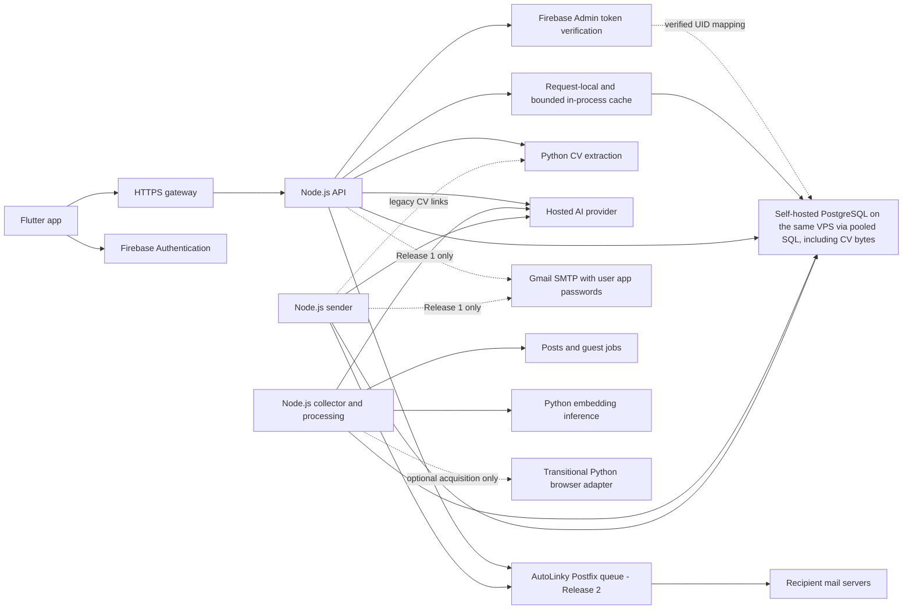

# Complete backend plan after the Node.js migration

Owns runtime architecture, identity/data adapters, routes, workflows, deployment topology, releases and cutover. Follow the [shared language requirement and status](README.md). Detailed [source scope](python-to-nodejs.md), [SQL specifications](sql-mapping.md), [mail contracts/infrastructure](softfix-mail-adaptation.md) and [cache policies](caching-and-optimization.md) are maintained in their respective plans.

## Target system

Use one `.js` codebase for independently deployed API, collector and sender processes, with the specialized Python boundaries below. PostgreSQL owns authoritative data/scoring/counters/claims. Firebase Authentication owns sign-in; CV bytes are stored in PostgreSQL too (`user_cv_files`), so there is no separate file service. The main objective is simpler ownership; performance is validated under the caching plan.



Mobile requests go through the HTTPS API; the collector and sender work without the app being open. Firebase sign-in/client migration is defined under [authentication](#authentication-and-account-migration).

Use [derived read caches](caching-and-optimization.md#read-path-and-layers) through API service loaders; the existing SQL match engine remains authoritative. Pin reviewed runtime/packages during implementation.

## Preflight decisions

Required decisions below produce a versioned implementation configuration and evidence. An unresolved item blocks the affected phase; it does not justify silently retaining a legacy dependency. Every row below now has a decision, assumption and verification in the [decision register](#decision-register); a failed verification reopens only that row.

| Decision | Required resolution before activation |
| --- | --- |
| Node runtime/framework and dependencies | Pin a supported reviewed runtime, HTTP framework and package/image versions; prove native ESM startup, runtime validation, streaming, shutdown and existing error/DTO adaptation |
| Firebase project/providers and client UX | Select Google/email sign-in behavior, provider linking and verification/session refresh; prove the Google plus email-link sign-in (the six-digit code screen is replaced) on the actual Flutter client |
| Legacy identity binding | Select a trusted import/linking method, collision report and interrupted-import recovery; prove representative old accounts retain internal UUIDs and new non-UUID UIDs work |
| Native data and CV storage | Select PostgreSQL/extension versions; produce the squashed baseline, native grants (RLS disabled), backup/restore including an off-host copy, CV hash reconciliation into `user_cv_files` and capacity budgets under the SQL specification. Decided: no separate object store |
| Load and resources | Record expected concurrent users, route mix, collector demand, AI load, CV sizes and SMTP submissions; set finite pool/concurrency/memory/deadline budgets and evaluate them under the caching plan |
| Recovery and client compatibility | Declare write-freeze duration and rollback window from rehearsal, restore-time/data-loss objectives, supported client version and response to old Firebase-incompatible clients; locate required backups/credentials securely |

No extra broker, Java service, Firestore database or new generic job system is required for this architecture. Revisit those only for a demonstrated unmet requirement.

## Processes and ownership

| Process | Owns | Does not own |
| --- | --- | --- |
| Node.js API | Current public APIs plus platform-mail capability, authorization, user/CV data, hosted AI, billing, mail previews/manual submission, legacy mail-route transition and device activity | Collector scheduling, inference, enrichment, schema setup or auto-apply loop |
| Node.js sender | Persistent auto-apply loop, conditional due-user claims, email delivery, quotas, pauses, next-send scheduling, interrupted-send recovery, and heartbeat | Public HTTP routes or a second matching implementation |
| Node.js collector | Demand, accounts, scheduling, acquisition, parsing, handlers, hosted AI, optimization, enrichment/learning, database writes and SQL maintenance | Local embedding inference, binary CV parsing or public API request handling |
| Optional legacy Python browser | Bounded Selenium acquisition for a source not yet ported, behind an explicit adapter | Ordinary HTTP processing/enrichment or an implicit requirement for HTTP-only deployments |
| Python embedder | Existing E5 tokenization, ONNX inference, pooling, batching, and normalized vectors | Application data access or email workflows |
| Python CV extractor, new | Bounded PDF/DOCX text and hyperlink extraction | User authorization, database writes, hosted AI, profile updates, or SMTP |
| AutoLinky SMTP service, new (Release 2) | Authenticated domain submission, authorized sender, DKIM, persistent queue, remote delivery and service-level pacing | Application authorization, AI, user quota accounting or applicant Gmail credentials |
| Redis read cache, **deferred** | Not part of the first release. If added later: expiring derived catalog/facets and proven base-feed payloads shared across several API replicas | Authoritative state, authorization, quota/consent decisions, email claims, Postfix queue, private CV bodies or collector processing |
| Self-hosted PostgreSQL | Internal user UUIDs/UID mapping, tables, constraints, triggers, matching functions, caches, counters, durable worker coordination, CV bytes (`user_cv_files`), mail attempts and suppressions | Firebase sign-in, HTTP validation or SMTP side effects |
| Firebase Authentication | Sign-in, external identities, ID tokens and provider session lifecycle | Application data, SQL access or mail consent |

After the final cutover, the Python public API and Python sender can be retired. The original `backend/cv_file.py` behavior must first be retained in the new extractor package; deleting the old backend directory must not delete code the extractor still imports. Root `db_client.py`, `models.py`, and `scraper.py` remain where Python consumers still need them.

## Proposed Node.js layout

The following paths are proposed, not existing files. Keep the new implementation in `backend-node/` while `backend/` remains available for comparison and rollback.

```text
backend-node/
  package.json
  src/
    api.js                       # starts the HTTP process
    app.js                       # builds the app for runtime and tests
    sender.js                    # starts the persistent sender process
    collector.js                 # starts the complete collection/processing worker
    config.js                    # validated environment and defaults
    http/
      auth.js                    # Firebase Admin verification and UID-to-UUID mapping
      device-auth.js             # separate Device token checks
      errors.js                  # current detail/status/header contract
      request-id.js
      rate-limit.js              # api_hit buckets and failure policy
      routes/                    # health, me, taxonomy, jobs, profile, cv,
                                 # applications, email-apply, devices
      admin/                     # admin console API under /admin/api (see the admin dashboard plan)
    contracts/                   # public request/response schemas and DTOs
    cache/                       # first release: policy, keys, request-context, singleflight, memory
                                 # (revisions/redis/invalidate are deferred, see the caching plan)
    db/
      client.js                  # private pg Pool, role budgets and transactions
      functions.js               # typed parameterized SQL function inputs/results
      repositories/              # users, catalog, profiles, cvs, jobs,
                                 # applications, mail, devices, subscriptions
    services/
      catalog.js
      jobs.js
      profiles.js
      cvs.js
      billing.js
      applications.js
      activity.js
      devices.js
    ai/
      client.js                  # configured OpenAI-compatible provider
      cv-analysis.js
      cover-letters.js
    email/                       # module contracts listed in the mail plan
    integrations/
      cv-extractor.js            # bounded private HTTP calls to Python
    collector/
      coordinator.js             # cycles, stop/resume, maintenance timers
      accounts.js                # eligibility and isolated session contexts
      settings.js                # current config formats and overrides
      scheduler.js               # search priority and pacing decisions
      title-watch.js             # user-demand and first-search queue
      posts.js                   # HTTP/RSC acquisition
      jobs.js                    # guest listing/detail acquisition
      post-parser.js             # RSC text, source IDs and metadata
      job-parser.js              # HTML cards/details
      contacts.js                # contact extraction and validation
      geo.js                     # current location/country rules
      job-age.js                 # posting dates and eligibility cutoffs
      taxonomy.js                # classification/rules versioning
      pipeline.js                # deduplication and raw persistence
      enricher.js                # requirements mapping/opportunity writes
      job-ai.js                  # hosted classifier/title/requirement calls
      skill-learning.js          # learning orchestration and numeric parity
      embeddings.js              # client of Python inference
      transport.js               # connections, deadlines, cancellation
      pacing.js                  # shared account/IP request caps
      browser-adapter.js         # optional legacy acquisition compatibility
      metrics.js
      notifier.js                # optional Telegram alerts, same variables as collector/notifier.py
    workers/
      auto-apply.js              # due-user claims, scheduling and recovery
    ops/
      metrics.js                 # in-process counters, 5-minute flush into ops_metrics
      admin-auth.js              # admin accounts, scrypt, TOTP, sessions, re-authentication, role checks
      settings.js                # app_settings reader with a 10-second cache
      audit.js                   # audit rows written in the same transaction as each change
    shared/
      text.js                    # normalization, title keys, contact redaction
      skillmatch.js              # API-side role/skill matching
      countries.js
      time.js                    # UTC instants and configured local hours
    scripts/
      verify-mail.js             # TLS/auth check, sends no message
  admin-ui/                      # static admin console served by the API at /admin (plain .js and CSS,
                                 # ported from backend/admin/, strict Content-Security-Policy)
  smtp/                          # independent SMTP Compose/image/overrides,
                                 # queue volumes, bootstrap, manage.js/TLS utility
  test/
    contracts/
    integration/
    fixtures/
```

Routes validate/authorize, services perform workflows and repositories access data. API/sender share billing, letters, platform mailer, composition and delivery modules. New domain sending (Release 2) reads server secrets from environment and does not use applicant Fernet credentials. In Release 1 the Node mail code keeps the Gmail path, decrypting stored app passwords with the existing `MAIL_SECRET_KEY`; the Python credentials/code then stay protected for rollback only. API startup must not start a sender loop.

The collector runs independently from HTTP request handling and shares pure domain rules/config/repositories with the API. Its scheduler, parsers and handlers communicate inside one JavaScript pipeline. CPU-bound parsing and rule stages run in a bounded `worker_threads` pool (size from the benchmark gates in the [parallel search pipeline](search-concurrency.md), inline when the gates say so); network and database I/O stay on the main thread. There is no standalone fetcher process or Python raw-page client in the target.

## Complete public route map

All `/v1` routes below use bearer authorization and current general limits except `/v1/device/activity`, which uses the dedicated Device token and its own limit. Health routes are public. Route names come from current source code, including endpoints absent from older README tables.

| Route(s) | Target module | Required behavior |
| --- | --- | --- |
| `GET /health`, `GET /health/ready` | Health | Preserve version, bilingual service notice, and existing DB readiness/error-reason contract. `/health` makes no database call. |
| `GET /v1/me` | Identity | Return the mapped internal user UUID/email. Firebase UID is a separate opaque identity key; controlled legacy identity mapping replaces old project adoption. |
| `GET /v1/taxonomy` | Catalog | Active fields, roles, skills, bilingual labels and existing response groups. |
| `GET /v1/jobs` | Jobs | Preserve filters/query/cursor/summary. Base-content caching is gated by job-revision/freshness proof; overlay the user's fresh application state after shared reads. |
| `GET /v1/jobs/matched` | Jobs | Call `match_opportunities`; keep profile requirement, offset cursor, score/reason mapping and application state. |
| `GET /v1/jobs/matched/new` | Jobs | Preserve since-time validation, matching threshold/count behavior and returned `now`. |
| `GET /v1/jobs/filters` | Jobs | Use `opportunity_facets` with current time range and caching behavior. |
| `GET /v1/jobs/{job_id}` | Jobs | Source-specific raw text and contact details, current detail limit, and explicit public response fields. |
| `GET /v1/profile`, `PUT /v1/profile` | Profiles | Preserve partial writes, catalog validation and errors/defaults. See [mail API changes](softfix-mail-adaptation.md#api-and-mobile-changes-required) for the signature field. |
| `GET /v1/profile/search-status` | Profiles | Read generated profile keys and active collector progress; return searched/searching/skipped states. |
| `POST /v1/cv?name=...` | CVs | Raw PDF/DOCX body, bounded upload, Python extraction, reuse/full-or-partial analysis, storage of the CV bytes in PostgreSQL and profile update. This is not a multipart upload. |
| `GET /v1/cv`, `DELETE /v1/cv`, `POST /v1/cv/reanalyze` | CVs | Public metadata/detected fields only; deletion preserves profile; reanalysis uses stored text and returns `ai_unavailable` if analysis is still partial. |
| `GET /v1/applications` | Applications | Saved job snapshots, methods, public statuses, applied time, errors, auto flag, total and cursor. |
| `POST /v1/applications` | Applications + delivery | Keep offered-method validation/201 and record-only methods. Email uses the shared delivery workflow and [mail contract](softfix-mail-adaptation.md#api-and-mobile-changes-required). |
| `GET /v1/applications/email-preview` | Applications + letters | Preserve letter reuse/budget; [platform preview fields](softfix-mail-adaptation.md#api-and-mobile-changes-required); no send. |
| `DELETE /v1/applications/{job_id}` | Applications | Preserve 204/idempotent deletion and refusal to remove an email already sent or in progress. |
| `GET /v1/auto-apply`, `PUT /v1/auto-apply` | Email settings | Preserve scheduling/quotas/plan fields; [platform capability and opt-in changes](softfix-mail-adaptation.md#api-and-mobile-changes-required). |
| `GET /v1/auto-apply/activity` | Activity | Application activity, enabled/problem state, new matches and returned `now`; preserve current time window and validation. |
| `PUT /v1/mail-account` | Legacy mail transition | [Deprecated credential-write behavior](softfix-mail-adaptation.md#api-and-mobile-changes-required). |
| `GET /v1/mail-account/signature`, `DELETE /v1/mail-account` | Legacy mail transition | [Signature/disconnect compatibility](softfix-mail-adaptation.md#api-and-mobile-changes-required). |
| Proposed `GET /v1/mail-delivery` | Platform mail capability | [Capability DTO and readiness semantics](softfix-mail-adaptation.md#api-and-mobile-changes-required). |
| `POST /v1/devices`, `DELETE /v1/devices/{device_id}` | Devices | Return a new token once, store its hash, preserve oldest-device eviction, limits and user ownership. |
| `GET /v1/device/activity` | Device auth + activity | Resolve user from hashed device token, check active status, enforce device limit, then use the shared activity service. |
| Proposed `DELETE /v1/me` | Identity + lifecycle | Release 1. Deletes the caller's account and data: refuses with 409 `deletion_blocked` while any email application is `sending`; otherwise calls `delete_user_data`, then deletes the Firebase user through the Admin SDK, with a retry/reconciliation job if the Firebase step fails. Needed for store account-deletion rules. Subscription rows are not deleted automatically. |
| `/admin` (page and assets) and `/admin/api/*` (login, overview, users, user actions, subscriptions, settings, collector, taxonomy, audit, admin accounts; mail in Release 2) | Admin console | Exists today (Step 19: login, overview, users, user detail, limits, Pro on/off) and is ported with parity, then extended. Not under `/v1`, same origin as the page, bearer session token, role-checked per route, audited. See the [admin dashboard plan](admin-dashboard.md). |
| `POST /v1/profile/search-now` | Profiles | Added by Step 18: asks for a live search of the caller's titles; limited to 12 per hour; writes `user_searches`, which the collector claims within seconds. Returns the same status shape as `GET /v1/profile/search-status`. |
| Proposed `POST /internal/v1/downloads` | Website integration | Not under `/v1`; shared-key authenticated, rate-limited, not reachable by the mobile app. Accepts the fields `website/api/_stats.js` records today and inserts into `app_downloads`; the website treats any failure as non-fatal. |

The current 30 `/v1` method/path combinations are the baseline (the first 29 plus `POST /v1/profile/search-now` from Step 18; the admin console's `/admin` routes are listed separately). Additions: `GET /v1/mail-delivery` (Release 2) and `DELETE /v1/me` (Release 1, account deletion; see [data handling](#data-handling-and-account-deletion)), plus the non-public `POST /internal/v1/downloads` used by the website (key-authenticated, not under `/v1`, not for mobile). Preserve unrelated contracts and deliberately revise/deprecate mail behavior with the matching client in Release 2. Do not reintroduce removed license verification or historical WebSocket/session endpoints.

## Authentication and account migration

Firebase Authentication handles sign-in; Firestore is a document database and is not an application store/cache here. [Firebase Authentication](https://firebase.google.com/docs/auth), [Firestore](https://firebase.google.com/docs/firestore).

1. Flutter signs in with Firebase Authentication and obtains a Firebase ID token. It sends that token to the Node.js API as bearer authorization; it never sends the token to PostgreSQL.
2. Node.js uses the Firebase Admin SDK `verifyIdToken` with the configured project to verify signature/issuer/audience/expiry and obtain the UID. Reject unsupported anonymous identities under the application's policy. Do not accept a UID supplied separately in a request body as authentication.
3. Resolve the verified UID to a stable `public.app_users.id` UUID. Keep internal UUIDs and existing user foreign keys; do not cast a Firebase UID to UUID.
4. Enforce PostgreSQL active/blocked status and row ownership. For domain mail, require verified email and persist the authoritative email-verification flag from verified identity data, not client claims.
5. User, device, SMTP and SQL credentials have separate purposes; device activity is defined under [request authorization](#request-errors-and-device-authorization).

For ordinary reads, a dedicated private process cache may retain the verified project/UID-to-UUID binding and SQL active/blocked status for at most 60 seconds, bounded to 10,000 entries. Bind/relink/delete/block operations invalidate it; misses, expiry and eviction require SQL verification. It is separate from Redis/read payloads. Sensitive operations and device status use fresh required state under the failure policy below.

The Admin SDK verifies ID tokens and exposes the UID as documented in [ID-token verification](https://firebase.google.com/docs/auth/admin/verify-id-tokens). Standard verification does not automatically check token revocation. Define fresh revocation/disabled-user checks for sensitive account and mail/consent operations using the documented Admin SDK behavior; do not cache those decisions indefinitely. [Session and revocation management](https://firebase.google.com/docs/auth/admin/manage-sessions)

Normal token verification may reuse SDK-managed signing certificates; it does not require a Firestore query per request. App blocked status, quotas and consent remain PostgreSQL decisions. Auth/admin email-change/deletion/disable operations must update or reconcile the internal user state so background sends do not rely indefinitely on an obsolete identity. Do not put complete tokens or service credentials in Redis.

For unattended mail, the sender has no current user bearer token. Before a due-user submission turn, use Firebase Admin `getUser(firebase_uid)` to confirm the account exists, is enabled and has a verified current email; reconcile that identity into PostgreSQL and use it for Reply-To. Missing/disabled/unverified accounts or lookup failures stop that turn before SMTP. This fresh mail check bypasses generic caches; administrative reconciliation still handles lifecycle cleanup. Use the same check for manual mail where a freshly verified token could contain an older email. No new identity-cache timestamp column is assumed. [Admin user lookup](https://firebase.google.com/docs/auth/admin/manage-users)

### Account transition

Apply the [identity SQL changes](sql-mapping.md#proposed-provideridentity-migration), keeping internal UUIDs while binding opaque Firebase UIDs. Binding is an atomic server-side repository operation before `touch_app_user`; ownership is not established by the shape of a UID.

Legacy import procedure:

1. Export users and identities from the current self-hosted GoTrue `auth.users`/`auth.identities` (id, email, `email_confirmed_at`, provider, and the Google subject for Google identities). Export the old project referenced by `LEGACY_SUPABASE_URL` only if it still holds accounts that were never adopted into `app_users`; otherwise record in the release evidence that it is out of scope and why.
2. Import with the Firebase Admin bulk import, using the old UUID string as the Firebase UID, with email-verified flags and Google provider data so a later Google sign-in lands on the same account. Email-code-only users import as email-verified accounts without a password.
3. Run first as a dry run producing a collision, unverified-email and unmapped-user report. Check Firebase's setting for linking accounts that share a verified email so a Google user cannot end up with two accounts.
4. After import set `app_users.firebase_uid = id::text` for imported users. New users get normal non-UUID UIDs and a new internal UUID on first binding.
5. Verify with representative accounts of each kind (Google, email-only, both) before the write freeze.

Build a reviewed identity mapping/import using trusted legacy provider records and ownership proof. Preserve each legacy internal UUID, profiles, CVs, applications and subscriptions. Firebase Admin supports explicitly supplied UIDs; where feasible, controlled imports may use the old UUID string as the Firebase UID, but the schema must support normal non-UUID UIDs for future users. [Admin user management](https://firebase.google.com/docs/auth/admin/manage-users)

Do not blindly merge accounts by an email string supplied by a caller. Prove linked identity ownership, handle collisions, and verify restored access with representative Google/email users before cutover. Export/import identity data through approved server-side tools; secrets are not copied into client bundles or plans.

Target runtime accepts Firebase tokens only. Old Supabase sessions do not become Firebase sessions; users must reauthenticate through the updated client. Any temporary dual-provider acceptance would need an explicitly scoped, time-limited transition policy and tests and is not assumed in this target.

The old six-digit email-code experience is not automatically provided by Firebase's passwordless email-link flow. **Decision for Release 1: Google plus Firebase-native email sign-in (email link), with the custom code flow as the tested fallback (see the decision register).** Firebase email links on mobile no longer use Dynamic Links, which were shut down on 25 August 2025: they use the project's Firebase Hosting domain and need app-link setup. Prerequisites to verify on a real device: the Firebase project has Hosting enabled with its default domain; the Android package name and SHA-1/SHA-256 fingerprints are registered; the manifest handles the `/__/auth/links` path; the server sets the project's mobile links domain through the Admin SDK (`mobileLinksConfig`); the app sends links with the current `linkDomain` option rather than the deprecated `dynamicLinkDomain`; and the installed `firebase_auth` version supports the Hosting-based flow. See Firebase's [Flutter email-link guide](https://firebase.google.com/docs/auth/flutter/email-link-auth) and [Android migration guide](https://firebase.google.com/docs/auth/android/email-link-migration). The six-digit code screen is replaced, not preserved; the old `selfhost/templates/code.html` and its GoTrue sender disappear, and the Firebase email template (customized with the AutoLinky name) is used instead. A custom code-to-Firebase-token flow (API-generated code, hashed with expiry and attempt limits, sent through the AutoLinky SMTP, exchanged for a custom token, plus one small table) is a possible later change if keeping the code UX proves important; it is not part of Release 1. Do not claim the old UI can remain unchanged merely by replacing the SDK. The updated Flutter Auth flow, provider linking and session refresh are release gates.

### Identity lifecycle consistency

The verified token establishes the UID; a caller cannot choose the internal UUID or create/merge a second account through an email field. First binding is atomic and uses trusted provider/import data, with a unique UID constraint to resolve concurrent first requests.

Current mail email/verification comes from the fresh Admin user snapshot. Do not let an older otherwise-valid token overwrite that confirmed identity through `touch_app_user`: ordinary activity touches can preserve the stored email, while the verified identity repository owns updates. A fresh provider snapshot never clears a separate SQL administrator block automatically.

Controlled Admin email/disable/delete operations reconcile SQL state; external console changes require a bounded, resumable server-side reconciliation owned by the identity integration, plus the fresh mail lookup. Disable/deletion stops new mail eligibility without depending on a Firestore read. Removing Firebase users no longer cascades into SQL automatically: account/CV cleanup is an explicit authorized lifecycle operation with key/ownership checks, not deletion by caller email. It calls the SQL function `delete_user_data(user_uuid)` (one transaction, children first; CV bytes are rows, so no file removal remains). The authorized admin tool, the reconciliation job and, if enabled, a self-service route are its only callers. Subscriptions, keyed by email, are deleted only when the operator asks.

Tests cover concurrent first binding, changed/unverified email, disabled/deleted/re-enabled accounts, a stale token arriving after reconciliation and interrupted provider/SQL updates. Preserve subscription lookup rules under the SQL reconciliation plan; a new verified email does not silently transfer another account's paid entitlement.

### Request errors and device authorization

- Keep `Authorization: Device ...` as a separate hashed-token path; device activity does not refresh a Firebase session.
- Keep `X-Request-ID`, generic public 500/503 errors, expected `detail` payloads, validation 422 structure and `Retry-After`. Adapt framework validation errors to the existing FastAPI public shape.
- Runtime-check request, SQL-result and Python-service payloads, including omitted/null/empty distinctions.
- Keep production API documentation disabled as configured. Browser access is required because the web client ships: configure an explicit `CORS_ALLOWED_ORIGINS` allow-list (the production web origin only; no wildcard with credentials), allow the `Authorization`, `Content-Type`, `X-Request-ID` and `X-Autolinky-Client-Version` request headers, expose the response headers the app reads (including `Retry-After` and `X-Request-ID`), and answer preflight requests without touching the database. CORS is browser policy, not authorization; every route still requires its bearer or device token.

### Dependency failure policy

The current Python [`auth.py`](X:/Autolinky-with-serverbased/backend/auth.py) can use stale status or assume active when its status query fails; [`ratelimit.py`](X:/Autolinky-with-serverbased/backend/ratelimit.py) fails open for general limits but closes costly-route limits. The target below deliberately tightens unresolved identity/status handling and requires corresponding outage/client tests.

| Failure | Required target behavior |
| --- | --- |
| Invalid/expired/wrong-project/anonymous bearer token | 401 with existing bearer error shape; never substitute a client UID/email |
| Verification infrastructure unavailable | 503 when verification cannot be established; do not mislabel an infrastructure failure as a valid identity or permanent invalid token |
| UID mapping or active status unavailable | Use only an already verified mapping and status within the explicitly bounded ordinary-read policy. Missing/expired state is 503; never default an unknown user to active or extend stale status indefinitely |
| Blocked user / invalid Device token | Existing 403 blocked / 401 invalid-device behavior. Device activity needs current mapped SQL status; unavailable required state is 503 |
| General `api_hit` failure | Retain the ordinary-request fail-open counter behavior after authorization succeeds; record the outage. It does not bypass stricter route budgets or authorize a mutation that cannot reach SQL |
| Costly-route, AI budget, consent, send/quota state unavailable | Fail closed before the external side effect; preserve existing 503/fallback contracts. A rules-only CV/letter fallback must not consume an unapproved provider call |
| Firebase current-mail lookup unavailable | Stop manual/automatic SMTP submission under the authentication rule; no cached identity fallback |
| CV write fails (database unavailable or constraint error) | The single transaction rolls back: no partial metadata and no orphan file; the upload returns the existing public error |
| Cache layer error (in-process cache is bounded; Redis only if later adopted) | Apply the [bounded cache fallback](caching-and-optimization.md#stampede-outage-and-capacity-behavior); failure never changes the rules above |

Generic clients may retry safe reads after backoff. A timeout, 5xx or connection loss is not permission to replay a mutation or SMTP submission; use the recorded outcome and mail recovery protocol.

## Native PostgreSQL access

Use a reviewed, pinned `pg`/node-postgres dependency and `Pool` in `.js`. API, collector and sender connect privately to PostgreSQL with separate least-privilege service roles. No PostgREST server or Supabase client is required. Connection pooling is supported by the [node-postgres pooling interface](https://node-postgres.com/features/pooling).

- Parameterize all values. Select whitelisted tables/functions in code; never use a client-supplied SQL identifier or function name.
- Preserve logical function argument/result contracts, calling SQL functions directly with typed parameters. Replace `.table(...).execute()` chains with repository queries and `.rpc(...)` with SQL function calls; PostgREST HTTP argument resolution/errors are legacy behavior, not the target transport.
- Use one checked-out client for an entire transaction and release it in `finally`. Do not run transaction steps on unrelated pool connections. Bound pool wait, query duration and statement/lock timeouts; account for every API replica/worker pool within the server's connection budget.
- Follow the [physical schema/query proposal](sql-mapping.md#optimized-physical-schema-proposal): narrow projections, batched overlays/aggregates and tested candidate indexes. Preserve public pagination, totals and SQL scoring.
- Use the lossless [SQL type mapping](sql-mapping.md#type-and-permission-mapping) for IDs, arrays/JSON, bigints and microsecond cursors.
- Keep scoring, claims, rate counters, search triggers, purge/statistics/cache functions in SQL. The collector's caller changes language/transport, not matching logic.
- Revise readiness to test the configured database role and required schema/functions rather than Supabase API keys. Preserve the public notice/liveness behavior independently of database/Auth availability.

Native roles/grants and security audits are specified in the [SQL permission mapping](sql-mapping.md#type-and-permission-mapping). API private queries use the verified internal UUID. Row-level security is disabled on `public` tables (the existing policy-less RLS only worked because the old `service_role` bypassed it); per-user isolation comes from grants, the verified internal UUID in every private query, and two-user tests. If per-user policies are added later, set their context transaction-locally on the same checked-out connection and test that it cannot leak through pooling.

Do not expose PostgreSQL directly to mobile or the public internet. PostgreSQL remains behind server-side adapters; Firebase verification does not itself authorize a query or a CV read.

PostgreSQL runs on the same VPS as the web application (owner decision). Bind it to the internal Docker network or a Unix socket only, publish no host port, and keep the firewall closed to it. Size `shared_buffers`, `work_mem`, pool maximums and container memory limits for a database that shares the host with the API, collector, sender, embedder, CV extractor and SMTP, and record the result in the load/resource budget. A same-host backup does not survive loss of the host: keep daily dumps plus a copy outside the VPS, and test a restore onto a fresh machine. Any website function that previously wrote to the database through Supabase REST must use an API route on this host, not a direct database connection from a third-party platform.

The [native schema migration](sql-mapping.md#proposed-provideridentity-migration) replaces legacy provider roles/schemas. Existing `selfhost/` is a Supabase stack and its compatibility prelude adds Auth/Storage stubs; neither is the requested plain PostgreSQL production path.

## CV file storage

Decision: CV original bytes are stored in PostgreSQL (`user_cv_files`, see the [SQL specification](sql-mapping.md#proposed-platform-mail-migration)), not in an object store. Supabase Storage is replaced by the database itself; no S3-compatible service, bucket policy or storage credential exists in the target.

- `user_cvs` (metadata, extracted text, links, analysis) and `user_cv_files` (bytes, SHA-256, size) are written in one transaction. A failed upload or replacement rolls back as a whole, so there is no orphan-file cleanup path and no "metadata saved but file missing" state.
- Metadata reads never select `content`. API and sender read the bytes only for analysis reuse, preview and SMTP attachment, through the same pooled connections. Mobile never receives a file URL; there is no direct file download route.
- CV extraction receives bytes over its private boundary and has no database credentials.
- Preserve 4 MB PDF/DOCX limits and byte/type/hash validation. Bytes stay within normal memory limits because a single CV is at most 4 MB; the pool and request caps must account for concurrent reads.
- Migration: copy each legacy object into `user_cv_files`, verify size and SHA-256 against `user_cvs`, then reconcile as described in the SQL plan. Keep the legacy objects and `storage_path` values as protected rollback material until the rollback window closes.
- Backups: the database dump now contains every CV, so the off-host backup is encrypted and access-controlled, and logs never contain CV bodies. Revisit this decision if total CV bytes grow to a size that breaks the dump/restore objective.

## Collector and specialized Python boundaries

### Complete JavaScript collector

1. The API saves profile/search choices; SQL generates keys and recounts demand.
2. The `.js` title watcher/scheduler reads demand and prioritizes first searches/accounts/scopes.
3. The same worker acquires posts/jobs, parses raw HTML/RSC, extracts contacts, normalizes/deduplicates and persists using existing IDs/keys and direct SQL functions.
4. Hosted classification/requirements/title/skill calls use current prompts, budgets and validators. The JavaScript enricher maps results to opportunities using current rules/versioning.
5. JavaScript learning calls Python `/embed` when needed, validating vectors and preserving numeric thresholds/ties/fallback behavior. Rules continue working when embeddings are unavailable as currently specified.
6. The coordinator invokes existing SQL statistics/status/purge/cache functions over its PG pool at the current cadence and writes progress after successful processing/save steps.
7. API/sender read the existing feed/match SQL contracts. No separate JavaScript scorer or search-demand writer is introduced.

Concurrency, the worker-thread pool for CPU stages, lanes, backpressure and the safe maxima are specified in the [parallel search pipeline](search-concurrency.md); transport rules (stop statuses, bounded `Retry-After`, transient retries, redirect scope checks, size cap) and parser-health drift alerts come from the [DataForge review](dataforge-adoption.md). One shared per-account posts limiter and per-IP guest limiter cover all attempts/session probes and urgent priority. Preserve canary/no-results/sort behavior, throttle backoff, total deadlines, bounded queues/body sizes, checkpoints and cancellation. Do not treat a failed request as an empty successful search.

Port guest jobs as a complete vertical path first, then posts and learning/enrichment. Compare recorded responses and expected raw/enriched rows before switching a source. Drain/stop the Python source worker before enabling its JavaScript replacement; avoid duplicate collection, pacing budgets and SQL maintenance loops. Keep current config formats/search keys/source IDs so rollback resumes known progress.

Required checkpoint rule: advance the acquisition/save checkpoint only after its associated SQL commit. Enrichment version/pending work remain separate from raw acquisition progress; an AI/parser failure must not pretend the raw save or searched state succeeded. Crash tests replay committed/partial stages using current IDs/fingerprints, proving no lost work or duplicate learning increments. Hosted calls that cannot safely be replayed need a bounded explicit retry policy, not an assumption of source idempotency.

### Embedding inference stays Python

Keep `embedder/app.py`, `e5.py`, `/health`, `/embed` and `X-API-Key`. Replace `collector/embeddings.py` runtime usage with `collector/embeddings.js`, preserving batch limits, 384-number vectors, kind prefixes, cache identity, circuit behavior and unavailable-service fallback. JavaScript performs small client-side vector/cosine work with parity tests; the model/tokenizer remains Python.

The API does not acquire an embedding dependency for ordinary reads. Changing matching signals is separate from migrating the collector.

### Optional transitional browser acquisition

Keep Selenium source behavior temporarily only if a configured source still needs it. Define an optional narrow acquisition adapter with trusted internal configuration, bounded browser sessions/deadlines, cancellation, stable returned source IDs and one active owner. Node.js performs downstream processing. This adapter does not exist today and must pass its own tests before a browser-dependent source can switch; HTTP-only deployments do not start it. Later evaluate a JavaScript browser adapter independently.

### CV extractor: new private adapter required

Introduce `python_services/cv_extractor/` and a dedicated image. Reuse/lift the pure parsing and link-reading behavior from `backend/cv_file.py`; avoid a runtime dependency on the retired public FastAPI application. The adapter itself may remain a small Python HTTP app.

Proposed internal contract, separate from the public API:

| Operation | Request | Response / policy |
| --- | --- | --- |
| `GET /health` | Internal liveness check | Process state; no database credentials required. |
| `POST /internal/v1/cv/extract` | Raw file bytes; `X-Internal-Key`; optional MIME treated as advisory | Versioned JSON `{version: 1, file_type, text, pages, size, sha256, links}`. `pages` may be null for DOCX. Type is identified from bytes. |
| `POST /internal/v1/cv/links` | Raw bytes with the same key | Versioned JSON `{version: 1, links: [...]}` for older stored CVs missing links. Preserve current link-reader behavior: unreadable/no links returns an empty list. |

The second operation prevents legacy signature repair from depending on a successful full text extraction. It is needed by API/sender paths that currently call `extract_links` on stored bytes; new uploads already save links.

Preserve parser rules: 4 MB input, up to 10 PDF pages for text, 500 ZIP entries, 8 MB document XML, text length/cleaning limits, encrypted/unreadable/unsupported/scanned-file error codes, and bounded links. Stream-limit the input at both Node.js and Python; do not trust Content-Length alone. Add bounded concurrent parsing and request deadlines in the adapter so it does not block unrelated API requests indefinitely.

Node.js validates response version, type, byte size, digest, link bounds and text shape before using it. Port filename cleanup and contact redaction to the shared JavaScript rules with parity fixtures. The Python service returns extracted content only; Node.js still decides whether it is a CV and handles AI/profile/storage behavior.

Use a private container network, no public published port, a dedicated internal key, and bounded client timeouts. Do not forward user bearer tokens or give the extractor PostgreSQL, Firebase Admin, SMTP or hosted-AI credentials. Avoid persisting file bytes or extracted text to logs/disk. Connection failures/timeouts map to public service-unavailable errors; parser errors retain the current public CV codes/statuses.

CV extraction failure prevents accepting a new upload. Hosted AI failure has a different policy: a valid upload may be stored with partial rules-only analysis. Reanalysis from stored text does not need the extractor.

## End-to-end workflows

### CV upload and profile update

1. Authorize and enforce general/CV-specific limits. Read a bounded raw body.
2. Extract text and links through Python; validate the result and calculate/verify the file hash.
3. Read the user's previous CV. Reuse an identical fully analyzed CV without repeating AI or overwriting a profile the user may have edited.
4. Load the catalog and apply shared API-side skill/role rules. Reserve the existing SQL AI budget, redact contacts and call the configured provider. Validate model output against the taxonomy; keep unknown skills separate.
5. Reject `not_a_cv` as currently defined. On hosted-model unavailability/budget failure, preserve the rules-only `partial` path.
6. In one transaction, upsert `user_cvs` and `user_cv_files` (replacing the previous bytes). A failure rolls both back; there is no separate file to remove.
7. Apply current first/subsequent-CV profile semantics. Preserve user choices and let SQL maintain search demand. Return the existing `{cv, detected, profile}` shape.

CV bytes and CV metadata are now one transaction. The profile update remains a separate operation after it, as today: if it fails after the CV commit, the CV stays saved and the existing error path applies. Making the profile update part of the same transaction would change the semantics of reuse of an edited profile and is not part of this migration.

### Manual applications and SMTP delivery

*This workflow (suppression check, `mail_attempts` reservation, platform SMTP) is Release 2. Release 1 keeps today's manual-send behavior over the Gmail path.*

Record-only application methods stay within the repository. Email calls the shared delivery service: authorize and enforce the platform/client gate, freshly validate mail identity under [authentication](#authentication-and-account-migration), read current CV/plan/quota/contact state, check the recipient against `mail_suppressions`, prepare the letter/attachment, claim the application and insert the `mail_attempts` reservation in one transaction, submit through the mailer and record the outcome on that attempt. API and sender use the same workflow.

[Mail contracts and SMTP acceptance handling](softfix-mail-adaptation.md) own message composition, transport errors, uncertain submission and queue behavior; [SQL writes](sql-mapping.md#direct-table-writes-nodejs-must-preserve) own atomic claims/conflicts/accounting and metadata. New platform sending has no Fernet dependency; legacy keys/ciphertext remain protected for the rollback window.

### Persistent auto-apply sender

*Release 1 ports today's sender exactly (Gmail path, existing claim and quota behavior). The bullets below that mention platform mode, consent, `mail_attempts` or the shared MTA describe Release 2.*

- Keep the current 30-second tick, heartbeat identity, configured local active hours, and due-user selection. UTC is used for stored instants; Africa/Cairo is used for configured local hours in deployment.
- Claim the due turn with the existing conditional database update before delivery. Returned rows determine success. Do not replace this with an in-memory lock.
- Preserve no-CV/free-limit and scheduling/quota/cooldown rules; use consented platform-mode rows and platform pause reasons. Add an aggregate capacity limit for the shared MTA.
- Reuse billing/contact/letter/attachment/delivery services used by manual submissions. Require recorded platform sender consent; no worker-only formula/template.
- Keep uncertain claims interrupted rather than automatically resend. Reconcile MTA acceptance/queue evidence by message ID and distinguish central SMTP problems from recipient failures.
- Handle SIGTERM/SIGINT by stopping new turns and allowing the current bounded delivery to finish. Do not run overlapping ticks or schedule the worker inside the API process.

Initially retain turn concurrency. Later evaluate bounded cross-user preparation/submission with per-user serialization, manual/auto claim coordination and shared MTA capacity. Measure queue age and remote deferrals as well as turn wait time; fast local acceptance alone does not show delivery throughput. Keep per-user quotas unchanged.

## Configuration and deployment plan

Port API defaults from `backend/config.py` and collector config/override semantics from existing files. Keep cookie and account configuration private/read-only; do not copy secrets into frontend bundles.

| Process | Configuration |
| --- | --- |
| Node.js API | Firebase project/Admin server credentials, `PG_DATABASE_URL`/`PG_POOL_MAX` for the API role, notices/limits, hosted CV/letter AI, SMTP/client gate, in-process cache budgets and private CV extractor settings |
| Node.js collector | Private PostgreSQL collector-role URL/pool budget, accounts/cookies/headers, source/search/rate caps, hosted job AI, embedder URL/key, processing limits and maintenance timers; optional browser adapter only when enabled |
| Node.js sender | Private PostgreSQL sender-role URL/pool budget, AI/budgets and optional CV-link extraction. Release 1: `MAIL_SECRET_KEY` for the Gmail path. Release 2: Firebase project and restricted Admin user-read credentials, platform SMTP, user/global capacity and reconciled identity/mode/consent; no applicant Gmail secrets, and `MAIL_SECRET_KEY` removed after the rollback window |
| Python embedder | Model/tokenizer/inference settings and its dedicated private API key |
| Python CV extractor | Private key and bounded parser/concurrency/deadline settings; no SQL/email/AI credentials |
| Transitional browser adapter | Its source cookies/browser settings and private adapter authorization; downstream processing remains JavaScript |
| PostgreSQL | Private native deployment, separate runtime/migrator roles, native schema/grants, backups and bounded connection/query budgets; no Supabase services |
| Firebase Auth | Configured project/providers, controlled account mapping, client sign-in/refresh, Admin permissions and revocation/identity reconciliation |
| Redis | Deferred; not deployed in the first release |
| AutoLinky SMTP | Independent accounts/DKIM/TLS/queue/pacing and inbound operational routes; no application data key |

Build API/collector/sender from the shared pinned `.js` source with independent `node src/api.js`, `node src/collector.js`, `node src/sender.js` commands and non-root images. Add a proposed `Dockerfile.collector`; retain the old Python image only for transition/reference/browser compatibility.

Keep `api:8000` gateway wiring or update it together (the topology above is the target). Publish only the API through HTTPS; collector has no public HTTP ingestion service. Embedder/CV and any optional browser adapter remain private. Preserve public health/readiness semantics and monitor worker and SMTP readiness/queue separately (and Redis only if it is adopted later).

Use existing `EMBEDDER_URL`/key semantics and proposed `CV_EXTRACTOR_URL`/key/timeout settings. Provider and data settings are listed above; [cache settings](caching-and-optimization.md#proposed-code-and-deployment) and [mail settings](softfix-mail-adaptation.md#javascript-mailer-to-build) belong to their companion plans.

### Bounded execution and observability

- Validate required configuration before serving/starting workers; publish no ready state on a missing Firebase project, schema/role, internal key or enabled service configuration. Liveness stays independent; readiness reports required dependency failure using the public contract, without exposing secrets.
- Give API requests and collector/sender turns explicit finite deadlines and admission caps. Pool wait, SQL statement/lock, upstream HTTP, extraction/inference and AI budgets must fit the remaining operation budget. Cap body bytes, in-flight work and queued waiters; pressure produces the documented 503/429 behavior rather than unbounded promises.
- Propagate cancellation to supported read/provider/parser work and release acquired clients/slots in `finally`. Once an SMTP submission may have started, finish or reconcile it under the [mail outcome protocol](softfix-mail-adaptation.md#submission-outcomes-and-retries); client disconnect cannot make it safe to resend. Use one checked-out SQL client per transaction as documented by [node-postgres](https://node-postgres.com/features/transactions).
- Graceful shutdown stops new requests/turns, drains bounded work, preserves progress/claims, closes transports/pools and exits within the configured grace period. A forced termination must pass the same crash/recovery tests. Do not hold a SQL transaction open around remote AI, file transfer or SMTP.
- Record request/turn correlation IDs, route/method, dependency latency, pool occupancy/wait, queue age, collector checkpoint age, model/parser failures, identity-check failure, SMTP outcome class and cache metrics. Keep labels bounded and logs free of tokens/cookies, CV text, message bodies and private recipient identities; hash or restrict operational identifiers where appropriate.
- Alert on repeated identity/schema failures, growing pool wait/checkpoint lag, unknown mail outcomes and MTA backlog. Thresholds come from the declared workload/deadline budget; monitoring does not automatically replay work. Deployment evidence includes an induced outage/alert and a clean recovery.

## Decision register

Decisions taken so the preflight list has no open item. Each has a verification the rehearsal or implementation must pass; a failed verification reopens only that row. Rows marked *assumption* come from missing facts and are replaced by measured values as soon as they exist.

| Decision | Value | Basis / verification |
| --- | --- | --- |
| Node runtime | The current Active LTS release at implementation start, pinned in `.nvmrc` and the image tag; native ESM | Startup, streaming and shutdown tests |
| HTTP framework | Fastify with JSON-schema validation; errors adapted to the existing FastAPI-shaped `detail` payloads | Contract tests against recorded FastAPI responses; raw-body streaming with a hard 4 MB cap |
| PostgreSQL | Version 17 (same major as the current `selfhost/` image, so dump/restore needs no major upgrade); `pgcrypto` and `pg_trgm` in a schema named `extensions` | Restore of a real export into a fresh instance |
| Driver | `pg` (node-postgres) with role-scoped pools | Pool-budget load test |
| Migration runner | Plain ordered SQL files `database/migrations/NNNN_name.sql` applied by a small `database/migrate.js` that keeps a checksum ledger in `migrator.schema_migrations` (a separate schema, outside the `public` inventory); runs only as the migrator role; services refuse to start if the schema fingerprint differs | Empty install and populated restore |
| Sign-in | Google plus Firebase email link, using the project's Firebase Hosting default domain for mobile links (see below) | Prototype on a real Android device before the client build is committed. **Fallback if it fails or proves too fragile:** the custom code flow (API-generated six-digit code stored hashed, exchanged for a Firebase custom token), which keeps today's screen and needs the AutoLinky SMTP brought forward to Release 1 for transactional mail only, plus one small `login_codes` table |
| Platforms in Release 1 | **Android, iOS and web, all served by the same backend** (owner decision, 2026-10-15). One API, one Firebase project with three app registrations, one set of routes and DTOs; no platform-specific endpoints. Per-platform client work is listed under [client release](#client-release-and-platforms) | Each platform signs in, loads matches, uploads a CV and deletes an account against the candidate before cutover |
| iOS sign-in options | Google plus email link, and **Sign in with Apple added** unless App Review confirms the existing options satisfy the current App Store rule for apps that offer third-party login (check the current App Store Review Guidelines at build time) | App Review pre-check or submission feedback |
| Web client hosting and CORS | The Flutter web build is served as static files by the gateway on the VPS (for example `app.<domain>`); the API allows only that origin (and local development origins in non-production); the admin console is same-origin and needs no CORS entry through a configured `CORS_ALLOWED_ORIGINS` list | Browser test from the production origin; a request from another origin is refused |
| Cutover model | Hard cutover; write freeze targeted at 60 minutes or less | The rehearsal must prove it; a longer freeze stops the cutover |
| Recovery objectives | RPO 24 hours, RTO 4 hours (nightly dump plus a daily off-host copy). If the owner wants RPO under 24 hours, add continuous WAL archiving with a maintained tool as a follow-up | Timed restore onto a fresh machine |
| Off-host backup | Client-side encrypted copy to object storage at a different provider and region (a backup target only, not a runtime service), retention 14 daily and 8 weekly; encryption key stored off the VPS | Backup-freshness alert and a restore drill |
| Rehearsal environment | A temporary second VPS built from the same Compose project and restored from the latest dump, destroyed afterwards; never the production host | Each rehearsal records its evidence |
| Planning load (*assumption*) | 2,000 registered users, 200 daily active, 20 concurrent requests at peak, 100 auto-apply users, 10 CV uploads an hour at peak | Replace with the rehearsal measurements (database review, checklist) |
| Mail volume (*assumption*) | Launch about 1,000 platform emails a day, warm-up doubling weekly from 50 a day (50, 100, 200, 400, 800, then the target) while bounce and deferral rates stay inside thresholds fixed before launch | Observed deferrals and bounces during warm-up |
| Website | Stays where it is and calls the internal downloads route over HTTPS; if it later moves to the VPS the same route works locally | Website test suite |
| Admin console | Port the Step 19 admin page with parity, then extend it into a management console ([admin dashboard plan](admin-dashboard.md)): separate admin accounts with roles (`owner`, `operator`, `viewer`), password plus TOTP, 12-hour sessions with an independent signing key, re-authentication for destructive actions, audit in the same transaction. Served by the API at `/admin` (and the website's existing rewrite), same origin, no CORS. Release 1 includes everything except the mail panels and actions | The ported Step 19 tests pass, then the new access, write-safety and privacy tests in the plan |
| Operator role | The owner is the default operator for the operations mailbox, suppression list, kill switch and privacy requests until another named person is assigned | Named in the release evidence |
| Legacy accounts | Import from the current GoTrue; the rehearsal counts the old project's unadopted accounts and either imports them or records them as out of scope | Import report |

## Deployment topology and sizing

One Compose project on the VPS replaces the root `docker-compose.yml` and `selfhost/`. Only the gateway publishes ports.

| Service | Notes |
| --- | --- |
| `postgres` | Official PostgreSQL image, pinned. Internal network only, no host port. Memory settings come from a ported version of the RAM-based tuning in `selfhost/scripts/init_env.py` (deployment tooling may stay Python); statement and idle-transaction timeouts per role replace the old per-role Supabase timeouts. |
| `api`, `collector`, `sender` | The three Node images from this plan. `api` joins the gateway network; the others have no inbound ports. |
| `embedder`, `cv-extractor` | Existing / new Python services, internal only. |
| `smtp` | Postfix from the mail plan (Release 2), separate volumes. |
| `gateway` | Caddy is kept (it is not a Supabase component). Remove the `/rest/v1`, `/auth/v1`, `/storage/v1` routes and the template server; keep the `api.<domain>` route with its 10 MB body cap, health check and certificate handling. Also serves the Flutter web build as static files (for example at `app.<domain>`), proxies `/admin*` to the API (as the website's rewrite already does) with `Cache-Control: no-store`, no indexing, rate limiting and an optional owner IP allow-list and, if the website moves to the VPS, the website. |
| `backup` | Nightly `pg_dump -Fc` of the `public` schema (no `auth` schema exists), keeping 7 local days, plus a daily encrypted copy shipped off the VPS. The restore-time and data-loss objectives are set in the decision register (RTO 4 h, RPO 24 h); the off-host destination is chosen at Phase 0 under the register's rule (a different provider and region, client-side encrypted); the plan requires a restore rehearsal onto a fresh machine before cutover. Because CV bytes are in the dump, the off-host copy is encrypted and access-controlled. |

Keep `restart: unless-stopped`, `init: true`, log caps and the stop grace periods (collector 60 s, sender 40 s) from the current Compose files. `TZ=Africa/Cairo` stays on the collector and sender. The API runs only as this container; the Vercel API project and the API part of `vercel.json` are retired at cutover (keep `vercel.json` only for the website if it stays on Vercel). The 4 MB CV limit remains a product limit enforced on the request stream; the "Vercel accepts 4.5 MB" comment no longer applies.

Delete `selfhost/` (PostgREST, GoTrue, Storage API, template server, `import_from_supabase.sh`) only after the cutover rehearsal and rollback window; its history stays in git.

### Memory budget (to be verified by measurement)

Known from the repository: collector about 300 MB, embedder 0.7-0.9 GB (about 0.6 GB with the int8 model), API container limit 768 MB. Assumed and to be measured: PostgreSQL 0.75-1.5 GB, sender and CV extractor roughly 150-250 MB each, Postfix 0.2-0.4 GB, gateway about 50 MB. That totals roughly 3.5-4.5 GB, so the plan states **4 GB RAM as the minimum and 8 GB as comfortable**, replacing the 2 GB assumption in `DEPLOY.md`. Set a memory limit on every container. CPU: at least 2 vCPU (4 comfortable), because the collector's worker-thread pool, PostgreSQL and the API share the cores; the pool size is derived from `os.availableParallelism()` and capped as described in the [parallel search pipeline](search-concurrency.md). Acceptance test: all services at peak plus one CV upload plus a match-cache rebuild for a profile edit fit in RAM without swap. If the VPS stays at 2 GB, use the int8 embedder and expect to move PostgreSQL or the embedder to a second host; that is a deployment change, not a design change.

## Client release and platforms

Firebase needs native configuration (`google-services.json`, `GoogleService-Info.plist`) and native plugins, which a Shorebird patch cannot deliver. The Firebase client is therefore a new store/APK **release**, built with `shorebird release`; patches resume afterwards for Dart-only changes.

All three platforms ship from the same Flutter code and talk to the same API. Each needs its own Firebase app registration and release channel:

| Platform | Distribution | Client work for Firebase |
| --- | --- | --- |
| Android | Website download (`website/api/latest.js`, `download.js`) | Register the package with debug and release SHA-1/SHA-256 fingerprints; `google-services.json`; manifest handler for the `/__/auth/links` path; Google sign-in with the Android and web client IDs |
| iOS | App Store / TestFlight | `GoogleService-Info.plist`; Google reversed-client-ID URL scheme; Associated Domains entry `applinks:<project>.firebaseapp.com` (or the custom link domain) for email links, which needs a recent Firebase Auth iOS SDK; Sign in with Apple (see the decision register); `app_devices.platform` already accepts `ios` |
| Web | Static Flutter web build served by the gateway | Firebase web configuration and authorized domains replace the Supabase `redirectTo: Uri.base.origin` flow; Google popup or redirect sign-in; email link needs no app-link setup; CORS allow-list on the API; web does not register a background device (`app_devices.platform` stays `android`/`ios`) |

Because the platforms share one backend, a server change is validated once for the API contract and then once per platform for sign-in, session refresh and the main flows (matches, CV upload, applications, account deletion).

Rollout:
0. Prototype the email-link flow on a real Android device (prerequisites listed under the account transition); if it fails, switch to the fallback in the decision register before building the release.
1. Ship the Firebase-enabled builds ahead of cutover: the Android APK through the website download, the iOS build through App Store review (submit early; review time is outside our control and cutover waits until the build is live), and the web build on the gateway. Record the new minimum client version per platform.
2. Use the existing public bilingual service notice (`SERVICE_NOTICE`/health) before cutover to ask users to update, and after cutover to tell users on old builds that an update is required. Old builds fail authentication because Supabase tokens are no longer accepted (hard cutover, as already decided); they show the notice, not a custom error. iOS users update on their own schedule, so the notice period before cutover is at least as long as it takes most iOS users to update; the web build updates for everyone at once when deployed. Shorebird can patch Dart code on iOS as well as Android once the Firebase release is out.
3. Update `.github/workflows/mobile.yml`: store the Firebase config files for all three platforms as repository secrets (like `SELFHOST_ENV_JSON`), materialize them in the job, build the web target in CI, add an iOS build on a macOS runner (or document a local iOS release process), remove `supabase_flutter` and Supabase environment keys, add a failing check if a `supabase` dependency reappears, and keep the patch step limited to `main`.
4. Replace the Supabase Google sign-in section of `mobile/README.md` with Firebase console steps.

## Website and operational tools

- **Download statistics.** `website/api/_stats.js` stops calling `${SUPABASE_URL}/rest/v1/app_downloads` and instead posts the same fields to `POST /internal/v1/downloads` on the API using `API_BASE_URL` and a shared `STATS_KEY`, keeping today's guarantee that recording never fails a download. `STATS_SALT` becomes required; unless it is set to the former fallback value, unique-visitor counts restart at cutover, which is accepted. Update `website/test/download.test.js`.
- **Scripts.** Every script that stays supported moves off PostgREST: see the [script disposition table](python-to-nodejs.md#operational-scripts).
- **Alerts.** `notifier.js` replaces `collector/notifier.py` with the same variables and no-op behavior, and carries the new plan alerts (checkpoint lag, pool saturation, identity failures, MTA backlog).

## Data handling and account deletion

- **Deletion.** `DELETE /v1/me` (route table above) and the operator tool both call the SQL function `delete_user_data`; CV bytes are rows, so nothing outside SQL needs removing. It is blocked while an email application is `sending`, and a failed Firebase deletion is retried by the reconciliation job. Subscription rows, keyed by email, are removed only when the operator asks.
- **Retention.** Jobs and AI results 14 days; letters until sent or 14 days; CV, profile and applications until account deletion; device tokens until revoked; rate-limit windows 2 days; `ops_metrics` 30 days; `admin_log` 365 days; download rows 400 days; legacy Gmail secrets until the Release 2 rollback window closes. Backups keep deleted data until they rotate (7 local days plus the off-host retention), which the privacy policy must state.
- **Privacy-policy checklist (drafted in [launch-content-drafts.md](launch-content-drafts.md#4-privacy-policy-outline); the owner reviews and completes the jurisdiction-specific parts).** Firebase Authentication as identity processor (email, UID, provider); CV text sent to the hosted AI provider after contact redaction; the AutoLinky mail relay sending the CV on the user's behalf (Release 2); recruiter contact details collected from public posts and kept 14 days, with the recipient address kept in application history; data location (the VPS region; Firebase Authentication data is held by Google); how to request deletion.

## Operations and security baseline

- **Host.** SSH keys only, root login disabled, firewall allowing only 22, 80 and 443 inbound (and outbound 25 once Release 2 starts), fail2ban or equivalent, unattended security updates. No container runs privileged. PostgreSQL has no published port and `pg_hba` accepts only the internal Docker network, with a distinct random password per role.
- **Secrets.** Environment files live outside git with owner-only permissions; the Firebase service-account file is mounted read-only; each service receives only the variables it needs (as the current Compose files already do). A rotation table in the runbook covers the database role passwords, the internal service keys, `STATS_KEY`, the Firebase service account and `MAIL_SECRET_KEY`; rotate on suspected leak or when access changes, and rehearse one rotation. CI runs a secret-scanning step; logs never contain secrets, tokens, cookies, CV text or message bodies.
- **Monitoring.** Container health checks; an external uptime monitor on `/health` and `/health/ready`; Telegram alerts for the conditions in the observability list; alerts on disk, memory and swap, PostgreSQL connection use, and **backup freshness** (the newest off-host copy older than 36 hours). Logs are JSON on Docker's rotated `json-file` driver. Enable `pg_stat_statements` and `log_min_duration_statement` (start at 500 ms) and watch autovacuum.
- **Dependencies.** Commit lockfiles, install with `npm ci`, pin image tags (digests for the database and gateway), run `npm audit` in CI with high-severity production findings failing the build, and keep a monthly update window.
- **Drills.** A restore drill onto a fresh machine before each release and then quarterly, and one secret-rotation drill before Release 1.

## Admin console

The private console the owners use to watch and manage Autolinky is specified in the [admin dashboard plan](admin-dashboard.md), which supersedes the earlier read-only dashboard design here. In short:

- It **ports the Step 19 admin page** (`backend/routers/admin.py`, `backend/admin/`, `step19_admin.sql`) with parity, then extends it into full management: users (block, sign out, delete, pause auto-apply, export, relink), plans and subscriptions (including bulk and pre-grant), global settings, collector control, taxonomy review, health, audit and admin-account management, with Release 2 adding mail control.
- It is served by the API at `/admin` (and through the website's existing rewrite), same origin, bearer session token, strict Content-Security-Policy, no cookies.
- Admin accounts are separate from app users: roles `owner`, `operator`, `viewer`, password plus TOTP, 12-hour sessions signed with an independent secret, re-authentication for destructive actions, every change audited in the same transaction.
- It shows the minimum personal data needed for support (email, recipients and job titles of the last 100 sends) and never CV files or text, letters, Gmail ciphertext, tokens or password hashes; opening a user is logged.
- Data comes from live SQL, the new cache tables and `ops_metrics`; the heavy aggregates are rewritten as described in the [database efficiency plan](database-efficiency.md).

## Tests, CI and documentation

- SQL tests (`tests/test_*_sql.py`, `test_migrations.py`) stay in Python and run directly against native PostgreSQL built from the squashed baseline. The HTTP/backend tests are rewritten in JavaScript with the built-in test runner against a real test database (no mocked data layer); fixtures are translated, not code.
- Add `.github/workflows/backend.yml`: a PostgreSQL service container; SQL tests; Node tests; the forbidden-file check (no `.ts`/`.tsx`, no Python imports from Node code); and a failing "no Supabase" repository search that excludes the historical documents and `supabase/`.
- Documentation is part of Phase 8: a new Arabic deploy guide for the Compose project replacing `DEPLOY.md`, a `backend-node/` README replacing `backend/README.md`, updated `PROJECT.md`, `mobile/README.md` and `website/README.md`, and archival of `selfhost/README.md` after the rollback window. No stale Supabase instruction may remain in a supported document.

## Release plan

The plan ships as three releases so the removal of Supabase does not wait on mail infrastructure or caching.

| Release | Contents | Notes |
| --- | --- | --- |
| 1. Core | Node API, collector and sender on native PostgreSQL; Firebase sign-in and the new client; squashed baseline; `user_cv_files`; `delete_user_data` and `DELETE /v1/me`; in-process caches; website route; scripts moved; Telegram alerts; admin console (parity port plus management, without the mail panels); backup and Compose project | **The sender and mail routes keep today's Gmail behavior**: Fernet decryption with the existing `MAIL_SECRET_KEY`, Gmail SMTP through Nodemailer, `PUT/GET/DELETE /v1/mail-account` unchanged, existing pause reasons, existing quotas and the current reservation behavior. This is a faithful port, not the hardened protocol. The SMTP service, `mail_attempts`, `mail_suppressions`, the `auto_apply` platform columns, `application_signature`, `GET /v1/mail-delivery` and the consent flow are **not** created in Release 1 |
| 2. Platform mail | AutoLinky SMTP, `mail_attempts` reservation protocol, `mail_suppressions`, platform consent and client mail screens, capacity/warm-up/abuse controls, dashboard mail panels | All statements in the mail plan and the shared-reservation text in the SQL plan describe Release 2. Legacy Gmail rows stay until the rollback window closes, then `mail_accounts` and `MAIL_SECRET_KEY` are removed |
| 3. Caching tier | Redis, revision bridge, base-feed caching | Only if measurement justifies it; see the caching plan |

Cutover steps below that disable legacy Gmail and require platform opt-in belong to Release 2; in Release 1 the old Python sender is stopped and replaced by the Node sender with equivalent behavior. Release 1 and Release 2 each need their own rollback rehearsal.

## Migration sequence and coexistence

The task-level breakdown, dependencies, cutover runbook, rollback matrix and risk register for these phases are in the [implementation roadmap](implementation-roadmap.md). Phase 0 (prerequisites: measurements, Firebase project and prototypes, rehearsal environment, identity dry run, named owners) precedes phase 1.

| Phase | Deliverable | Activation condition |
| --- | --- | --- |
| 1. Freeze contracts | Route/DTO inventory, representative fixtures, SQL adapters and normalization parity cases | Current Python behavior captured; no user-visible route changes |
| 1a. Build provider/data migration | Native schema/grants/pools, Firebase identity import/mapping and client Auth, CV bytes loaded into `user_cv_files`, `delete_user_data` | Stable user keys, row counts, CV hashes, SQL matching outputs, UID collisions, identity flags, session transition and role/RLS/precision checks pass |
| 2. Build API foundation | Node.js app/config/auth/limits/errors; health, identity, taxonomy and jobs routes | Contract tests and real test-database reads pass |
| 3. Build full JavaScript collector | Guest jobs then posts: coordinator, parsers/handlers, AI, enrichment/learning, persistence and maintenance | Raw/enriched/numeric/scheduling parity, account isolation, throttle behavior, SQL output, cancellation/checkpoint/crash recovery and embedding-client tests pass |
| 4. Build user state and CV boundary | Profiles, devices/activity, applications repository, Python extractor, Node.js CV/AI workflow | Two-user isolation, parser errors, atomic CV replace/delete (no orphan bytes) and profile/search-demand parity pass |
| 5. Build platform email unit | Shared mailer, independent SMTP, mail SQL and updated mobile flow | [Mail activation checks](softfix-mail-adaptation.md#mail-activation-and-recovery-gates) pass, including manual sends before automatic activation |
| 6. Build sender with existing concurrency | Independent Node.js loop sharing delivery modules | Due-turn claims, heartbeat, pauses, scheduling and interruption tests pass |
| 6a. Build caching/optimization boundary | Request reuse, batching/connections and bounded in-process caches with short TTLs. Redis, the revision bridge and base-feed caching are deferred | [Resource activation/measurement gates](caching-and-optimization.md#delivery-order-and-acceptance) pass for each enabled policy |
| 7. Cut over | Candidate images, migrated identities/data/files, Firebase-capable client, new mobile mail capability, SMTP readiness and routing | Old sender stopped, legacy auto disabled, platform opt-in enforced, queue-aware rollback and single active collector/sender/maintenance owners |
| 8. Retire superseded runtime | Retire ordinary Python API/sender/collector; retain small specialized services, optional browser and tools | All migrated source/processing/maintenance owners verified; optional Python imports and rollback window accounted for |
| 9. Evaluate optional concurrency | Bounded cross-user sender pool after parity | Race/shutdown/quota tests and measured due-user latency justify enabling it |

Release mapping of the phases: phases 1-4, 6 (with the Gmail path), 6a (in-process caches only), 7 (cutover) and 8 belong to Release 1; phase 5 and the platform parts of phase 7 (new mobile mail capability, SMTP routing, legacy automatic settings disabled, platform opt-in) belong to Release 2, which repeats the cutover and recovery steps for the mail change only. Phase 9 stays optional.

Default to one public API cutover after the candidate implements all routes. If implementation needs incremental routing, route only complete method/path groups with one owner. In particular, `POST /v1/applications` contains both record-only and SMTP behavior: keep the whole route on Python until both Node.js branches are ready. Developing its non-email module earlier does not authorize splitting the route by request body at the gateway.

Read-only comparison may use matched isolated snapshots and mapped test identities; legacy and target adapters use different data/Auth transports. Never mirror a production write, CV/AI budget reservation, account setup, or email-send request to both. Use isolated test users/storage and fake external services for workflow comparisons. During transition, the current owner continues collection/SQL maintenance; after source cutover the Node.js coordinator takes that ownership. Do not start a second maintenance loop accidentally.

In Release 1, stop and drain the Python sender and start the Node sender with the same Gmail behavior; legacy automatic settings stay as they are. In Release 2, stop/drain the Gmail sender and disable legacy automatic settings before platform opt-in. The old sender does not filter new delivery mode/consent. Use the mail plan's client/consent contract and [recovery gates](softfix-mail-adaptation.md#mail-activation-and-recovery-gates); keep one active sender and preserve accepted queues.

Use the native ordered identity/mail/cache migrations and retain readable historical rows/legacy ciphertext for the rollback window. Rollback must preserve new writes, internal UUID mappings, CV bytes and MTA acceptance records. An old API image cannot authenticate Firebase sessions: provider rollback also needs a compatible client sign-in path and rehearsed native-to-legacy data reconciliation. Keep platform automatic rows disabled before legacy code runs.

Collector rollback needs a compatible database adapter as well as a saved image/config: the old Python collector depends on PostgREST, so it cannot simply be pointed at native PostgreSQL. Rehearse either a direct-PG-compatible transitional Python adapter or restore an isolated reconciled legacy environment, keeping one writer/maintenance owner. Preserve raw/enriched IDs/fingerprints and persisted search state; avoid duplicate writes/requests. Specialized Python services retain their private interfaces.

### Cutover and recovery procedure

Use a rehearsed write-freeze cutover for the first provider migration; ongoing dual writes and an unbuilt change-data-capture system are not assumed. Earlier candidate comparisons run against isolated snapshots, not two active production writers.

| Step | Owner boundary and required evidence | Stop condition |
| --- | --- | --- |
| 1. Prepare | Release operator confirms preflight, candidate checks, compatible client availability on all three platforms (Android APK published, iOS build live in the App Store, web build deployed), required backup locations and declared freeze/recovery limits | Any missing gate or inaccessible recovery artifact |
| 2. Quiesce | Gate legacy `/v1` traffic with the documented maintenance/503 response, including GET paths that write status/rate counters; stop collector/maintenance/sender work and legacy Auth signup/admin mutations, drain writes/submissions and preserve the MTA queue. Health/notice handling must not mutate source data | Writer/provider still active or unresolved work cannot be accounted for |
| 3. Capture final state | Data operator records consistent SQL export (the legacy CV objects are exported alongside it for hash verification) plus the identity manifest under [SQL reconciliation](sql-mapping.md#data-reconciliation-and-restore); include writes since rehearsal and reconcile Firebase changes/new sign-ins before binding | Incomplete watermark, identity export or CV hash mismatch |
| 4. Restore and reconcile | Apply native schema/grants in the defined order, import data/identity bindings/files, rebuild derived caches and compare authoritative keys/counts/content | Any unexplained authoritative difference, unsafe grant or missing CV |
| 5. Start candidate read path | Run native API with mutations/automatic sending gated; test representative Firebase users, profiles/CVs, cursors/matches, device activity and a deliberate submission to a fake mail sink (Gmail path in Release 1, platform SMTP in Release 2) | Auth/isolation/SQL/file/client or SMTP acceptance test fails |
| 6. Reopen one writer | Enable new API mutations, one collector/maintenance owner and the sender (Release 1: the Gmail-path sender after its sink checks; Release 2: the consent-gated platform sender after the mail checks); record activation times/checkpoints | Duplicate owner, mismatch, deadline breach or unexpected unknown sends |
| 7. Observe | Verify normal writes, restored histories, worker progress, quotas, cache policies and queues for the declared observation window | Any correctness gate fails; stop affected writes/submissions and diagnose |

Before reopening writes, the saved legacy environment may be restored after accounting for the drained work. After target writes resume, rollback requires a new consistent export/reverse mapping of those writes, including changed CVs, plus a compatible client Auth path; it is not a blind old-image restart. Preserve accepted MTA messages and unresolved mail reservations throughout. Do not re-enable legacy Gmail automatically.

Exceeding the rehearsed freeze limit, losing a recovery artifact, crossing user ownership or seeing unexplained data loss stops cutover. Choose either the proven recovery path or keep mutation/sending gates closed while fixing the issue; an elapsed timer is not proof that the migration succeeded.

## Verification and completion criteria

| Concern | Required evidence before final cutover |
| --- | --- |
| Public contract | Baseline 30 `/v1` routes remain inventoried; unrelated DTOs/cursors match; Firebase client reauthentication/provider migration is verified. Release 1 also tests `DELETE /v1/me`, the internal downloads route and unchanged mail routes. Release 2 tests the added mail-delivery GET, changed previews/settings, legacy endpoint responses, client-version gate and updated Flutter mail/consent flows. |
| Authorization | Expired/malformed/wrong-issuer/wrong-audience/wrong-algorithm/anonymous tokens, Firebase UID mapping/collisions, revoked/disabled identities, blocked users, device tokens and two-user isolation behave as specified. |
| Database integration | Actual isolated native PostgreSQL checks for parameterized function arguments/results and role/grant/pool isolation (RLS disabled; each role can do exactly what its grants allow), triggers, generated keys, partial updates, conflicts, permissions and timestamp precision. Mocks alone do not validate this boundary. |
| Collector/specialized integration | SQL profile demand reaches the Node.js scheduler; JavaScript raw/enriched rows match fixtures and feed/matches; Node.js calls Python embeddings/CV with parity. Optional browser acquisition has its own gate. |
| Collection/processing | Replay RSC/HTML through JavaScript parsers and compare Python reference outputs; verify Unicode/phone/geo/date/ID/fingerprint, AI validation, vector/cosine/tie, scheduling, throttle/canary, persistence and maintenance parity. Test event-loop bounds and source crash/resume. |
| CV/AI | Size/type/ZIP limits, reuse, partial/full results, reanalysis failures, redaction, catalog validation, AI budgets, stored metadata and atomic byte/metadata replacement match. Use provider fixtures for deterministic comparisons. |
| Email | Release 1: Gmail-path parity (send, quota, pause, interruption) against a fake SMTP sink. Release 2: [mail activation/recovery evidence](softfix-mail-adaptation.md#mail-activation-and-recovery-gates), quota/manual-auto races and SQL claim/outcome integration pass. |
| Worker | Concurrent due-claim test, crash/interruption recovery, signal shutdown, heartbeat, hours, cooldown and pause/gap behavior. Inject clock/randomness for deterministic cases. |
| Operations | Candidate images start, private collector/CV/embedding boundaries work, gateway health succeeds, the active coordinator still runs SQL maintenance and provider/data/file/client and collector/API/sender rollback is rehearsed. |
| Supabase independence | Required gate. On the release candidate and a fresh install: no `SUPABASE_*` or `LEGACY_SUPABASE_*` variable, no `supabase`/`supabase_flutter`/PostgREST/GoTrue/Storage image, package or URL in backend, collector, sender, scripts that stay supported, website or mobile code; no `auth`/`storage` schemas or `anon`/`authenticated`/`service_role`/`authenticator` roles in the database; the schema builds on plain PostgreSQL with only `pgcrypto`/`pg_trgm`; a repository search for `supabase` returns only historical documents and migration evidence. |
| Admin console | The ported Step 19 tests pass; every `/admin/api` route is refused for no session, an expired session, a session after password change, an app token, a Device token and a role without permission; write actions are audited in the same transaction, honor `changed_meanwhile` and idempotency, and require reason, typed confirmation and recent re-authentication where the plan says so; `autolinky_admin` cannot update or delete `admin_log`; responses never contain CV text, CV files, letters, Gmail ciphertext, tokens or password hashes (checked with seeded data); a stopped service and an old backup raise the matching panel state. |
| Performance | [Performance acceptance](caching-and-optimization.md#delivery-order-and-acceptance) compares the migrated pipeline with the threaded Python baseline under the same workload/limits. |
| Caches and invalidation | [Cache correctness/failure tests](caching-and-optimization.md#delivery-order-and-acceptance) pass for every enabled policy (first release: request-local and in-process caches only). |

Retain the existing `tests/backend/` and SQL/collector tests as references and coverage for Python/SQL components. Add Node.js contract/integration tests and extractor tests; translate fixtures/expected behaviors rather than blindly translate Python test code.

Required release evidence includes a machine-readable fixture comparison, real native PG role/transaction checks, simultaneous manual/auto reservations, request cancellation/forced shutdown, dependency outages, final data and CV-hash reconciliation, `delete_user_data` removing every user row, and a timed cutover/recovery rehearsal including a restore from the off-host backup. Test missing/null/empty inputs, lossless timestamps/bigints, malicious user/identifier input and public error headers as well as happy paths. Candidate DTO parity excludes only the deliberately documented Firebase/mail/failure-policy changes.

Completion of Release 1 requires API and complete collector/processing/maintenance ownership, the Node sender with Gmail parity, small specialized Python integration, native PostgreSQL/CV/identity migration and SQL/security/client readiness and rollback. Completion of Release 2 adds the sole consent-gated platform sender and mail readiness and rollback. Planned caching requires freshness/isolation/outage checks and measured benefit. Optional concurrency is separate; no extra layer counts as an improvement without evidence.

## Source references

These references describe the historical Supabase/Python baseline; target runtime changes are specified above.

- [Current route wiring](X:/Autolinky-with-serverbased/backend/main.py) and [routers](X:/Autolinky-with-serverbased/backend/routers).
- [Authentication](X:/Autolinky-with-serverbased/backend/auth.py), [settings](X:/Autolinky-with-serverbased/backend/config.py), [limits](X:/Autolinky-with-serverbased/backend/ratelimit.py), and [catalog](X:/Autolinky-with-serverbased/backend/catalog.py).
- [CV workflow](X:/Autolinky-with-serverbased/backend/routers/cv.py), [parser](X:/Autolinky-with-serverbased/backend/cv_file.py), and [CV analysis](X:/Autolinky-with-serverbased/backend/cv_ai.py).
- [Delivery/scheduling](X:/Autolinky-with-serverbased/backend/auto_apply.py), [sender](X:/Autolinky-with-serverbased/backend/sender.py), [mailer](X:/Autolinky-with-serverbased/backend/mailer.py), [composition](X:/Autolinky-with-serverbased/backend/application_email.py), [letters](X:/Autolinky-with-serverbased/backend/letter_ai.py), and [secrets](X:/Autolinky-with-serverbased/backend/mail_secret.py).
- [Python coordinator](X:/Autolinky-with-serverbased/collector/run_forever.py), [posts transport](X:/Autolinky-with-serverbased/collector/http_search.py), [jobs transport/parsers](X:/Autolinky-with-serverbased/collector/jobs_search.py), [post parser](X:/Autolinky-with-serverbased/collector/post_extract.py), [enricher](X:/Autolinky-with-serverbased/collector/enricher.py), [embedder](X:/Autolinky-with-serverbased/embedder/app.py), and [Compose](X:/Autolinky-with-serverbased/docker-compose.yml).
- [SQL mapping](sql-mapping.md), [SoftFix mail adaptation](softfix-mail-adaptation.md), [caching and optimization](caching-and-optimization.md), [backend tests](X:/Autolinky-with-serverbased/tests/backend), and [load-test tools](X:/Autolinky-with-serverbased/scripts/loadtest/README.md).
