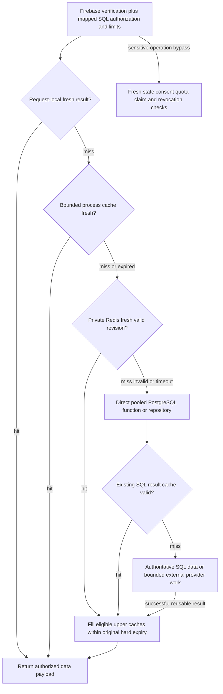

# JavaScript backend caching and optimization plan

Owns verified lookup behavior, resource policies, invalidation, failure handling and measured performance changes. Follow the [shared status/language requirement](README.md); [backend architecture](backend-after-migration.md) defines services/adapters and [SQL mapping](sql-mapping.md#deferred-cache-revision-migration) defines the deferred revision schema.

## Release scope decision

Owner decision (2026-10-14): PostgreSQL, the API, the collector and the sender run on one VPS, with one API process. Cross-replica sharing and cross-process invalidation, the problems Redis and the revision table solve, do not exist there yet. So:

| Piece | First release | Later, only if measured need |
| --- | --- | --- |
| L0 request-local reuse, batching of per-page reads, same-key in-flight sharing | **Yes** | - |
| L1 bounded in-process cache | **Yes**: catalog/taxonomy DTO 60 s; job-filter facets 10 s; the 60 s UID-to-UUID/status cache from the backend plan | Raise or lower TTLs from measurement |
| Redis (L2) | **No** | Add when a second API replica exists or the in-process hit rate is too low to protect PostgreSQL |
| `api_cache_revisions`, `read_api_cache_revisions()` and revision triggers | **No** | Add together with Redis, or alone before base-feed caching |
| Base-feed summary caching | **No** (stays disabled) | Only after the revision bridge, writer coverage and overlay-isolation tests pass |
| Personalized, activity, CV, letter, quota, consent and send decisions | Never generically cached (unchanged) | - |

Consequences for the sections below: they remain the design for the deferred tier and are not first-release requirements. In the first release a catalog or facet change made by the collector, a taxonomy tool or learning becomes visible to API reads within the L1 TTL (at most 60 s for the catalog, 10 s for facets), and any write path that validates against the catalog reads current data rather than the cached presentation, as the policy matrix already requires. Neither the SQL tables nor the Compose project contain a cache service until that tier is adopted.

## Outcome to measure

Reduce repeated data reads, duplicate concurrent work, connection setup, unnecessary payload copies and queue waiting while preserving data freshness, authorization, job quality and send correctness. Moving code to JavaScript creates an opportunity to reorganize these paths; it does not by itself prove a speedup.

The [backend authentication policy](backend-after-migration.md#authentication-and-account-migration) and SQL `api_hit` limits still run on cached requests. A cached response does not make a request database-free or quota-free. Measure data-read savings separately from mandatory security/counter calls.

API request limits count each caller; hosted-AI budgets count each actual provider call, not every waiter or reuse of a stored result. Preserve that distinction.

## Current baseline

| Existing layer | Current behavior | Target |
| --- | --- | --- |
| `backend/catalog.py` | Process-local catalog, 3,600-second TTL; empty roles not cached | Shared serialized catalog payload plus bounded process-local compiled matchers; revision-aware refresh |
| `backend/routers/taxonomy.py` | Process-local taxonomy response, 3,600-second TTL; empty fields not cached | Reuse catalog loading and cache public DTO separately; invalidate on taxonomy/approved-skill changes |
| `backend/routers/jobs.py` | Process-local filter facets, 600-second TTL | Shared facets with an explicit freshness budget; initial 60-second shared TTL/10-second local TTL, tested against baseline |
| `backend/auth.py` | Historical JWKS 600 seconds; user status 60 seconds bounded by 10,000 entries | Target Firebase Admin manages signing certificates and verifies every token; separate bounded SQL status policy and fresh revocation/disabled checks for sensitive operations. No Firestore Auth read. |
| SQL `match_cache*` | Per-user scores/state/version/queue and eligibility/live fallback inside `match_opportunities` | Keep scorer/cache correctness in PostgreSQL; call the function directly, without a JavaScript scorer |
| CV/letter reuse | Full analysis reused by file hash; letters stored per user/job/CV hash | Keep durable results in SQL (CV bytes are SQL rows); coalesce concurrent work only with the same identity/input |
| `backend/db.py` | Historical PostgREST client disables HTTP keep-alive for serverless stale-connection behavior | Target data reads use bounded role-scoped `pg` pools. Reuse bounded HTTP connections only for Firebase/upstream/model/file integrations, with operation-aware retries |

These are source observations, not live production measurements. Proposed TTLs below are starting settings requiring validation.

## Read path and layers

This is a policy-controlled lookup hierarchy, not automatic communication between caches. A valid fresh hit skips lower data-read layers; a miss falls through and eligible successful results fill upper layers. Request-local reuse and singleflight serve different purposes: singleflight only combines in-flight identical work. Not every resource uses every layer. The hierarchy and cache-aside behavior are confirmed in [cache-aside documentation](https://learn.microsoft.com/en-us/azure/architecture/patterns/cache-aside); extra layers can add latency when hits are rare. Security and quotas run before reuse, and sensitive operations bypass generic caches.

| Layer | Responsibility | Lifetime/limits |
| --- | --- | --- |
| L0 request context | Load current identity/catalog/profile dependencies once per request; map already-fetched job/application data without extra queries | Request lifetime only; never reuse across users |
| Same-key in-flight sharing | One concurrent loader for identical safe reads or hosted-AI preparation; other callers await its promise | No post-completion cache implied; cap keys/waiters/deadline; release on failure. One caller's cancellation must not cancel work still needed by others |
| L1 process memory | Fast reuse of small hot read payloads and compiled catalog indexes | LRU/TTL with byte and entry caps; proposed 32 MB per API process, configurable; do not copy the allowance into every worker blindly |
| L2 Redis | Share eligible serialized read payloads across API replicas, reducing duplicate loads/restarts | Proposed dedicated private service, memory capped and evictable; all cached keys expire and can be discarded |
| L3 PostgreSQL | Existing match scoring/cache validity, full CV analysis and stored letters | Existing SQL rules and result identities, not Redis TTLs; permanent application history remains separate |

Redis is a derived read cache, not the primary store, message queue, rate-limit counter or sender claim authority. Start with cache-aside reads and explicit invalidation; server-assisted client tracking is a possible later optimization, not a substitute for observing PostgreSQL writes. Redis invalidation only tracks Redis changes unless the application bridges database changes. [Redis caching documentation](https://redis.io/docs/latest/develop/clients/client-side-caching/)

## Cache policy matrix

| Data | Initial target policy | Freshness/isolation rule |
| --- | --- | --- |
| Catalog and taxonomy DTO | L1 60 seconds; L2 5 minutes, keyed by durable catalog revision | No caching of empty initialization failures. Catalog validation must load a current revision for writes rather than accept retired values from stale read presentation |
| Compiled skill/role lookup indexes | L1 only, tied to catalog revision | Store serialized source data in Redis, not functions/classes; rebuild compiled indexes when revision changes |
| Job filter facets | L1 10 seconds; L2 60 seconds | Global read data only; key includes time-range semantics. Freshness bound includes local cache and revision-probe lag, not only Redis TTL |
| Base job feed summaries | Disabled initially; opt in with L1 up to 5 seconds/L2 up to 15 seconds after job-revision bridge passes | Cache base job content, never the user's `application` overlay. Canonical filters, exact cursor, resolved time cutoff and job revision are part of the key |
| Raw job detail/contact data | No new Redis/L1 cache initially | Bound privacy and removal semantics; only enable an explicit policy if measured need justifies it |
| User profile for GET presentation | Request-local only initially | Mutation/send validation reads current authoritative data. Optional future cross-request caching requires user revision and read-your-write guarantees |
| Personalized matched pages/new-match counts | Keep `match_opportunities` plus request-local reuse; no new response cache initially | SQL validity/live fallback, relative time windows, profile version, freshness ranking and application overlays make these unsafe to cache casually |
| Application state/history/activity | Fresh authoritative reads; batch by job IDs | Never cache overlays inside global job keys or reuse an old activity `now` watermark |
| CV metadata/file hash | Request-local metadata; existing durable full-analysis reuse | No shared caching of raw CV bytes/text or private links; keep grants and hash/input checks |
| Letters/AI output | Existing SQL result reuse; user/CV/job/model/prompt-aware preparation sharing | No general Redis cache of private CV-derived content. Changing model/prompt does not silently reuse incompatible prepared output |
| Firebase signing certificates | Admin SDK-managed certificate reuse; verify each ID token against the configured project | Certificate caching is not a cached authorization/revocation decision. No custom legacy 600-second JWKS policy or Firestore query is required in the target. |
| Firebase current mail identity | Bypass generic caches; apply [backend mail identity checks](backend-after-migration.md#authentication-and-account-migration) | No cached identity decision authorizes unattended mail |
| UID mapping / blocked-user status | Use the dedicated bounded [backend identity/status policy](backend-after-migration.md#authentication-and-account-migration); sensitive/send checks read required current state | No extra L2/L1 layer extends authorization staleness. Apply the explicit backend failure policy rather than assuming active on expiry/outage |
| Billing/quota/consent/send eligibility | No stale read cache for decisions | Authoritative reads and existing SQL claims/counters immediately before applicable actions |
| SMTP readiness | Short operational observation only, with timestamp | Recheck actual submission failures; do not assume a cached ready flag guarantees delivery or permits a send |
| Upstream LinkedIn HTTP bodies/session probes | No result cache initially | Avoid hiding expiry/throttling, freshness or account isolation. Only share simultaneous identical fetches under the same account context if existing progress/metric semantics are proven |

Keep authenticated HTTP responses private at the gateway. Do not CDN-cache `/v1` by default. Conditional ETags may later reduce transfer for taxonomy DTOs after authorization, but they do not bypass limits. Cache data payloads, never another request's `X-Request-ID`, authorization headers or personal response wrapper. Never cache errors, missing credentials, expired sessions or failed upstream results as successful empty data.

## Keys, revision bridge and invalidation

*Deferred tier: not a first-release requirement (see the [release scope decision](#release-scope-decision)). In the first release only the in-process L1 keys and TTL expiry apply.*

Proposed key form: `autolinky:<environment>:read:v1:<resource>:<revision>:<canonical-input-hash>`. Include user ID for any approved user-specific cache. Never include raw JWTs, SMTP secrets, cookies, CV text or personal reply addresses in keys. Canonicalization follows current filter semantics: normalize set-like filters, preserve meaningful ordering and cursor bytes, and distinguish null from empty arrays. A short hash is not authorization.

The collector, API and operational tools all write the database; transitional Python workers also remain until cutover. API-only delete-on-write hooks miss enrichment, taxonomy changes and purges. Introduce a separate additive cache-revision migration before caching job feeds or sharing catalog revisions:

- Use the [deferred SQL revision bridge](sql-mapping.md#deferred-cache-revision-migration); the private function returns durable catalog/jobs revisions and database observation time together.
- Require every relevant catalog/jobs writer to participate in the SQL bridge, including collector learning, tools, deletion/purge and transitional owners. Measure revision contention; API-only mutation hooks are insufficient.
- Successful API mutations evict request-local/L1 values and related Redis entries only after database commit. Never populate caches before the write succeeds. Future user-specific revisions must cover every writer and depend on durable state, not Redis-only generation numbers.
- API processes probe durable revisions at a bounded interval, proposed 5 seconds, and use versioned cache namespaces. Redis Pub/Sub may speed L1 eviction, but is only a hint: reconnect/crash can lose notices. TTLs and revision probes provide bounded recovery.
- L1 must not extend an L2 payload's expiry. Cache envelopes carry schema version, source revision, load observation and hard expiry. New puts are limited to remaining lifetime; compare against current revision before publishing a loader result.
- Check the bounded current resource revision before hits as well as fills. Do not use an old namespace for its full TTL merely because its entry is still in memory. Account for clock/network skew when propagating remaining expiry.
- Race protection: a loader observes revision before/after its SQL read. If it changes, discard the candidate and do a bounded fresh retry or return uncached results. An invalidation followed by an old loader completion must not refill the new namespace with old data.
- Do not bucket a feed's rolling cutoff merely to increase hit rate: preserve exact resolved cutoffs initially. If keys yield too few hits, retain no-cache or design a tested time-snapshot contract separately. Facets already use an as-of-load TTL snapshot in current code; key its logical window, record the actual load cutoff and enforce the explicit facets freshness budget.

Catalog write validation and mail/send decisions may bypass cached revisions to require current state. Describe each route's stale-read budget explicitly. Feed staleness must not allow sending a purged/ineligible job; delivery re-reads current eligibility regardless of what a read cache showed.

The revision bridge does not replace SQL match-cache triggers. Ordinary handlers move to JavaScript under the approved collector port; invalidation remains independent of writer language. Validate it against all retained writers before enabling associated L2 policies.

### Required cache envelope and loader contract

*Applies to the in-process L1 now; the Redis and revision-probe clauses apply only when the deferred tier is adopted.*

The `.js` cache layer accepts a policy, canonical key/scope and bounded loader, returning a validated data payload rather than an HTTP response. Every cache entry carries schema version, resource, source revision as a lossless string, load observation, original hard expiry and serialized byte size. User-specific scope is mandatory if such a policy is ever enabled; a hash does not establish ownership.

- Reject malformed, wrong-schema/resource/scope, expired, oversized or incompatible-revision envelopes as misses. Validate payload DTO shape before return; never promote an error/partial initialization result into a successful empty result.
- L1 promotion uses remaining hard lifetime, not a new TTL. Jitter only shortens the declared hard cap. Record measured entry/object overhead as well as serialized bytes when enforcing memory limits.
- Revision observations must be no older than the declared probe budget, initially 5 seconds. If required revision refresh fails past that age, bypass dependent cache entries and use a bounded fresh SQL read or the existing unavailable response. Stale-while-refresh is allowed only with a still-valid revision observation and the policy's hard expiry.
- A loader checks the resource revision around its read and fills only the matching namespace. Discard a raced candidate; retry within the same deadline or return a permitted uncached result. Never keep retrying until a changing resource happens to become quiet.
- Singleflight waiters keep their own authorization, request limits, cancellation and deadline. Cap both leaders and waiters. Shared work has a finite independent budget; a cancelled caller cannot indefinitely extend it or cancel work still needed by others.
- Cross-replica fill locks are hints only; release with an ownership check and TTL. Losing a lock, Redis outage or reconnect must not change the database/SMTP admission rules. Revision resampling and hard expiry remain the correctness boundary.

## Stampede, outage and capacity behavior

*Bounded in-flight sharing, TTL jitter and direct-load limits apply in the first release; the Redis lock and Redis-outage clauses apply only if Redis is adopted.*

- Bound in-flight sharing and use TTL jitter within the documented hard freshness cap. Avoid an unlimited map of arbitrary queries, users or cursors.
- A short Redis lock may reduce duplicate safe cache fills across replicas. It is an optimization hint with a timeout and ownership token, never an email-send lock, quota lock or proof of exactly-once execution.
- Stale-while-refresh is allowed only for explicitly classified non-sensitive read presentation, such as taxonomy/facets, within its hard cap. Writes, authorization decisions, consent, billing, send checks and personal activity never use generic stale fallback.
- On Redis timeout/outage, trip a short cache circuit and use bounded direct loads or eligible L1 entries, without making Redis a global readiness dependency. If the underlying database is unavailable, preserve the existing route error policy rather than invent cached success.
- Bound fallback concurrency and shed expensive read work with the route's documented overload error when capacity is exceeded; a cache outage must not create unlimited database misses. Test this as a deliberate error-policy addition.
- Treat caches as disposable; invalidate on schema-version changes or incompatible deployments. Do not persist Redis cache dumps containing private content, and do not share its memory/eviction policy with authoritative queues.

Backend caches reduce repeated database/provider reads. They do not automatically reduce Flutter-to-API request count or remove Firebase verification/SQL security/limit work. Client request deduplication, ETags or polling changes need separate measured contracts. Self-hosted PG is the data origin; Firebase Auth is the identity provider; Firestore is not in this read path.

## Additional work that belongs in JavaScript

| Work | Concrete optimization | Boundary |
| --- | --- | --- |
| API read orchestration | Parallelize independent lookups with concurrency caps; batch per-page application overlays and catalog loads; select only required columns | Keep SQL matching and enrichment algorithms unchanged during the JavaScript port; a failed required lookup still follows the public error contract |
| Connection management | Use role-scoped `pg` pools and bounded upstream HTTP connections; reconnect stale sockets with operation-aware retry rules | Read-only lookups may retry within deadlines; SMTP and mutation replay need separate idempotency/acceptance rules |
| Hosted CV/letter AI orchestration | Combine same-input preparation, bound provider concurrency, enforce SQL budgets, cancel abandoned work where supported | Model calls/prompt coordination move; collector AI processing and model accuracy do not change by language alone |
| File and raw-response transport | Stream with backpressure, byte caps and deadlines; avoid extra stringify/base64/body copies | HTML/RSC and the specialized Python CV parser may require a bounded complete input; preserve original CV bytes for the `user_cv_files` row and the SMTP attachment |
| Complete collector orchestration | Bounded account/IP and processing queues, connections, priority, batching and checkpoints | JavaScript owns scheduling/parsing/handlers/optimization/enrichment/persistence together; preserve source algorithms/output and SQL contracts |
| Sender preparation/submission | Batch candidate preparation where ranking/claims permit; evaluate bounded concurrency only after measurement | Follow the [persistent sender constraints](backend-after-migration.md#persistent-auto-apply-sender) and mail plan for claim/SMTP acceptance safety |
| Telemetry/admission controls | Record event-loop lag, dependency timings, queue age and saturation; cap expensive operations | Redis or metrics must not become authorization/send correctness authorities |

Use `stream.pipeline`/equivalent bounded streaming patterns where supported and preserve backpressure rather than buffering every concurrent response without a limit. [Node.js stream documentation](https://nodejs.org/api/stream.html)

[Migration scope](python-to-nodejs.md) owns language boundaries and source parity. Use bounded worker isolation/chunking for measured event-loop bottlenecks; algorithm changes require separate validation.

## Proposed code and deployment

First release: add `.js` modules under `backend-node/src/cache/`: `policy.js`, `keys.js`, `envelope.js`, `request-context.js`, `singleflight.js`, `memory.js` and `metrics.js`. `redis.js`, `revisions.js` and `invalidate.js` are added only with the deferred tier. Service loaders call this layer; routes do not implement independent cache policies. Add separate `.js` bounded-concurrency, deadline and connection-adapter helpers where needed.

First release settings: server-side `CACHE_ENABLED`, `CACHE_L1_MAX_BYTES`, `CACHE_L1_MAX_ENTRIES` and per-policy TTL flags. Deferred tier only: a private Redis service with `CACHE_REDIS_URL`, `CACHE_REDIS_TIMEOUT_MS` and revision-probe settings; pin reviewed server/client versions when it is adopted. Keep authentication/private-network access; no published public port or frontend cache credentials. Rollback can disable the cache and discard derived values without restoring application data. The collector does not depend on Redis for authoritative pacing/progress/claims; any derived collector caches need their own tested policy. Specialized Python services retain their private boundaries.

Use per-policy feature flags, not one global switch that caches every route. Keep all new cache helpers/tests in `.js`; runtime schema checks remain required. Server-side cache values are not a substitute for response-field allowlists.

## Delivery order and acceptance

1. Record baseline API/dependency timings, cache hits, query counts, memory, event-loop lag and worker/MTA queue delay under representative hot/cold workloads.
2. Port current behavior; add request-local reuse, bounded same-key sharing, batched reads and measured connection reuse. These can improve repeated work without a shared service.
3. Add L1 catalog and facets policies with TTL, bounded-memory and stale-read tests; roll out by resource and compare against no-cache. Adding Redis and the revision migration/bridge (with TTL/race/outage tests) is a separate, later decision.
4. Enable base-feed caching (which requires the deferred tier) only after writer coverage, freshness, cursor, overlay isolation and removal tests pass. Leave personalized pages/activity/send decisions uncached unless their own proof is added.
5. Tune payload/stream/concurrency and provider/SMTP limits with realistic load; test cache outage and cold-restart saturation.
6. Retain changes only when measured resource/latency/throughput gains outweigh cache overhead, invalidation contention and extra operational complexity.

Required tests (the Redis, Pub/Sub, L2 and revision items apply only when that tier is enabled) include two-user isolation, expired/blocked auth on cache hits, quotas on cache hits, canonical/null keys, zero valid-data caching of errors, concurrent misses, bounded memory, L2 expiry without L1 extension, invalidation versus slow loader races, collector/tool and transitional Python taxonomy/job writes, job purge, Redis reconnect/missed Pub/Sub, revision rollback/crash, direct-load overload, unchanged cursors, read-your-write and SMTP eligibility rechecks.

Completion means demonstrated performance gains with these correctness checks, documented freshness budgets and a tested cache-disable path. No numeric speedup or reduced server requirement is promised before measurement.

### Reproducible workload and measurable gates

Run the Python reference and `.js` candidate against matched isolated data/fixtures with identical effective CPU/memory, replica counts, SQL configuration and source/model/SMTP test budgets. Record provider/Auth differences separately from data-cache savings. The current [load-test scripts](X:/Autolinky-with-serverbased/scripts/loadtest/README.md) contain legacy Vercel/Supabase assumptions; adapt the target harness into `.js` rather than treat their old signup/cleanup path as native-Firebase validation.

| Scenario | Required observation |
| --- | --- |
| Hot/cold route mix | Exercise identity, catalog/facets, feed/cursor/detail, matched pages and activity with cache on/off and cold starts; report latency/error/data-query counts by route and cache layer |
| Concurrent cache miss | Identical and distinct keys plus two users, bounded leaders/waiters, invalidations during load and dependency slowdown; no unbounded queues or cross-user response reuse |
| Write-heavy collection | Replay recorded acquisition/enrichment/learning while profile/taxonomy/job updates and purge run; report revision contention, checkpoint lag, match consistency and cache freshness |
| CV/AI and sender load | Bounded file/model fixtures and isolated MTA, concurrent admission at quota boundaries, interruption and late finalization; preserve outputs/reservations and actual side-effect counts |
| Degraded dependencies | Redis disconnect, failed revision probe, exhausted pool, slow parser/model, identity outage and MTA backlog; demonstrate bounded resource use and the canonical failure policy |

Proposed initial validation protocol: concurrency stages 10/25/50/100, extend only while the prior stage stays inside capacity, and use at least five equal-duration runs per baseline/candidate condition. Keep warm-up and recorded observation durations fixed. These synthetic stages establish a tested envelope, not a promised production user count. Stop on memory/admission saturation or correctness failure.

Required correctness thresholds are zero ownership leaks, duplicate admitted submissions, unexplained authoritative differences and stale results beyond the declared hard budget. For an optional read-cache policy, proposed review thresholds are median-run p95 no more than 5% worse, p99 no more than 10% worse, no unexplained error-rate increase and at least 20% fewer eligible origin data reads on the repeat-read scenario. Count mandatory auth/SQL-limit work separately; include Redis/revision overhead in total cost.

Declare/tighten review thresholds before running the comparison; do not loosen them retrospectively to label a change successful. If an optional policy misses its gate, leave it disabled and retain the completed language migration. If a required correctness check fails, activation stops regardless of a latency gain. Report resource totals, confidence/run variability, per-layer hits/misses/expiry, fallback load and capacity at the tested stage.
