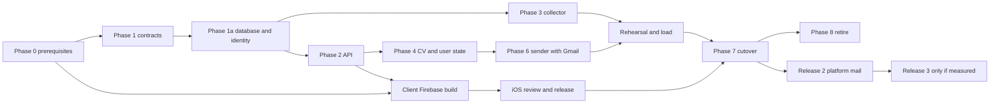

# Implementation roadmap

Owns the work breakdown, dependencies, milestones, runbooks, rollback matrix, test matrix and risk register for the three releases. The designs live in the other plans and are linked, not repeated: [backend](backend-after-migration.md), [SQL](sql-mapping.md), [mail](softfix-mail-adaptation.md), [caching](caching-and-optimization.md), [scope](python-to-nodejs.md). Nothing here has been started.

**Sizes** are rough relative effort for one engineer, for ordering and for spotting the critical path, not a schedule: **S** up to 3 working days, **M** up to 2 weeks, **L** 2-6 weeks. Re-estimate after Phase 0. A task is done only when its exit evidence exists.

## 1. Workstreams

| Code | Workstream | Main owners of the work |
| --- | --- | --- |
| DB | Native PostgreSQL: baseline, roles, migrations, import, `delete_user_data`, `ops_metrics` | SQL plan |
| API | Fastify API, auth, routes, caches, CORS, internal routes | backend plan |
| COL | Collector: acquisition, parsing, enrichment, learning, maintenance, alerts | scope plan |
| SND | Sender: Gmail port (R1), platform mail (R2) | mail plan |
| ID | Firebase project, identity import, client sign-in | backend plan |
| CLI | Flutter clients: Android, iOS, web | backend plan, client release |
| OPS | Compose project, gateway, backups, monitoring, dashboard, hardening | backend plan |
| WEB | Website integration, download stats | backend plan |
| QA | Fixtures, parity, load, failure injection, CI | all plans |
| DOC | Runbooks, deploy guide, READMEs | backend plan |

## 2. Critical path

The longest chains are (a) database and identity, then API, then client build, then iOS review, then cutover, and (b) collector parity, which can run in parallel with the API once the database exists. Start the iOS build and its store submission as soon as the API contract is stable; its review time is outside our control.

## 3. Phase 0: prerequisites (before any build)

| ID | Task | Needs | Size | Exit evidence |
| --- | --- | --- | --- | --- |
| P0-1 | Restore a production dump onto a scratch database and run the [measurement checklist](database-design-review.md#6a-rehearsal-measurement-checklist-resolves-d1-and-d2) | Dump access | S | Results recorded; planning-load assumptions replaced; B1 and sizing re-checked |
| P0-2 | Confirm platform and account facts: Apple developer account, Play/APK channel, web hosting origin, DNS control, Firebase project ownership | Owner | S | Facts recorded in the decision register |
| P0-3 | Create the Firebase project: Google and email-link providers, Hosting default domain, three app registrations, Admin service account | P0-2 | M | Console configuration exported as a checklist |
| P0-4 | Prototype sign-in on a real Android device, a real iPhone and a browser: Google, email link, session refresh; check the Sign in with Apple requirement | P0-3 | M | Pass/fail per platform; fallback decision (custom code flow) taken if email link fails |
| P0-5 | Build the rehearsal VPS from a Compose skeleton; take and restore a backup including an off-host copy | P0-2 | M | Timed restore recorded against RTO 4 h |
| P0-6 | Identity import dry run from the current GoTrue (and the old project if it still holds accounts) | P0-3 | M | Collision, unverified-email and unmapped-user report |
| P0-7 | Name the owners and operators (their admin accounts are created on the server with the CLI), the operations mailbox and the Telegram bot | Owner | S | Named in the release evidence |

## 4. Release 1: core

### 4.1 Task breakdown

| ID | Phase | Task | Depends | Size | Exit evidence |
| --- | --- | --- | --- | --- | --- |
| R1-01 | 1 | Capture route fixtures from the running FastAPI backend against a seeded database (all 29 method/path pairs, success and error cases) | P0 | L | Machine-readable fixture set |
| R1-02 | 1 | Capture golden outputs of the SQL functions (`match_opportunities`, feed, facets, purge, statistics) on a fixed dataset | P0-1 | M | Golden files |
| R1-03 | 1 | Record LinkedIn post and guest-job responses and the Python parser outputs for parity | P0 | M | Recorded corpus with expected parsed rows |
| R1-04 | 1 | Fixtures for text rules: title keys, contacts, geography, job age, search-query keys, Arabic and Unicode cases | P0 | M | Case files shared by SQL and JS tests |
| R1-05 | 1 | CI skeleton: forbidden files, no-Supabase search, secret scan, lockfile install | P0 | S | `backend.yml` green on an empty project |
| R1-06 | 1a | Squashed baseline from `schema_current.sql`, native roles (`autolinky_api`, `_collector`, `_sender`, `_ops`, migrator), RLS disabled, grants, `migrate.js` with the ledger | R1-05 | M | Empty install and populated restore pass; role denial tests pass |
| R1-07 | 1a | Port the Python SQL tests to run on the native baseline (`test_*_sql.py`, `test_migrations.py`, `local_test_db.py` replacement) | R1-06 | M | Existing SQL tests green |
| R1-08 | 1a | `user_cv_files`, `ops_metrics`, `app_settings`, `admin_accounts`, `admin_user_stats`, `admin_log` audit fields, `autolinky_admin` role, identity columns, `delete_user_data`, adapted `security_report()` | R1-06 | M | Migrations tested; `delete_user_data` removes every user row |
| R1-09 | 1a | Identity import tool and UID binding (UUID as Firebase UID), reconciliation job skeleton | P0-6, R1-08 | M | Import report clean on the rehearsal dataset |
| R1-10 | 1a | CV importer: legacy objects into `user_cv_files` with hash verification | R1-08 | S | Every CV hash matches |
| R1-11 | 2 | API skeleton: config validation, Fastify app, error shape, request IDs, graceful shutdown, health and readiness | R1-06 | M | Contract tests for health and errors |
| R1-12 | 2 | Firebase verification, UID mapping, status cache, failure policy, rate limiting via `api_hit`, device token auth | R1-09, R1-11 | L | Authorization matrix tests including outage behavior |
| R1-13 | 2 | Catalog, taxonomy, jobs routes (feed, matched, new, filters, detail) with in-process caches | R1-12, R1-02 | L | Fixture parity for every jobs route |
| R1-14 | 2 | Profile routes, search-status and `POST /v1/profile/search-now`; CORS allow-list; `GET /v1/me` and `DELETE /v1/me` | R1-12 | M | Fixture parity; two-user isolation tests |
| R1-15 | 2 | Devices routes and device activity | R1-12 | S | Fixture parity |
| R1-16 | 2 | Internal downloads route and the website change | R1-11, R1-05 | S | Website tests updated and green |
| R1-17 | 3 | Collector transport, accounts, pacing, settings readers, notifier | R1-06 | L | Throttle, deadline, cancellation and account-isolation tests |
| R1-18 | 3 | Guest jobs vertical path: acquisition, parser, pipeline, persistence | R1-17, R1-03 | L | Recorded responses produce the expected raw and enriched rows |
| R1-19 | 3 | Posts path: acquisition, RSC parser, contacts, geography, job age, search-query rules | R1-17, R1-03, R1-04 | L | Parity with Python parser outputs |
| R1-20 | 3 | Enricher, classification, hosted AI modules, skill learning, embeddings client | R1-18 | L | Taxonomy decisions, fingerprints, vectors and ties match within recorded tolerances |
| R1-21 | 3 | Coordinator: demand, first-search priority, maintenance timers, checkpoint rule, stop/resume | R1-18, R1-19 | M | Crash and replay tests; no duplicate learning increments |
| R1-22 | 4 | CV extractor service and Node client | R1-11 | M | Accepted and malformed file corpus passes; limits enforced at both ends |
| R1-23 | 4 | CV routes and workflow: upload, reuse, analysis, atomic bytes plus metadata, reanalyze, delete | R1-22, R1-12 | L | Fixture parity; atomic replace tests |
| R1-24 | 4 | Applications routes, activity, billing and quota reads, cover-letter preview | R1-23 | M | Fixture parity |
| R1-25 | 6 | Gmail-path mailer: Fernet decrypt (cross-checked against Python-encrypted samples), Gmail SMTP through Nodemailer, signature and legacy mail-account routes | R1-24 | M | Fake SMTP sink tests; routes match fixtures |
| R1-26 | 6 | Sender loop: 30 s tick, conditional claim, heartbeat, quotas, pauses, graceful stop | R1-25 | L | Concurrent claim, crash and shutdown tests |
| R1-27 | 6a | In-process cache modules, `ops/metrics.js` flush into `ops_metrics`, `ops/settings.js` and `ops/audit.js` | R1-13 | M | Bounded-memory and stale-read tests |
| R1-28 | 6a | Admin console parity port: login, overview, users, user detail, limits, Pro on/off, `admin_log`, security headers, static page and fonts; port `tests/backend/test_backend_admin.py` | R1-27, R1-12 | L | Every Step 19 test passes against the Node console and the native database |
| R1-29 | 7 | Flutter: replace Supabase with Firebase on Android, iOS and web (bootstrap, env, auth repository, session storage, API client token source, verification screen), Sign in with Apple, account deletion screen | P0-4, R1-14 | L | Sign-in, refresh, matches, CV upload, deletion pass on each platform |
| R1-30 | 7 | Mobile CI changes, store and APK builds, web build deployment, iOS submission | R1-29 | M | Builds published; iOS submitted |
| R1-31 | 7 | Compose project: gateway, services, backup job writing `ops_metrics`, hardening, monitoring, uptime monitor | R1-11 | L | Fresh-machine bring-up from the repository alone |
| R1-32 | 7 | Operator tools and scripts per the [script table](python-to-nodejs.md#operational-scripts) | R1-24 | M | Each supported script runs on the native database |
| R1-33 | 7 | Load tests (stages 10/25/50/100), failure injection, event-loop and memory checks, restore drill | R1-26, R1-31 | M | Results recorded against the budgets |
| R1-34 | 7 | Two full cutover rehearsals on the rehearsal VPS with rollback tested once | all above | M | Timed runbook, freeze duration at or under 60 minutes |
| R1-36 | 1a | Efficiency migrations E1, E2, E5, E10, E11, E14, E15, E18 ([database efficiency](database-efficiency.md)): rate-limit retention, conditional `touch_app_user`, download retention, storage mode, compression settings, housekeeping, `pg_stat_statements` | R1-06 | M | SQL tests identical; retention jobs bounded and tested |
| R1-37 | 6a | Rewrite `admin_users` / `admin_overview` over `admin_user_stats` and rollups; `admin_user_stats_refresh()` on the maintenance timer | R1-28, R1-36 | M | Same columns and filters as Step 19 on a seeded dataset; page under 150 ms at 10x planning load |
| R1-38 | 7 | Run the measurement queries on the rehearsal copy and record E3, E6-E9, E12 decisions | R1-34 | S | Measurements recorded; each measure item either closed or moved to the backlog with its trigger |
| R1-39 | 8 | Monthly efficiency review procedure (unused indexes, bloat, growth, slow statements) wired to the dashboard database panel | R1-28 | S | First review done |
| R1-40 | 6a | Admin accounts: `admin_accounts`, scrypt, TOTP, sessions with `session_epoch`, re-authentication, roles, lockout, CLI (`scripts/admin-user.js`) | R1-28 | L | Access and session tests in the [admin dashboard plan](admin-dashboard.md) |
| R1-41 | 6a | Audit: same-transaction audit rows, `view_user`, filters, export, revert helper, immutability grants | R1-40 | M | Audit tests; `autolinky_admin` cannot update or delete `admin_log` |
| R1-42 | 6a | User management: block/unblock, sign-out, disable, delete, remove CV, revoke devices, pause/resume, clear stuck, export, relink, notes | R1-40, R1-41, R1-23 | L | Case tests for section 6B |
| R1-43 | 6a | Plans and settings: subscriptions list, pre-grant, bulk with dry run, revert, `app_settings` panels (notice, maintenance, minimum versions, defaults, toggles) | R1-40, R1-41 | L | Case tests for sections 6C and 6G |
| R1-44 | 6a | Collector, taxonomy and operations panels: pause/resume, run maintenance, titles/locations, live searches, jobs hide/restore, skill candidates, health, alerts, backups, admin-account management | R1-40, R1-21 | L | Case tests for sections 6E, 6F, 6H, 6J |
| R1-45 | 3 | Worker-thread pool for parse, extract and rule stages with transfer, timeouts, memory limits and an inline mode; equivalence tests for 0, 1, 2, N threads ([parallel search pipeline](search-concurrency.md)) | R1-17 | M | Identical rows for every thread count on the recorded corpus |
| R1-46 | 3 | Planner lanes (live, scheduled, backfill) with aging, bounded queues with backpressure, token buckets on the main thread, settings read from `app_settings` | R1-45, R1-43 | M | Pacing proof (never above the cap), fairness and failure-injection tests |
| R1-47 | 7 | Benchmark parse time per page, event-loop lag and throughput versus pool size; apply the gate rules and record the chosen defaults | R1-46 | S | Gate table filled in the release evidence |
| R1-48 | 7 | PostgreSQL parallel-query settings and `PARALLEL SAFE` test for `match_profile` under the 10/50-user stages | R1-33 | S | Plans and byte-identical results recorded; adopt or reject |
| R1-49 | 3 | Collector transport rules from the DataForge review: stop statuses, bounded `Retry-After`, transient retries, redirect scope checks, size cap, challenge markers | R1-17 | S | Transport tests with a fake server |
| R1-50 | 3 | Parser-health metrics (field coverage per cycle, 20-point drift alert) and sanitized failure fixtures | R1-18, R1-19, R1-27 | S | Alert fires on a seeded drop |
| R1-51 | 1a | Migration runner additions: pending-migration check at startup and a snapshot before applying on production | R1-06 | S | Services refuse to start with a pending migration |
| R1-52 | 1 | `fast-check` property tests for normalization, title keys, contact redaction and fingerprints | R1-04 | S | Properties pass against the Python reference outputs |
| R1-53 | 1a | General limiters in memory, durable limiters kept in `api_hit`; CV extractor expansion-ratio limits; zstd dump settings | R1-12, R1-22, R1-31 | M | Rate-limit tests unchanged for users; WAL per request measured before and after |
| R1-54 | 6a | Admin console diagnostics export (redacted) | R1-44 | S | Export contains no secrets or record values |
| R1-55 | 1 | Shared normalization library (`tidy`, Arabic-aware `fold`, e-mail, phone via libphonenumber-js, URL, company key, fingerprints) with parity against the Python and DataForge reference on a shared corpus | R1-04 | M | Exact parity on normalization outputs; Arabic cases pass |
| R1-56 | 3 | Engine library: blocking, evidence, decide, constrained clustering, canonical selection, metrics ([matching engine](matching-engine.md)); unit and property tests | R1-55 | L | Golden pair set decisions identical to the reference; properties hold |
| R1-57 | 7 | Offline evaluation harness on the restored copy: duplicate-rate measurement, labeled-pair sampling, precision and recall report | R1-56, R1-34 | M | Duplicate rate recorded; decides whether the tier is activated |
| R1-58 | 1a | Dedupe schema (`job_keys`, `job_dupes`, `dedupe_constraints`, `canonical_id`) and `app_settings` flags, created empty with mode `off` | R1-08, R1-56 | S | Migrations tested; no behavior change |
| R1-59 | 3 | `ai/` client with task profiles, token meter (input, output, cached), retry caps with parking, no-thinking and provider flags, prompt registry, cache layer and a deterministic fake provider; parity with the Python AI paths on recorded answers ([AI token efficiency](ai-token-efficiency.md)) | R1-17 | L | Same prompts, caps, parsing and cache behavior; token counts within tolerance |
| R1-60 | 6a | AI usage metrics (daily rollups), admin AI usage panel and controls, per-service API keys, budgets and anomaly alerts | R1-59, R1-28 | M | Panel shows seeded usage; caps and kill switches tested |
| R1-61 | 7 | Evaluation harness and baselines: recorded gold sets, report per task, non-inferiority checker; baseline metrics recorded before any lever ships | R1-59 | M | Baseline report in the release evidence |
| R1-62 | 3 | Port of the free gates and caches exactly: pre-filter, age gates, Step 16 "wanted" selection, verdict, content-hash, title-key and letter caches | R1-59, R1-20 | M | Gate and cache parity tests against the Python behavior |
| R1-35 | 8 | Retire Python API, sender and collector; documentation rewrite; archive `selfhost/` after the rollback window | cutover | M | Import and entry-point audit; no stale Supabase instruction |

### 4.2 Release 1 cutover runbook

| When | Step | Go/no-go check |
| --- | --- | --- |
| T-4 weeks | Submit the iOS build; publish the Android APK and web build behind the minimum-version setting; start the in-app and website notice | iOS review status known |
| T-2 weeks | First full rehearsal; restore drill; secret-rotation drill | Freeze duration measured; RTO met |
| T-1 week | Second rehearsal including rollback; confirm iOS build live; admin accounts exist with TOTP and the console passes its tests | All gates in the [verification table](backend-after-migration.md#verification-and-completion-criteria) green |
| T-1 day | Confirm backups fresh and off-host copy readable; announce the maintenance window; freeze unrelated changes | Operator on call |
| T-0 quiesce | Switch the old API to the maintenance 503, stop collector, maintenance and sender, drain writes ([cutover step 2](backend-after-migration.md#cutover-and-recovery-procedure)) | No writer or provider still active |
| T-0 capture and restore | Final export, identity and CV hash manifests, restore, import bindings, rebuild caches, compare keys and counts | Zero unexplained differences |
| T-0 candidate | Start the Node API with mutations gated; sign-in and flow checks on all three platforms; dashboard shows every service up | All checks pass |
| T-0 reopen | Enable mutations, one collector owner, the Gmail-path sender; record activation times | One owner for collector, maintenance and sender |
| T+1 hour / day / week | Observation window; watch the dashboard, error rates, queue age, quota behavior; keep the old environment restorable until the rollback window closes | Any correctness failure stops affected writes and triggers the matching rollback row |

## 4b. Deduplication tier (post-parity, flag-controlled)

Built offline in Release 1 (tasks R1-55 to R1-58), activated only after the gates in the [matching engine plan](matching-engine.md#9-activation-gates). Tasks once Release 1 is stable:

| ID | Task | Gate |
| --- | --- | --- |
| D-01 | Shadow mode for at least 14 days in production; record duplicate rate, block sizes, review volume | Mode `shadow` |
| D-02 | Admin Duplicates panel (review queue, side-by-side evidence, confirm/keep separate/split/lock/undo) | Panel tests |
| D-03 | Label 300 pairs; compute precision and recall; calibrate thresholds | No false merge in 300 sampled auto-matches |
| D-04 | Scoring and feed migration to read `canonical_id IS NULL`, with flag-off parity tests; activate | Duplicate rate above 5% and D-03 met |
| D-05 | Likelihood and learned queue ordering | 100 reviewed pairs, 20 labels with both outcomes |
| D-06 | Data-quality variant report and alias table for company, city and title spellings | Operator review |

## 4c. AI tuning wave (after Release 1 parity, each behind its evaluation)

Each task ships only after passing the non-inferiority gates in the [AI token efficiency plan](ai-token-efficiency.md#6-quality-guardrails-same-level), first in shadow mode on a sample, with the baseline profile kept for rollback.

| ID | Task | Gate |
| --- | --- | --- |
| AI-01 | Exact text-fingerprint reuse before the post call and content-hash reuse for requirements (A1), retry caps and parking (A2), known-lookup failure handling (A3) | Identical outputs on the gold sets; avoided-token counters |
| AI-02 | Letters: thinking off, `finish_reason` check, static-first prompt (D1, C4) | 20-letter A/B, then the 100-pair set: zero invented claims |
| AI-03 | Letters from structured facts and body-only generation (C2, D2) | Grounding check plus blind comparison on 100 pairs |
| AI-04 | Title key without noise and embedding nearest-neighbour reuse; role shortlist in title and CV prompts (B1, C1) | Role agreement and shortlist recall at least 99.5% |
| AI-05 | Ad tail trimming and rules-first years and education (C3, B2) | Required and preferred F1 and years/education agreement not lower |
| AI-06 | Near-duplicate reuse before posts and requirements calls (A1 extension) | Matching-engine precision gate met |
| AI-07 | Cheap-eligibility-first ordering for letters (A5) | Release 2; no letter written for a refused or unclaimable send |
| AI-08 | Model tiering and letters on the lighter model (E1, E2) | Only if proven by the gates; otherwise left unchanged |

## 5. Release 2: platform mail

| ID | Task | Depends | Size | Exit evidence |
| --- | --- | --- | --- | --- |
| R2-01 | SMTP stack from the SoftFix patterns: Postfix image, accounts, DKIM, TLS utility, `manage.js`; DNS (SPF, DKIM, DMARC, reverse DNS), outbound port 25 check, operations mailbox and routes | Release 1 stable | L | Isolated sink tests; DNS and certificate checks; deliberate test recipients |
| R2-02 | Shared mailer and composer (`mailer.js`, `compose.js`, `transport.js`), offline MIME tests, `verify-mail.js` | R2-01 | M | MIME, attachment, sender and Reply-To tests |
| R2-03 | `mail_attempts`, `mail_suppressions`, `auto_apply` columns and `application_signature` migrations; the shared reservation transaction and admission | R1 | L | Race tests: two manual, manual vs auto, two auto, final free slot, late finalizer |
| R2-04 | Capacity cap, warm-up schedule, kill switch, suppression tool, opt-out header | R2-03 | M | Cap enforced; kill switch stops submissions; suppressed address refused |
| R2-05 | API changes: `GET /v1/mail-delivery`, preview fields, legacy route behavior, client-version gate, profile signature | R2-03 | M | Fixture parity for unchanged routes; new contracts tested |
| R2-06 | Platform sender: consented rows only, fresh Firebase identity check, MTA capacity, interruption recovery | R2-03, R2-04 | L | Failure-injection list in the mail plan passes |
| R2-07 | Flutter mail setup, preview and consent screens on Android, iOS and web; client-version gate | R2-05 | L | Manual platform submission validated before automatic activation |
| R2-08 | Admin console mail control: kill switch, global cap and warm-up target, suppression list, attempts and queue panels, resolution of `unknown` attempts with evidence | R2-03, R1-44 | M | Case tests for section 6D (Release 2 rows) |
| R2-09 | Activation: legacy Gmail automatic settings disabled, platform opt-in, warm-up from 50 a day doubling weekly while thresholds hold | all above | calendar time | Observed bounce and deferral rates within thresholds set before launch |
| R2-11 | Recipient quality gate: syntax, placeholder and no-reply verdicts, typo-domain suggestions, optional cached MX check, wired into admission and preview ([matching engine plan](matching-engine.md#10-recipient-quality-gate-release-2)) | R2-03, R1-55 | M | Refusal and suggestion cases tested; no silent correction |
| R2-10 | Close-out: after 30 days stable, drop `mail_accounts` secrets and `MAIL_SECRET_KEY` | R2-09 | S | Removal verified; rollback to Gmail no longer offered |

## 6. Release 3: caching tier

Only started when measurement shows the in-process caches are insufficient or a second API replica exists: Redis, revision bridge and policy-by-policy rollout under the [caching gates](caching-and-optimization.md#delivery-order-and-acceptance). No tasks are scheduled until then.

## 7. Rollback matrix

| Point | Action | Data consequence |
| --- | --- | --- |
| Before the final export | Restore the old environment as it was; reopen the old API | None |
| After restore, before mutations reopen | Discard the candidate database; reopen the old environment; users on new clients see the service notice because Firebase tokens are not accepted by the old API | None lost; the Firebase import can be repeated |
| After mutations reopen, within the rollback window | Export writes made since reopening, map identities back, restore into a reconciled legacy environment, use a compatible client path | Writes since reopening preserved by the export; this is a rehearsed procedure, not an image swap |
| Collector problem only | Stop the Node collector; start the Python collector against a compatible database adapter or restored legacy database; one maintenance owner | Raw and enriched IDs and search state preserved |
| Sender problem only (R1) | Stop the Node sender; the old Python sender needs a compatible data path (same constraint as the collector) | Accepted Gmail sends are not repeated; uncertain attempts stay `sending` |
| Release 2 problem | Activate the kill switch; platform submissions stop; accepted queue items stay; legacy Gmail rows remain until the 30-day close-out, so Gmail sending can be re-enabled manually | Never resubmit accepted mail; never attach one queue to two MTAs |

## 8. Test matrix

| Area | What is run | Where |
| --- | --- | --- |
| API contract | Replay the Release 1 fixtures against every route; compare status, body shape, headers and errors | CI |
| Authorization | Token matrix, blocked users, device tokens, admin roles and sessions, stale sessions, two-user isolation | CI against a real database |
| Database | SQL tests on the native baseline; role denial tests; restore tests; `delete_user_data` completeness | CI |
| Collector | Recorded-response parity, throttle, cancellation, crash/replay, account isolation, numeric tolerances | CI and rehearsal |
| CV and AI | Accepted/malformed corpus, limits, atomic replace, partial analysis, provider fixtures | CI |
| Sender | Gmail-path parity against a sink (R1); the mail plan's failure-injection list (R2) | CI and rehearsal |
| Clients | Per platform (Android, iOS, web): Google sign-in, email link, session refresh, matches, CV upload, application, account deletion, notice display | Manual checklist before each release plus automated widget tests |
| Admin console | Ported Step 19 tests, access and session matrix, write-safety (audit in transaction, concurrency, idempotency, reason, re-auth), every case in sections 6B-6J of the plan, privacy checks, query budgets | CI |
| Load | 10/25/50/100 concurrency stages, five runs per condition, memory without swap | Rehearsal VPS |
| Operations | Restore drill, secret rotation, backup freshness alert, uptime monitor alert | Rehearsal VPS |
| Independence | Repository search for Supabase, fresh-install check on plain PostgreSQL | CI and release candidate |

## 9. Risk register

| Risk | Likelihood / impact | Mitigation | Trigger or owner |
| --- | --- | --- | --- |
| Email-link sign-in fails on a platform (Dynamic Links replaced by Hosting links) | Medium / high | Phase 0 prototype; custom code flow fallback with SMTP brought forward | P0-4 |
| iOS review delays or rejects (including Sign in with Apple) | Medium / high | Submit early; cutover waits for the build to be live; pre-check guidelines | R1-30 |
| Scorer or parser behavior drifts in JavaScript | Medium / high | Fixtures and golden outputs from Phase 1; scoring stays in SQL; recorded tolerances | R1-02, R1-03 |
| New collector triggers LinkedIn throttling or session loss | Medium / medium | One shared pacing budget; drain the Python collector first; canary behavior preserved; Telegram alerts | R1-17 |
| Single VPS failure | Low / high | Off-host encrypted backups, restore drill, RTO 4 h; WAL archiving if RPO 24 h is too weak | Operator |
| CV bytes in the database make dumps slow | Low / medium | Measure in P0-1; reopen B1 if restore breaks RTO | P0-1 |
| Memory pressure on a small VPS | Medium / high | 4 GB minimum, container limits, int8 embedder, acceptance test without swap | R1-33 |
| Duplicate Firebase accounts from account linking | Medium / medium | UUID as Firebase UID, linking setting checked, dry-run report, representative accounts | P0-6 |
| Write freeze longer than planned | Medium / medium | Two timed rehearsals; stop condition at the limit | R1-34 |
| Old app builds linger after cutover | High / medium | Long notice, minimum version, bilingual notice, Shorebird patches for new builds | R1-30 |
| Email deliverability poor from a new domain | Medium / high | Warm-up, suppression, kill switch, reputation monitoring, sink tests first | R2-04 |
| Hosted AI cost or provider outage | Medium / medium | Existing SQL budgets and rules-only fallback preserved; dashboard shows budget use | Operator |
| Residual Supabase reference ships | Medium / medium | CI search gate and fresh-install gate | R1-05 |
| Scope growth delays Release 1 | High / medium | Three releases; deferred backlog with triggers; no algorithm changes during the port | Owner |
| Legal or policy exposure from automated applications and scraped contact data | Unknown / high | Drafts of the acceptable-use position and privacy-policy outline exist in [launch-content-drafts.md](launch-content-drafts.md); qualified review before Release 2; retention limits already in the plan | Owner |

## 10. Inputs needed from the owner

| Needed by | Input |
| --- | --- |
| Phase 0 | Apple developer and Firebase ownership, DNS access, VPS size, backup destination, owner Google accounts, operator and mailbox owner |
| Before the iOS submission | App Store listing details, privacy labels, account-deletion URL |
| Before Release 1 cutover | Final notice wording in both languages, maintenance window, privacy-policy text |
| Before Release 2 | Review or adjust the drafted acceptable-use position; the sender display name and domain; launch volume target |

All notice, deletion, consent and policy texts have drafts in [launch-content-drafts.md](launch-content-drafts.md); the owner edits rather than writes them.

## 11. Definition of done

- **Release 1:** every gate in the [verification table](backend-after-migration.md#verification-and-completion-criteria) except mail-platform and cache rows is green on the release candidate; Android, iOS and web are live on the new clients; the Python API, sender and collector are retired after the rollback window; the repository passes the Supabase-independence search.
- **Release 2:** the mail gates in the [mail plan](softfix-mail-adaptation.md#mail-activation-and-recovery-gates) are green; warm-up reached the target within thresholds; the 30-day close-out removed the legacy Gmail secrets.
- **Release 3:** each enabled cache policy passed its correctness and measurement gate, or was left disabled.
