# Parallel search pipeline

Owns how searching runs concurrently and in parallel across threads and processes: the collector's job and post searches, the CPU stages behind them, and the database-side search and matching that users trigger. It refines the collector design in the [backend plan](backend-after-migration.md#collector-and-specialized-python-boundaries) and the bounded-execution rules, uses ideas from DataForge ([adoption notes](dataforge-adoption.md)), and is tuned from the [admin console](admin-dashboard.md). Nothing here changes what is searched, how results are scored, or the pacing caps that protect the LinkedIn accounts and the server's IP.

## 1. What the current collector does

From `collector/run_forever.py`, `collector/settings.toml` and `collector/jobs_runner.py` (Python, threads):

| Part | Today |
| --- | --- |
| Posts search | Per LinkedIn account, `workers = 3` searches in parallel sharing `requests_per_minute = 4` (the comment says never above 6: account safety is the binding limit) |
| Jobs search (guest listings) | `workers = 4` searches in parallel sharing a rate that starts at 60 and adapts up to `max_requests_per_minute = 90` per IP; a request takes under a second, so four workers already reach the cap; a 429 cuts the rate 30% and waits 15 seconds; up to 20 pages of 10 jobs per search; `sort = date` stops early at the first page of known jobs; `fetch_details` adds one request per new job |
| After acquisition | Producer/consumer queues; `HTTP_AI_THREADS = 3` consumer threads batch posts for the AI; each thread has its own database and AI client |
| Priority | A first-search lane serves live searches users ask for (`user_searches_claim`) before scheduled searches; titles are searched once in the order asked |
| Safety | Shared per-account and per-IP limiters, throttle pause (`throttle_pause_minutes = 180`), canary searches, total deadlines, checkpoints saved after the SQL commit |

The key fact: **throughput is capped by the request rate, not by thread count.** Raising workers cannot speed up fetching beyond the cap and would only add account risk. Parallelism helps in three other places: keeping the request pipeline full while earlier pages are being parsed and saved, spreading CPU work across cores, and answering many users' database searches at once.

## 2. Design goals

1. Keep the request pipeline saturated up to the configured caps, never above them.
2. Never let CPU work (parsing, extraction, classification, scoring prep) block the event loop that drives the network and database.
3. Use all useful cores without adding account or IP risk, and degrade to a single thread without changing results.
4. Bound memory, queues and worker lifetime; apply backpressure instead of buffering.
5. Make every knob visible and adjustable (within safe maxima) from the admin console, and measurable.

## 3. Architecture

```mermaid
flowchart LR
    SRC[Search planner: live, scheduled, backfill lanes] --> LIM[Pacing: per-account and per-IP token buckets]
    LIM --> FETCH[Async fetchers: bounded concurrency]
    FETCH -->|raw page bytes| Q1[(Bounded queue A)]
    Q1 --> POOL[Parse and extract pool: worker_threads]
    POOL -->|records, contacts, fingerprints| Q2[(Bounded queue B)]
    Q2 --> ENR[Enrichment: rules in pool, AI calls async in batches]
    ENR --> Q3[(Bounded queue C)]
    Q3 --> SAVE[Batched writers: pooled SQL connections]
    SAVE --> CP[Checkpoint after commit]
    CP --> SRC
```

| Stage | Where it runs | Concurrency control |
| --- | --- | --- |
| Planner | Main thread | Three lanes: **live** (user-requested, `user_searches`), **scheduled** (demand-ordered), **backfill/first-run**. Weighted priority with aging so backfill cannot starve and live searches always go first |
| Pacing | Main thread only | One token bucket per account and one per IP, owned by the main thread. Workers never touch the network, so the caps cannot be exceeded by adding threads. Adaptive rate rules unchanged (+5 per clean minute up to the maximum, -30% and a 15 s wait on 429) |
| Fetch | Main thread (async I/O) | `jobs_workers` (default 4) and `posts_workers_per_account` (default 3) concurrent requests, each waiting on its bucket; cancellation by `AbortSignal`; total deadline per search |
| Parse and extract | Worker-thread pool | HTML and RSC parsing, contact, geography, job-age and fingerprint rules. Input is the page bytes, output a plain record array. Pool size default `clamp(availableParallelism() - 1, 1, 3)`; each worker has memory limits (`resourceLimits`) and a task timeout |
| Enrichment rules | Same pool | Classification precedence, title keys, requirements mapping, vector math for skill learning |
| AI and embedding calls | Main thread (async I/O) | `ai_concurrency` batches in flight (default 3, as today); budgets and fallbacks unchanged |
| Writers | Main thread, pooled connections | Batched inserts (`insert_hiring_post` and the existing functions) on the collector role's pool, sized in the pool budget |
| Checkpoint | After the SQL commit | Unchanged rule: advance the search checkpoint only after its data is committed |

**Why worker threads, not more processes:** parsing and rules are pure functions of bytes, so they share nothing and transfer cheaply (`ArrayBuffer` transfer); threads start fast and share the container's memory limit. Child processes are reserved for isolation needs, as DataForge does with its crawler engine ([adoption notes](dataforge-adoption.md)).

## 4. When the pool is worth it (gates, not assumptions)

At the planning rate (about 1.5 requests per second at the 90 per minute cap, ten jobs per page) parsing is a small share of one core, so the pool is expected to matter mainly for **backfills, first runs for many new titles, enrichment bursts and the vector work in skill learning**. The pool therefore ships as an implemented, tested abstraction with these rules:

| Measure | Rule |
| --- | --- |
| Parse plus extract time per page, p95 | If under 5 ms and event-loop lag p99 under 20 ms with the pool disabled, run inline (pool size 0) and keep the pool for backfill lanes only |
| Event-loop lag p99 during backfill | If over 50 ms inline, the pool is required for that lane |
| Throughput versus pool size | Benchmark 0, 1, 2, 3 threads on a recorded corpus (pages per second, CPU per page, memory); choose the smallest size within 10% of the best |
| Memory | Peak resident memory of the collector, including workers, stays inside its container limit with headroom for a CV upload burst on the API side |

## 5. Correctness and determinism

- **Same results for any thread count.** Pool tasks are pure; results are sorted by a stable key (source, source reference, fingerprint) before persistence, so zero, one or N threads write identical rows. A test runs the recorded corpus with 0, 1 and N threads and compares every row.
- **Idempotent reprocessing.** A worker crash, timeout or restart re-queues its batch; ids and fingerprints make the writes idempotent, and the checkpoint only advances after commit.
- **Backpressure.** Each queue holds at most 2x the pool size of tasks (the page queue also has a byte cap). A full queue pauses the fetchers' next request; pages are never dropped or buffered without limit.
- **No shared mutable state** between workers and the main thread beyond the message channel; configuration and taxonomy are sent as immutable snapshots with a version, and a worker rejects a task whose version differs.
- **Cancellation and shutdown.** Stop and pause (also from the admin console) act at checkpoints: no new tasks are admitted, in-flight tasks finish within the grace period, uncommitted work is discarded and redone, and pools are terminated after queues drain.
- **Failure isolation.** A worker that throws, times out or exceeds memory is replaced; three consecutive failures on the same task mark that page "bad" in the run log (reported, skipped, never counted as an empty successful search).

## 6. Safe maxima and settings

Defaults mirror today's behavior. Settings are read from `app_settings` with the environment value as fallback (10-second cache) and are changeable by owners in the console, within code-enforced maxima that tool users cannot exceed.

| Setting | Default | Maximum | Note |
| --- | --- | --- | --- |
| `collector.jobs_workers` | 4 | 8 | Concurrent guest-job searches; all share the IP cap |
| `collector.jobs_rpm` / `jobs_max_rpm` | 60 / 90 | 90 | The ceiling that was tested live; raising it needs a code change and a rehearsal |
| `collector.posts_workers_per_account` | 3 | 4 | All share the account cap |
| `collector.posts_rpm_per_account` | 4 | 6 | Account-safety limit stated in the current settings |
| `collector.parse_threads` | gate result, else `clamp(cpus - 1, 1, 3)` | 4 | 0 means inline |
| `collector.ai_concurrency` | 3 | 6 | Bounded by the AI budgets |
| `collector.lane_weights` | live 50 / scheduled 40 / backfill 10 | - | Aging prevents starvation |
| `collector.queue_factor` | 2 | 4 | Queue size as a multiple of pool size |

Increasing parallelism never raises the request rate; the rate settings are separate and remain the only way to change it.

## 7. Database-side search and matching

| Area | Plan |
| --- | --- |
| Concurrent user reads | The API is async; each request borrows a pooled connection for one query. The API pool, statement timeouts and the in-process result caches bound the load. The load test covers 10/25/50/100 concurrent users on feed, matched pages and filters |
| Free-text search (`p_q`, trigram GIN on `search_blob`) | Unchanged; measured under load. If the index proves low-value (efficiency finding E7) free-text falls back to the posted-time index plus filtering |
| Parallel query | Set `max_parallel_workers_per_gather = 2` and a total parallel-worker cap of half the cores so background work and the API are not starved. `match_profile` is a pure SQL scorer; test marking it `PARALLEL SAFE` and read the plans: adopt only if the plan uses parallel workers, latency improves at the 10-user and 50-user stages, and results are byte-identical. `match_opportunities` writes the cache and calls `set_config`, so it stays parallel-unsafe |
| Cache rebuild storms | Concurrent rebuilds are capped at 2-4 in the API (efficiency finding E16); excess requests use the live path |
| Collector writes versus API reads | Separate roles and pools; the collector pool is bounded so enrichment bursts cannot exhaust connections the API needs |

## 8. Observability

Per stage: queue depth, tasks in flight, p50/p95 task time, worker utilization, restarts, bytes processed; per search: pages fetched, records saved, duplicates skipped, time to first result for live searches; global: event-loop lag, pool wait, rate now versus cap, 429 count, throttle pauses. These go to `ops_metrics` and the collector panel of the admin console; alerts fire on a growing queue age, repeated worker restarts, or time-to-first-result over the live-search budget (the one-hour expiry in `user_searches_claim` is the hard limit).

## 9. Tests

- Equivalence: recorded corpus through 0, 1, 2 and N threads gives identical rows and checkpoints.
- Failure injection: kill a worker mid-task, exceed its memory limit, time out a task, restart the collector between commit and checkpoint, fill each queue, cancel mid-run, 429 storms; assert no lost or duplicated rows and no rate above the cap (a fake clock counts requests per window).
- Fairness: with all lanes loaded, live searches start first and backfill still progresses.
- Pacing proof: with 8 workers and a cap of 60 per minute, the recorded request timestamps never exceed the cap in any one-minute window.
- Load: the 10/25/50/100 stages with the collector running in backfill, checking API latency does not regress beyond the review thresholds.

## 10. Tasks

Added to the [roadmap](implementation-roadmap.md): R1-45 (pool abstraction and tests), R1-46 (planner lanes, bounded queues, backpressure), R1-47 (benchmark and gates), R1-48 (PostgreSQL parallel-query measurement and settings).
