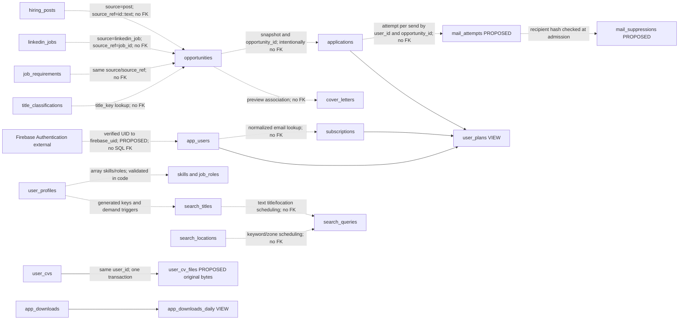

# SQL mapping for the Node.js migration

Owns the repository schema inventory, SQL contracts, target diagrams and planned migrations. Follow the [shared status](README.md); runtime identity and connection adapters are specified in the [backend plan](backend-after-migration.md).

## Database boundary

Keep matching, constraints/triggers, counters, atomic claims and durable result-cache algorithms in PostgreSQL. Node.js calls them through the [native pooled SQL adapter](backend-after-migration.md#native-postgresql-access); this plan documents the required schema/permission adaptations and logical input/result contracts.

The inventory describes repository definitions, not an inspected production database. `schema_current.sql` is generated without grants; historical ordered migrations provide the old permission model to adapt.

## SQL source map

| Source | Use during migration |
| --- | --- |
| [`supabase/schema.sql`](X:/Autolinky-with-serverbased/supabase/schema.sql) | Historical starting schema, not the final object inventory. |
| [`supabase/migrations/order.txt`](X:/Autolinky-with-serverbased/supabase/migrations/order.txt) and its listed migrations | Authoritative historical change sequence; use it to derive the native migration sequence. Later definitions override earlier functions and constraints. |
| [`supabase/build_database.sql`](X:/Autolinky-with-serverbased/supabase/build_database.sql) | Generated starting schema plus ordered migrations, including grants and seeds, for building the legacy database. Adapt provider/grant dependencies before building native PG; do not run it as an application-runtime migration or edit it directly. |
| [`supabase/schema_current.sql`](X:/Autolinky-with-serverbased/supabase/schema_current.sql) | Generated final public structure: tables, columns, keys, functions, triggers, and indexes. Use it to understand the resulting model. |
| [`scripts/rebuild_schema_files.py`](X:/Autolinky-with-serverbased/scripts/rebuild_schema_files.py) | Regenerates the build file and structural snapshot when an actual SQL migration is added. |
| [`selfhost/db/settings.sql`](X:/Autolinky-with-serverbased/selfhost/db/settings.sql) | Historical Supabase-stack settings; do not treat this as a plain PostgreSQL target deployment. |
| [`supabase/maintenance/`](X:/Autolinky-with-serverbased/supabase/maintenance) | Explicit maintenance/reset operations, not Node.js startup tasks. |

Derive a native `database/` migration/grant sequence from the reviewed public structure and seeds; preserve historical generated files. Required identity/provider, mail and cache changes are specified below.

Collector persistence uses the existing tables/functions and source IDs. No new SQL raw-ingestion queue is proposed.

Redis is not part of the first release and is outside the authoritative SQL inventory; the [deferred cache tier](caching-and-optimization.md#release-scope-decision) is maintained separately.

## Full database diagrams

The **current schema** (re-baselined 2026-10-15 at `main` after Steps 18 and 19) has 39 public tables, 323 table columns, 31 declared foreign keys (including the external `auth.users` one), two public views and 45 functions. Compared with the first baseline (36 tables, 40 functions) it adds `user_searches` (Step 18, live searches after setup or a new CV), and `user_limits` and `admin_log` (Step 19, the admin page) together with the functions `admin_overview`, `admin_users`, `plan_email`, `user_searches_claim` and `user_searches_title_done`. The **planned target** adds `user_cv_files`, `ops_metrics`, `app_settings`, `admin_accounts`, `admin_user_stats`, `mail_attempts` and `mail_suppressions`, giving **46 public tables, 381 columns and 33 physical FKs**. The additions are 78 columns in the seven new tables, plus nine columns on existing tables (two Firebase identity fields on `app_users`, four audit fields on `admin_log`, `delivery_mode` and `sender_consent_at` on `auto_apply`, `application_signature` on `user_profiles`). The external `auth.users` FK is removed and three FKs are added (`user_cv_files`, `admin_user_stats` and `mail_attempts` to `app_users`). The [admin dashboard plan](admin-dashboard.md) specifies the admin tables and [database efficiency](database-efficiency.md) the cache table and retentions. No cache-revision table is part of the first release (see the [deferred cache-revision migration](#deferred-cache-revision-migration)). These are proposals, not applied SQL. Firebase identities are an external logical link, not a SQL entity/FK; CV bytes live in SQL.

**Staging by [release](backend-after-migration.md#release-plan).** Release 1 creates the identity fields, the four `admin_log` audit fields, `user_cv_files` (4 columns), `ops_metrics` (4), `app_settings` (4), `admin_accounts` (9), `admin_user_stats` (8) and `delete_user_data` (44 tables, 362 columns, 32 FKs: the `auth.users` FK goes; the `user_cv_files` and `admin_user_stats` ones are added). Release 2 adds `mail_attempts` (13 columns), `mail_suppressions` (3), `auto_apply.delivery_mode`/`sender_consent_at` and `user_profiles.application_signature`, reaching the 46 tables, 381 columns and 33 FKs above. Release 1 keeps the Gmail path on today's columns.

- [Current-schema Mermaid source](database-current.mmd): every current public table and column, keys and all declared FK edges.
- [Target diagram below](#all-tables-columns-and-declared-relationships-target): all retained tables plus marked proposed additions.
- [Logical links and views below](#logical-sourcehistory-links-and-views): non-FK associations and view dependencies.

The diagram below represents the planned native PostgreSQL target. `PROPOSED` attributes/table are absent from the current snapshot. The external `auth_users` entity/FK is removed only in the target; the current diagram preserves historical Supabase references. Firebase UID is an opaque text key on `app_users`, not a UUID or SQL FK. Empty or unconnected entities are still included. `PK`/`FK`/`UK` mark key membership; multiple marked columns may form a composite key. Dashed ER lines are non-identifying declared FKs, not logical associations. Nullable FK columns permit an absent parent. Mermaid-friendly types are labels; SQL definitions remain authoritative.

The optimized proposal keeps this logical model and targets its physical indexes/query paths below. `mail_attempts.message_id` is unique; candidate performance indexes do not add tables/columns/FKs. Historical Gmail data stays readable, with `mail_accounts` retained only through its documented rollback/cleanup window.

### All tables, columns and declared relationships: target

```mermaid
erDiagram
    direction TB
    %% Native PostgreSQL target: no external auth.users FK.
    %% PROPOSED comments identify unapplied identity/CV-bytes (Release 1) and platform-mail (Release 2) additions.
    linkedin_jobs {
        text job_id PK
        text title
        text company "nullable"
        text company_url "nullable"
        text location "nullable"
        text city "nullable"
        text country "nullable"
        boolean is_remote
        date listed_at "nullable"
        text job_url
        text apply_type "nullable"
        text seniority "nullable"
        text employment_type "nullable"
        text job_function "nullable"
        text industries "nullable"
        text applicants "nullable"
        text description "nullable"
        text search_text "nullable"
        timestamptz details_fetched_at "nullable"
        timestamptz first_seen_at
        timestamptz last_seen_at
    }
    hiring_posts {
        uuid id PK
        text post_urn UK "nullable"
        text fingerprint UK
        text post_url "nullable"
        text author_url "nullable"
        text post_text
        text title "nullable"
        text level "nullable"
        text company "nullable"
        text city "nullable"
        text country "nullable"
        boolean is_remote
        text_array apply_methods
        text search_text "nullable"
        timestamptz created_at
    }
    api_rate_limits {
        text bucket PK
        timestamptz window_start PK
        integer hits
    }
    app_devices {
        uuid id PK
        uuid user_id FK
        text token_hash UK
        text platform
        timestamptz created_at
        timestamptz last_seen_at
    }
    app_downloads {
        bigint id PK
        timestamptz created_at
        text kind
        text version "nullable"
        text tag "nullable"
        text device "nullable"
        text in_app "nullable"
        boolean is_bot
        text country "nullable"
        text referrer "nullable"
        text source "nullable"
        text visitor "nullable"
        text user_agent "nullable"
    }
    app_users {
        uuid id PK
        text email "nullable"
        text status
        timestamptz created_at
        timestamptz last_seen_at
        text firebase_uid UK "PROPOSED nullable during binding; required active target"
        boolean email_verified "PROPOSED default false"
    }
    applications {
        uuid user_id PK,FK
        uuid opportunity_id PK
        text method
        text status
        jsonb job
        text error "nullable"
        timestamptz created_at
        timestamptz updated_at
        boolean auto
        text recipient "nullable"
        timestamptz sent_at "nullable"
        text letter "nullable"
    }
    auto_apply {
        uuid user_id PK,FK
        boolean enabled
        integer min_match
        integer daily_limit
        timestamptz enabled_at "nullable"
        timestamptz next_send_at
        timestamptz paused_until "nullable"
        text pause_reason "nullable"
        timestamptz updated_at
        integer gap_minutes
        text delivery_mode "PROPOSED"
        timestamptz sender_consent_at "PROPOSED; nullable"
    }
    cover_letters {
        uuid user_id PK,FK
        uuid opportunity_id PK
        text cv_sha256
        text body
        text model "nullable"
        timestamptz created_at
    }
    field_relations {
        text field_a PK,FK
        text field_b PK,FK
        real weight
    }
    job_fields {
        text slug PK
        text name_en
        text name_ar
        text icon "nullable"
        integer sort_order
        boolean active
        timestamptz updated_at
    }
    job_requirements {
        text source PK
        text source_ref PK
        text content_hash
        boolean is_job
        text_array required_raw
        text_array preferred_raw
        smallint min_years "nullable"
        text education "nullable"
        text model "nullable"
        timestamptz created_at
    }
    job_roles {
        text slug PK
        text field FK
        text name_en
        text name_ar
        text_array keywords
        integer sort_order
        boolean active
        timestamptz updated_at
    }
    mail_accounts {
        uuid user_id PK,FK
        text address
        text sender_name
        text secret "legacy Gmail only"
        text status
        text error "nullable"
        timestamptz checked_at "nullable"
        timestamptz created_at
        timestamptz updated_at
        text signature "nullable"
    }
    match_cache {
        uuid user_id PK,FK
        uuid opportunity_id PK,FK
        smallint total
    }
    match_cache_meta {
        boolean id PK
        bigint stats_version
        timestamptz stats_at
        integer size
    }
    match_cache_queue {
        uuid opportunity_id PK,FK
        timestamptz queued_at
    }
    match_cache_state {
        uuid user_id PK,FK
        timestamptz built_at
        timestamptz read_at
        numeric floor
        boolean complete
        bigint stats_version
        boolean dirty
        bigint marks
    }
    opportunities {
        uuid id PK
        text source UK
        text source_ref UK
        text title
        text company "nullable"
        text city "nullable"
        text country "nullable"
        text country_code "nullable"
        text work_mode
        text level
        text employment_type
        text field FK
        text role FK "nullable"
        numeric role_confidence
        text_array skills
        text_array apply_methods
        text language
        text snippet "nullable"
        text url "nullable"
        text search_blob
        timestamptz posted_at
        timestamptz last_seen_at "nullable"
        text status
        text enrich_version
        timestamptz created_at
        timestamptz updated_at
        text title_key
        text_array title_skills
        text_array req_skills
        text_array pref_skills
        text_array req_unknown
        smallint min_years "nullable"
        text education "nullable"
        boolean requirements_read
    }
    post_contacts {
        uuid id PK
        uuid post_id FK,UK
        text type UK
        text value UK
        text label "nullable"
        timestamptz created_at
    }
    post_verdicts {
        text key PK
        boolean is_hiring
        timestamptz created_at
    }
    requirements_skipped {
        uuid opportunity_id PK,FK
        text content_hash
        timestamptz checked_at
    }
    role_affinity {
        text role_a PK,FK
        text role_b PK,FK
        real weight
    }
    role_skill_stats {
        text role PK,FK
        text skill PK,FK
        real jobs
        real share
        real spec
        timestamptz updated_at
    }
    search_locations {
        uuid id PK
        text keyword UK
        text zone
        text country "nullable"
        boolean active "nullable"
    }
    search_queries {
        text search_text PK
        text title "nullable"
        text location "nullable"
        integer runs
        integer empty_streak
        integer total_posts
        integer total_emails
        integer total_saved
        integer last_posts "nullable"
        integer last_emails "nullable"
        integer last_saved "nullable"
        double score
        timestamptz last_run_at "nullable"
        timestamptz next_run_at "nullable"
    }
    search_titles {
        uuid id PK
        text title UK
        boolean active "nullable"
        timestamptz last_searched_at "nullable"
        text canonical "nullable"
        integer users
        boolean manual
        timestamptz created_at
        text_array scopes
    }
    skill_candidates {
        text name_key PK
        text name
        integer jobs
        integer cvs
        text status
        text slug FK "nullable"
        jsonb hints
        text_array examples
        text decided_by "nullable"
        timestamptz decided_at "nullable"
        boolean reviewed
        timestamptz created_at
    }
    skill_implications {
        text skill PK,FK
        text implied PK,FK
    }
    skill_stats {
        text skill PK,FK
        integer df
        real weight
        timestamptz updated_at
        real share_macro "nullable"
        real spec_any "nullable"
    }
    skills {
        text slug PK
        text name
        text skill_group
        text_array aliases
        boolean active
        timestamptz updated_at
        boolean learned
    }
    subscriptions {
        text email PK
        text plan
        timestamptz starts_at
        timestamptz ends_at "nullable"
        text note "nullable"
        timestamptz created_at
        timestamptz updated_at
    }
    title_classifications {
        text title_key PK
        text role FK "nullable"
        text field FK "nullable"
        text model "nullable"
        text example_title "nullable"
        timestamptz created_at
    }
    user_cvs {
        uuid user_id PK,FK
        text file_name
        text file_type
        integer file_size
        integer pages "nullable"
        text sha256
        text storage_path "legacy; unused after CV bytes move to user_cv_files"
        text text
        jsonb detected
        text analysis
        text model "nullable"
        integer tokens
        timestamptz created_at
        timestamptz analyzed_at
        text_array links "nullable"
    }
    user_profiles {
        uuid user_id PK,FK
        text_array target_roles
        text_array target_fields
        text_array skills
        text level "nullable"
        text_array countries
        boolean remote_ok
        text_array languages
        timestamptz updated_at
        text headline "nullable"
        smallint years_experience "nullable"
        text_array search_titles
        text_array extra_skills
        timestamptz created_at
        text_array search_keys "nullable; generated"
        text search_scope "nullable"
        text application_signature "PROPOSED; nullable"
    }
    worker_heartbeats {
        text name PK
        timestamptz seen_at
    }
    mail_attempts {
        uuid id PK "PROPOSED"
        uuid user_id FK "PROPOSED"
        uuid opportunity_id "PROPOSED; no FK, jobs are purged"
        text message_id UK "PROPOSED"
        text recipient "PROPOSED"
        text from_address "PROPOSED"
        text reply_to "PROPOSED"
        text state "PROPOSED; reserved/accepted/rejected/unknown"
        text queue_id "PROPOSED; nullable"
        timestamptz accepted_at "PROPOSED; nullable"
        text error "PROPOSED; nullable"
        timestamptz created_at "PROPOSED"
        timestamptz updated_at "PROPOSED"
    }
    mail_suppressions {
        text address_hash PK "PROPOSED; sha256 of the normalized address"
        text reason "PROPOSED"
        timestamptz created_at "PROPOSED"
    }
    user_cv_files {
        uuid user_id PK,FK "PROPOSED"
        bytea content "PROPOSED"
        text sha256 "PROPOSED"
        integer size "PROPOSED"
    }
    ops_metrics {
        timestamptz bucket_start PK "PROPOSED; 5-minute bucket"
        text source PK "PROPOSED; api/collector/sender/backup"
        text name PK "PROPOSED; low-cardinality metric name"
        double value "PROPOSED"
    }
    app_settings {
        text key PK "PROPOSED"
        jsonb value "PROPOSED; validated in code"
        timestamptz updated_at "PROPOSED"
        text updated_by "PROPOSED"
    }
    admin_accounts {
        text username PK "PROPOSED"
        text password_hash "PROPOSED; scrypt"
        text role "PROPOSED; owner/operator/viewer"
        text totp_secret_enc "PROPOSED; nullable"
        boolean totp_enabled "PROPOSED"
        boolean disabled "PROPOSED"
        integer session_epoch "PROPOSED"
        timestamptz created_at "PROPOSED"
        timestamptz last_login_at "PROPOSED; nullable"
    }
    admin_user_stats {
        uuid user_id PK,FK "PROPOSED; unlogged cache"
        integer sent_total "PROPOSED"
        integer sent_24h "PROPOSED"
        integer sent_30d "PROPOSED"
        integer used "PROPOSED"
        integer failed_total "PROPOSED"
        timestamptz last_sent_at "PROPOSED; nullable"
        timestamptz refreshed_at "PROPOSED"
    }
    user_limits {
        uuid user_id PK,FK
        integer free_emails "nullable"
        boolean unlimited
        integer daily_limit "nullable"
        boolean daily_unlimited
        text note "nullable"
        timestamptz updated_at
        text updated_by "nullable"
    }
    admin_log {
        bigint id PK
        timestamptz created_at
        text admin
        uuid user_id "nullable; no FK, survives deletion"
        text email "nullable"
        text action
        jsonb details
        text reason "PROPOSED; nullable"
        text target_type "PROPOSED; nullable"
        text target_id "PROPOSED; nullable"
        text request_id "PROPOSED; nullable"
    }
    user_searches {
        uuid user_id PK
        text_array titles
        text_array searched
        timestamptz requested_at
        timestamptz started_at "nullable"
        timestamptz done_at "nullable"
    }
    %% Only declared foreign keys below; logical associations are in a separate diagram.
    app_users ||..o{ app_devices : "user_id"
    app_users ||--o{ applications : "user_id"
    app_users ||--o| auto_apply : "user_id"
    app_users ||--o{ cover_letters : "user_id"
    job_fields ||--o{ field_relations : "field_a"
    job_fields ||--o{ field_relations : "field_b"
    job_fields ||..o{ job_roles : "field"
    app_users ||--o| mail_accounts : "user_id"
    opportunities ||--o{ match_cache : "opportunity_id"
    opportunities ||--o| match_cache_queue : "opportunity_id"
    user_profiles ||--o| match_cache_state : "user_id"
    match_cache_state ||--o{ match_cache : "user_id"
    job_fields ||..o{ opportunities : "field"
    job_roles |o..o{ opportunities : "role"
    hiring_posts ||..o{ post_contacts : "post_id"
    opportunities ||--o| requirements_skipped : "opportunity_id"
    job_roles ||--o{ role_affinity : "role_a"
    job_roles ||--o{ role_affinity : "role_b"
    job_roles ||--o{ role_skill_stats : "role"
    skills ||--o{ role_skill_stats : "skill"
    skills |o..o{ skill_candidates : "slug"
    skills ||--o{ skill_implications : "implied"
    skills ||--o{ skill_implications : "skill"
    skills ||--o| skill_stats : "skill"
    job_fields |o..o{ title_classifications : "field"
    job_roles |o..o{ title_classifications : "role"
    app_users ||--o| user_cvs : "user_id"
    app_users ||--o| user_profiles : "user_id"
    app_users ||--o{ mail_attempts : "user_id"
    app_users ||--o| user_cv_files : "user_id"
    app_users ||--o| user_limits : "user_id"
    app_users ||--o| admin_user_stats : "user_id"
```



### Logical source/history links and views

These arrows describe lookups, triggers or view dependencies, not new foreign-key constraints. Application, letter and mail-attempt opportunity links deliberately remain non-FKs, so purged jobs do not erase application history. A suppression entry is matched by the hash of a recipient address, not by a foreign key.



For exact uniqueness constraints, refer to the key mapping and snapshot. For proposed mode/consent/signature/acceptance changes, see the platform-mail section; for revision semantics, see the cache section. Mermaid ER notation reference: [official documentation](https://mermaid.js.org/syntax/entityRelationshipDiagram.html).

## Optimized physical schema proposal

Optimize known access paths while preserving stable IDs, snapshots and matching behavior. The current model already has trigram search, GIN skills/application-method indexes, a `(posted_at DESC, id DESC)` feed index, application-history ordering and cached SQL matching. Those are useful existing structures, not missing features to duplicate.

### Required integrity and candidate index changes

| Index | Purpose / evidence in current code | Decision and overlap |
| --- | --- | --- |
| `mail_attempts.message_id` unique constraint | Message-ID correlation for the SMTP reservation/outcome protocol | Required target integrity, declared on the new table, so no legacy duplicate audit is needed. This does not make SMTP itself deduplicate messages |
| `idx_auto_apply_platform_due` | New sender selects enabled, consented platform rows in due-time order | Test replacing `idx_auto_apply_due` after legacy sending stops; `(next_send_at, user_id)` provides a stable tie order. Update the actual candidate query/claim predicates to match |
| `idx_applications_email_counted` | Billing/admission repeatedly counts `sent`/`sending` email rows by user | Test a smaller `(user_id, status)` partial index against `idx_applications_user_email`. It also supports pending-reservation counts; do not restrict pending rows by age. Keep history queries on their existing ordering index |
| `idx_applications_recipient_recent` | Auto candidate selection filters user + recipient set + creation-time cooldown | Test extending/replacing `idx_applications_recipient` with `(user_id, recipient, created_at DESC)` rather than keeping two equivalent prefixes indefinitely |
| `idx_opportunities_active_feed` | `opportunity_feed`/facets filter literal `status='active'` and feed orders by posted time/ID | Dropped from the candidates: with a 14-day purge the only code that sets `expired` (21/45-day thresholds) appears unreachable, so nearly every row is active and a partial index saves nothing. Reconsider only if live data shows expired rows ([database review](database-design-review.md), F2) |
| `idx_hiring_posts_id_text` | Requirements selection and purge join using `p.id::text = source_ref` | Conditional expression index: the UUID PK does not directly index that text expression. It preserves current text equality/malformed-reference behavior; compare cost against an independently proven typed-lookup rewrite |

Partial indexes require predicates the planner can establish; expression indexes target the actual expression and impose write/storage cost. Test prepared query shapes, not only literal demonstrations. User IDs/cutoffs remain parameters; fixed trusted predicates such as platform mode and counted statuses may remain literal SQL constants. [Partial indexes](https://www.postgresql.org/docs/current/indexes-partial.html), [expression indexes](https://www.postgresql.org/docs/current/indexes-expressional.html).

Candidate definitions for isolated validation, not an executed migration or a complete database bootstrap:

```sql
-- mail_attempts.message_id uniqueness is a column constraint of the new table (see the platform-mail migration).

CREATE INDEX idx_auto_apply_platform_due
    ON public.auto_apply (next_send_at, user_id)
    WHERE enabled AND delivery_mode = 'platform_smtp'
      AND sender_consent_at IS NOT NULL;

CREATE INDEX idx_applications_email_counted
    ON public.applications (user_id, status)
    WHERE method = 'email' AND status IN ('sent', 'sending');

CREATE INDEX idx_applications_recipient_recent
    ON public.applications (user_id, recipient, created_at DESC)
    WHERE recipient IS NOT NULL;

CREATE INDEX idx_hiring_posts_id_text
    ON public.hiring_posts ((id::text));
```

Only the unique message-ID rule is unconditional. Promote performance candidates after the measured checks below; keep old indexes until all affected read/write/maintenance paths pass. New target databases may build these normally during restore. Live index construction needs its own migration/locking plan; never paste this block into production as a tuning shortcut.

### Smaller reads and bounded database work

- Project only needed columns in native repositories. `opportunities` summaries are read separately from raw post/job bodies; `user_cvs` metadata reads omit extracted text/links/large analysis data unless that operation needs them. Large text/JSON may already be stored through PostgreSQL TOAST; splitting the CV table is not automatically an improvement. [TOAST storage](https://www.postgresql.org/docs/current/storage-toast.html)
- Batch application overlays/contact reads for a page and combine quota aggregates under the shared reservation transaction, rather than loading all sent timestamps into JavaScript and recounting them. Return compact counts/minimum scheduling data while preserving window/cooldown rules and counted unknown reservations.
- Preserve feed keyset pagination and its lossless timestamp/UUID ordering. Application-history and matched-page offset cursors are current public contracts; a keyset replacement is a separate versioned client/SQL change. Do not claim a cursor-format change is invisible or drop exact totals without a contract decision.
- The facets function currently starts with `SELECT *` and scans a reused filtered CTE for multiple aggregates. Test a narrower projection/shared aggregation plan that returns exactly the same facet JSON, ordering and null/array behavior. Matching weights, reasons, freshness and ranking remain unchanged.
- `api_hit` currently sometimes deletes eight-day-old windows in the request path. Evaluate moving that cleanup to one bounded SQL maintenance owner with the same retention and protected permissions; enable the change only after its cleanup schedule/outage recovery is proven. Active counters stay logged and authoritative; Redis is not a replacement.
- Preserve reviewed native table storage settings: current deployment settings include fillfactor 80 for counters/search progress and 50 for worker heartbeats, while `opportunities` already has fillfactor 85/earlier vacuum. Extract relevant settings from historical `selfhost/db/settings.sql`, not its provider-role configuration. Measure HOT updates, dead tuples and vacuum lag before changing them.

### Validation and deferred restructuring

On an isolated realistic dataset, compare baseline versus each candidate using `EXPLAIN (ANALYZE, BUFFERS)` for feed/facets, prepared due-user scans, counted/pending quotas, cooldown sets, source joins, history and purge. Record rows/buffers, query and lock time, index bytes, write throughput and vacuum behavior. These queries can have side effects: reservation/matching/maintenance experiments must use disposable data, not live users. [PostgreSQL EXPLAIN](https://www.postgresql.org/docs/current/using-explain.html)

Require identical rows/order/DTOs and concurrency outcomes before evaluating speed. Then apply the [measured workload gates](caching-and-optimization.md#reproducible-workload-and-measurable-gates), including total write/maintenance cost. A tiny synthetic index test proves definition/correctness, not production speed or an index-drop decision.

Proposal validation on 2026-10-14: isolated PostgreSQL through PGlite 0.5.10 created all six definitions on four source-derived table structures with their relevant original keys/checks and proposed index columns. Fixtures contained 250 opportunities/posts, 30 application attempts and 10 automatic settings. Before/after due, quota, cooldown, feed and source-join queries retained identical rows/order; EXPLAIN ANALYZE succeeded, duplicate non-null message IDs failed and multiple null legacy IDs/aged pending reservations remained valid. This validates the index proposals, not the complete native migration, permissions, concurrency protocol or production capacity. That run predates the `mail_attempts` and active-feed decisions above; repeat it for the final index set.

Defer partitioning until retention/size/vacuum evidence justifies the key/uniqueness changes. Keep taxonomy arrays/GIN and the distinct match-cache/state/queue structures unless scoring-parity tests support a redesign. Do not add a second quota-counter table, duplicated raw bodies, broad covering indexes containing CV/letter payloads or materialized personal results by default. A future UUID-linked subscription redesign requires controlled entitlement binding and view/billing changes; the first target retains its normalized-email contract.

## Public table ownership map

All names below belong to `public`. Keys shown are primary keys. Ownership means the service responsible for application behavior, not an exclusive database grant. Node.js ownership is the proposed destination after the relevant migration phase.

### User and application data

| Table | Key | Current access -> planned owner | Preserve |
| --- | --- | --- | --- |
| `app_users` | `id` UUID; proposed `firebase_uid` unique text | Historical Python checks -> Node.js API and controlled identity migration | Stable internal identity, blocked status, email/verified flag and activity; resolve verified Firebase UID before `touch_app_user`. Remove external `auth.users` FK; internal user FKs remain. |
| `api_rate_limits` | `(bucket, window_start)` | Python API/letter budget -> Node.js API and sender via `api_hit` | Shared counters and existing bucket identities across processes and runtimes. |
| `user_profiles` | `user_id` | Python profile/CV routes -> Node.js API | Target roles/fields, skills, countries, languages, search titles/scope, and generated `search_keys`; matching and collector demand depend on this row. |
| `user_cvs` | `user_id` | Python CV API/email workflow -> Node.js API and sender | One current CV per user: SHA-256, extracted text/links, detected JSON, analysis status, and dates. The original bytes live in `user_cv_files`; `storage_path` is legacy. |
| `app_devices` | `id` | Python device routes -> Node.js API | Unique token hash, user association, registration and last-seen timestamps; do not store plaintext tokens. |
| `applications` | `(user_id, opportunity_id)` | Python application API/sender -> Node.js API and platform sender | Preserve snapshot/method/status/recipient/letter/times and the user-facing status values; per-send sender/reply/message/acceptance metadata lives in `mail_attempts`. History survives job purges. |
| `mail_accounts` | `user_id` | Current Gmail API/sender -> legacy data only, transitional clear operation | Existing Fernet secrets are not platform SMTP credentials. Release 1 keeps using this table for the Gmail path; from Release 2 platform sends never decrypt them. Drop the table (or at least `secret`) once the Release 2 rollback window closes. |
| `auto_apply` | `user_id` | Python email API/sender -> Node.js API and platform sender | Preserve scheduling/claims/limits; add platform mode/consent and platform-compatible pause reasons. |
| `cover_letters` | `(user_id, opportunity_id)` | Python preview/sender -> Node.js API and sender | Letter body and CV hash used for reuse; sent text lives separately in `applications.letter`. |
| `subscriptions` | `email` | Python billing reads; administrative tools write -> Node.js billing reads; tools stay Python | Normalized email identity, plan and start/end dates. Do not invent a public subscription-write endpoint. |
| `worker_heartbeats` | `name` | Python sender writes/API reads -> Node.js sender writes/API reads | Existing sender identity is `sender`; API health messaging relies on the same record. |
| Proposed `user_cv_files` | `user_id` | Node.js API writes in the same transaction as `user_cvs`; API and sender read | Original CV bytes (4 MB limit), SHA-256 and size; never returned to clients or logged; deleted with the user. |
| `user_limits` | `user_id` | Admin console writes (Step 19 behavior ported); billing and sender read | Per-user free-e-mail and daily limits and a note; no row means the defaults; deleted with the user. |
| `admin_log` | `id` | Admin console inserts; console reads | Every admin change and `view_user`; adds `reason`, `target_type`, `target_id`, `request_id`; the application role has INSERT and SELECT only; 365-day retention removed by a maintenance function; `user_id` has no FK so history survives account deletion. |
| `user_searches` | `user_id` | API writes (`POST /v1/profile/search-now`); collector claims through `user_searches_claim` / `user_searches_title_done` | A user's titles asked for a live search, which titles are done and when; rows done for more than 7 days are removed by maintenance. |
| Proposed `app_settings` | `key` | Admin console writes; API, collector and sender read (10-second cache) | Validated global settings: notice, maintenance, minimum client versions, defaults, toggles, collector pause, mail kill switch and caps (Release 2). |
| Proposed `admin_accounts` | `username` | Admin CLI creates; admin console reads and updates | Admin identities, role, scrypt password hash, encrypted TOTP secret, `session_epoch`; never exposed in any response. |
| Proposed `admin_user_stats` | `user_id` | Maintenance timer refreshes every five minutes; admin console reads | Unlogged per-user e-mail counts so the user list and sorts do not scan `applications`; rebuildable at any time. |
| Proposed `ops_metrics` | `(bucket_start, source, name)` | Written every five minutes by the API, collector, sender and backup job (`ON CONFLICT` upsert); read by the admin console | Operational counters and gauges only, 30-day retention deleted by the maintenance timer. Never holds personal data. Not a rate limiter or authority for anything. |
| Proposed `mail_attempts` | `id` (unique `message_id`) | Node.js API and sender | One row per SMTP submission attempt: reservation, acceptance, rejection or unknown outcome; state mirrored to `applications` in the same transaction. |
| Proposed `mail_suppressions` | `address_hash` | Node.js API (operator tools) writes; API and sender read at admission | Recipients that must not be mailed again; entry added manually at first, from bounces or complaints. |

### Collection and enriched job data

| Table | Key | Current access -> planned owner | Preserve |
| --- | --- | --- | --- |
| `hiring_posts` | `id` | Current Python collector -> Node.js collector writer, API/sender readers | Raw post text and author/source metadata; insertion with contacts uses `insert_hiring_post`. Node.js collector inserts through the existing RPC. |
| `post_contacts` | `id` | Current Python collector -> Node.js collector writer, API/sender readers | `post_id`, type/value/label; uniqueness includes `(post_id, type, value)`. Contacts determine available application methods. |
| `post_verdicts` | `key` | Current Python collector -> Node.js collector | Cached hiring verdicts and deduplication behavior. |
| `linkedin_jobs` | `job_id` | Current Python collector -> Node.js collector writer, API/sender readers | Text job ID, description, application links, posting/observation dates and metadata. Parsing and saving move together to JavaScript. |
| `opportunities` | `id` | Current Python enricher -> Node.js collector/enricher writer, API/sender readers | Unique `(source, source_ref)`, normalized job metadata, status, requirements, search text, and enrichment version. |
| `title_classifications` | `title_key` | Current Python enricher -> Node.js collector | Cached role/field decisions for normalized titles. |
| `job_requirements` | `(source, source_ref)` | Current Python enricher -> Node.js collector | Content hash, model result, required/preferred raw skills, years and education. |
| `requirements_skipped` | `opportunity_id` | SQL requirements selection -> stays SQL, invoked by Node.js collector | Unlogged cache of content hashes already checked for relevant requirements work. |
| `search_titles` | `id` | SQL profile-demand updates and collector writes; profile-status API reads -> SQL demand triggers/Node.js collector writers, API reader | Unique `title`, canonical form, active/manual flags, user counts, scopes, and last searched time. |
| `search_locations` | `id` | Node.js collector reads; configuration/seeds/tools maintain | Location keywords, zones, countries and active flags; the current constraint makes `keyword` unique. Do not silently change it to `(keyword, zone)` uniqueness. |
| `search_queries` | `search_text` | Current Python coordinator -> Node.js collector | Search progress, scheduling history, empty streak, score and next/last run dates. Node.js acquisition/processing failures must not advance this state as successful searches. The collector owns HTTP pacing and persisted SQL progress in one runtime. |

### Taxonomy and matching data

| Table | Key | Current access -> planned owner | Preserve |
| --- | --- | --- | --- |
| `job_fields` | `slug` | Taxonomy sync writes; API/enricher read -> Node.js sync/collector/API; existing operational tools may remain Python | Active slugs, bilingual labels, icons and ordering. |
| `job_roles` | `slug` | Taxonomy sync writes; API/enricher/SQL read -> Node.js sync writer and Node.js/SQL readers | Field relationship, bilingual labels and matching keywords. |
| `skills` | `slug` | Taxonomy sync/skill learner write; API/enricher/SQL read -> Node.js sync/learner writers and Node.js/SQL readers | Names, aliases, group, active and learned flags. |
| `skill_candidates` | `name_key` | Python learner writes; API catalog reads approved names -> Node.js learner writer, API reader | Decision status, mapped slug, evidence, examples and review metadata. |
| `field_relations` | `(field_a, field_b)` | Taxonomy sync writes, SQL reads -> SQL algorithms invoked/configured by Node.js collector | Weights used by matching. |
| `skill_implications` | `(skill, implied)` | Taxonomy sync writes, SQL reads -> SQL algorithms invoked/configured by Node.js collector | Certification/skill implications. |
| `skill_stats` | `skill` | SQL refresh invoked by enricher -> SQL invoked by Node.js collector | Learned skill weights and specificity statistics. |
| `role_skill_stats` | `(role, skill)` | SQL refresh invoked by enricher -> SQL invoked by Node.js collector | Per-role skill shares and specificity. |
| `role_affinity` | `(role_a, role_b)` | SQL refresh invoked by enricher -> SQL invoked by Node.js collector | Learned role similarity. |
| `match_cache` | `(user_id, opportunity_id)` | SQL matching/cache functions -> stays SQL | Unlogged score cache, not the primary job/history store. |
| `match_cache_state` | `user_id` | SQL matching/cache functions -> stays SQL | Unlogged per-profile validity, read/build times, dirty state and version. |
| `match_cache_queue` | `opportunity_id` | SQL triggers enqueue; Node.js collector invokes SQL drain -> SQL invoked by Node.js collector | Unlogged queue of jobs needing cache updates. |
| `match_cache_meta` | `id` | SQL cache metadata -> stays SQL | Singleton cache size and statistics version. |

### Website data and public views

| Object | Key or type | Decision |
| --- | --- | --- |
| `app_downloads` | Table, `id` | Written by the Node.js API route `POST /internal/v1/downloads`, called by the website's server functions with a shared key; the website no longer talks to the database or PostgREST ([website integration](backend-after-migration.md#website-and-operational-tools)). |
| `app_downloads_daily` | View | Keep the SQL download-count aggregation. |
| `user_plans` | View | Keep the operational plan/usage view. Current `backend/billing.py` reads base tables; migration does not silently switch it to this view. |

## API and sender SQL function contracts

The following argument names/signatures document the current PostgREST call contract. Target `.js` wrappers call whitelisted SQL functions directly with typed parameterized values, preserving logical defaults/nulls/result shapes. PostgREST HTTP resolution/errors are replaced by the native adapter; SQL functions remain in the database. Operational `security_report()` requires explicit native role/grant-audit adaptation.

| SQL function | Python caller -> Node.js caller | Inputs and result |
| --- | --- | --- |
| `touch_app_user` | `backend/auth.py` -> API authentication | `p_id: uuid`, `p_email: text`; returns status text after user upsert/touch. |
| `api_hit` | `backend/ratelimit.py`, health readiness, CV budget, letter budget -> API/sender limits | `p_bucket: text`, `p_window_seconds: integer`, `p_max_hits: integer`; returns integer `0` when allowed, otherwise retry seconds. Readiness uses `health:ready`. |
| `opportunity_feed` | `backend/routers/jobs.py` -> jobs service | `p_q`, `p_fields`, `p_roles`, `p_skills`, `p_countries`, `p_work_modes`, `p_levels`, `p_apply`, `p_sources`, `p_languages`, `p_since`, `p_after_at`, `p_after_id`, `p_limit`; returns job rows. Preserve date/ID cursor ordering. |
| `opportunity_facets` | `backend/routers/jobs.py` -> jobs service | `p_since: timestamptz`; returns JSON filter counts. |
| `match_opportunities` | Jobs routes and `backend/auto_apply.py` -> jobs service and sender | `p_user`, `p_since`, `p_limit`, `p_offset`, `p_work_modes`, `p_apply`, `p_sources`, `p_min_score`; returns job rows plus `score` and `reasons`. API maps these to `match_percent` and `match_reasons`. |

Admin functions (Step 19), called only by the admin console: `admin_overview(p_days integer)` returns the overview JSON; `admin_users(p_search, p_filter, p_sort, p_limit, p_offset)` returns one page of users with e-mail statistics and plan/limit columns plus `total_count`; `plan_email(p_email text)` returns an address as plans compare it (lowercased, `googlemail.com` folded into `gmail.com`). Both admin functions are rewritten for the port (see [database efficiency](database-efficiency.md), E4): same columns and filters, computed from `admin_user_stats` and cached rollups instead of whole-table scans.

`match_profile(p_profile, p_since, p_limit, p_offset, p_work_modes, p_apply, p_sources, p_min_score, p_ids)` is the underlying scorer and an evaluation-tool entry point. Keep it SQL. The public API should continue using `match_opportunities` for a user's saved profile rather than implement another scorer or accept an arbitrary user ID from the client.

## Collector SQL function contracts

| SQL function(s) | Caller / trigger | Keep in SQL because |
| --- | --- | --- |
| `insert_hiring_post(p jsonb, c jsonb)` | Root `db_client.py` | Raw post and contact insertion/deduplication belong to one database operation. Returns post UUID. |
| `refresh_search_titles()` | Root `db_client.py` | Reconciles persisted collector demand; returns integer. |
| `pending_posts(p_version, p_limit)`, `pending_jobs(p_version, p_limit)` | Enricher | Select raw rows needing enrichment for the current rules version. |
| `pending_titles(p_limit)` | Enricher | Selects titles needing classification, with normalized key and usage count. |
| `invalidate_titles(p_keys)`, `invalidate_opportunities(p_keys)` | Enricher | Mark affected opportunities for enrichment after title/rule changes. |
| `pending_requirements_wanted(p_limit, p_scan)` | Enricher, preferred path | Selects requirements work relevant to active profiles; includes SQL-side skipped-work caching. |
| `pending_requirements(p_limit)` | Enricher, fallback path | Selects requirements work when the preferred RPC is unavailable. |
| `requirements_pending_all()` | Internal requirements selector | Shared SQL selection used by requirements RPCs, not a new Node.js endpoint. |
| `refresh_opportunity_status()` | Enricher | Updates job activity status in SQL. |
| `refresh_skill_stats()`, `refresh_role_skill_stats()`, `refresh_role_affinity()` | Enricher on existing timers | Compute matching statistics over persisted jobs. |
| `purge_old_data(p_days)` | Enricher on existing timer | Deletes aged opportunities/raw data and associated caches; current default is 14 days. Returns deletion counts as JSON. Keep application snapshots/history. |
| `user_searches_claim(p_retake_after integer DEFAULT 1200)` | Collector | Claims live-search asks (`user_searches`) not done, requested within the last hour and not started or stale; returns `user_id`, `titles`, `requested_at`. Claiming is the atomic update, so two collector cycles cannot take the same ask. |
| `user_searches_title_done(p_title text)` | Collector | Marks one title searched for every asking user and sets `done_at` when all of a user's titles are done; returns how many rows it advanced. |
| `match_cache_apply_queue(p_max, p_bulk)` | Enricher | Applies changed jobs to per-user match caches. |
| `match_cache_rebuild_stale(p_max_seconds, p_idle_days)` | Enricher | Rebuilds stale caches within the existing budget. |

The migration must keep maintenance timers/function calls running under the active coordinator: legacy Python/PostgREST before cutover, then Node.js/native PG. Transitional Python tools need explicit adapter/retirement decisions. Matching may use live fallback for unsuitable caches; cache maintenance remains required.

The table names current Python call sites as implementation references. Their target caller is the Node.js collector/repository layer, including insertion, enrichment, learning and maintenance. SQL function signatures/behavior stay unchanged; Python is no longer the ordinary runtime caller after cutover.

## SQL helpers, triggers, and relationships

| SQL responsibility | Existing objects | Node.js migration rule |
| --- | --- | --- |
| Search-title normalization | `search_title_key`, `search_title_keys`; generated `user_profiles.search_keys` | Write `search_titles`, not the generated `search_keys` column. Match application normalization against SQL fixtures. |
| Collector demand after profile/status changes | `user_profiles_search_titles` and `app_users_search_titles` triggers; `user_profiles_search_titles_changed`, `app_users_status_changed`, `recount_search_title` | Keep recounting and advisory locking in SQL. Do not duplicate title-demand writes in the API. |
| Geographic search scope | `scope_countries`, `scope_work_modes`, `scope_profile` | Keep SQL interpretation of the user's scope consistent with collector processing. |
| Subscription cleanup | `subscriptions_clean` trigger/function | Preserve normalized subscription identity and dates. |
| Cache job updates | `match_cache_jobs_added`, `match_cache_jobs_changed` triggers/functions; `match_cache_job_columns` | Keep insert/update queueing in SQL. |
| Cache profile/statistics changes | `match_cache_profile_changed`, `match_cache_stats_changed` triggers/functions | Keep automatic invalidation when profiles or matching inputs change. |
| Cache rebuilding and cutoff | `match_cache_rebuild`, `match_cache_since` | Keep internal locks, score storage and cache eligibility in SQL. |
| Permission audit | `security_report()` | Keep the service-side audit function and existing exposure-check tool. |

Key relationships to preserve:

- Current `app_users.id` references `auth.users.id`; the target removes that external FK and adds unique `firebase_uid` plus `email_verified`. User CVs, profiles, devices, applications, mail accounts, auto-apply settings and cover letters continue referencing the stable internal UUID. Internal cascades remain SQL behavior; Firebase deletion requires explicit reconciled app/file lifecycle handling.
- `post_contacts.post_id` references `hiring_posts.id` with cascading deletion.
- `opportunities.source/source_ref` identify either `hiring_posts.id::text` or `linkedin_jobs.job_id`. This is a logical polymorphic link, not one foreign key. `job_requirements` uses the same source pair.
- `applications.opportunity_id` deliberately has no foreign key to the live opportunities table. Its job JSON and letter preserve history after the live job is purged. Do not add a cascade from jobs to applications.
- `cover_letters.opportunity_id` also has no opportunity foreign key; existing cleanup removes obsolete previews.
- `opportunities.field/role` reference taxonomy slugs. Role/skill relation tables retain their existing foreign keys; arrays such as profile skills are validated by application/catalog logic rather than individual foreign keys.
- `match_cache_state` references profiles; cache rows reference state and opportunities; the cache queue and `requirements_skipped` reference opportunities. Keep their existing cascades and unlogged status.
- Subscription lookup is by normalized email, not a user-ID foreign key. Preserve current Gmail/Googlemail normalization and subscription timing rules.

## Direct table writes Node.js must preserve

| Workflow | Existing operation | Migration requirement |
| --- | --- | --- |
| Profile/CV save | Upsert on `user_id` | Keep partial-update semantics, CV-derived versus user-chosen fields, generated columns, and trigger execution. |
| Application save | Upsert on `(user_id, opportunity_id)`; auto apply may use insert to avoid taking over an existing application | Preserve conflict behavior, snapshots and ownership filters. Do not replace every insert with a generic upsert. |
| Auto-apply turn | Conditional update of enabled/due row; success depends on returned rows | Retain atomic due-time claim, additionally selecting consented `platform_smtp` rows in both candidate selection and claim. No separate claim RPC exists today. |
| Send outcome | Write claim before SMTP; record acceptance/failure | Preserve uncertain-send protection. Insert the `mail_attempts` row (stable message, sender and reply identity) in the reservation transaction before submission and record acceptance metadata on that row afterward, mirroring state to `applications`. `sent` is acceptance compatibility, not recipient delivery. Postfix retries its accepted queue; the application does not resubmit queued mail. |
| Sender liveness | Upsert `worker_heartbeats` on `name` | Keep `sender` as the shared record, with comparable timestamps. |
| Letter reuse | Upsert `cover_letters` on `(user_id, opportunity_id)` | Compare `cv_sha256`; preserve cleanup after successful sending. |
| CV file lifecycle | Historical Storage bucket -> `user_cv_files` bytes written with the `user_cvs` row in one transaction | Preserve 4 MB PDF/DOCX limits, ownership and verified hashes. A failed upload or replacement rolls back as a whole, so no object cleanup path exists. Export/restore gates verify every CV hash. |

Optional concurrent sender turns are a later change. Preserve the conditional `auto_apply` claim, application conflicts and free/daily/hourly accounting under manual-versus-auto races before enabling concurrency. Do not add a new claim RPC or increase per-user quotas merely to port the sender to JavaScript.

### Shared email reservation transaction

Required safety hardening beyond the mechanical port: the current Python delivery path can upsert an application, then count free usage before SMTP. A composite key alone does not serialize two deliveries or reserve every relevant quota. Implement one `.js` repository protocol used by manual sends, automatic sends and application mutations:

1. Prepare bounded CV/letter inputs and perform external identity checks before opening a transaction. Begin on one PG client and lock the mapped `app_users` row with `SELECT ... FOR UPDATE`; every cooperating admission path takes this lock first.
2. Re-read authoritative active status, automatic mode/consent where applicable, the recipient against `mail_suppressions` and the recipient quality gate (a suppressed, invalid or placeholder recipient is refused before any reservation), current plan and configured free/daily/hourly/cooldown rules. Count pending reservations as well as accepted sends according to the declared quota semantics. Never decide admission from a read cache or an earlier preview.
3. Check the `(user_id, opportunity_id)` row while serialized. A `sending` or accepted `sent` email cannot be overwritten, deleted, changed to a record-only method or claimed by a second request. Auto insertion never takes over a manual record. A duplicate request returns the existing/conflict outcome without another SMTP call.
4. Save the reservation: `applications.status = 'sending'` with the snapshot, and insert the `mail_attempts` row (`state = 'reserved'`) with recipient, stable message ID and authorized sender/Reply-To. Preserve current plan/window thresholds; the protocol changes concurrency safety, not allowances. Commit before external SMTP. Roll back a failed admission fully.
5. Submit outside the transaction. Finalize with a conditional update of the `mail_attempts` row matching its message ID and `reserved` state, mirroring the result to `applications` in the same transaction. A late worker cannot overwrite a different attempt because each attempt has its own row and message ID. Use the [mail outcome protocol](softfix-mail-adaptation.md#submission-outcomes-and-retries) to distinguish rejection, acceptance and uncertainty.

Per-user serialization is short-lived and is never held through AI, file download or SMTP. Auto due-turn claims remain their existing conditional update and do not replace this application/quota reservation. Service admission to the shared MTA may additionally use a global `api_hit` bucket, with all submitters participating; its attempt budget does not increase product quotas or use Redis as the authority.

Quota counting stays on `applications` (`sending` and `sent` rows, `sent_at` windows), kept in step with the attempt state inside the same transactions, so legacy Gmail history and new platform sends are counted by one rule. Count all unresolved `sending` reservations in the applicable admission budgets until resolved, even if their timestamps are old. Count confirmed sends by their recorded acceptance windows; preserve historical timestamp fallbacks explicitly. An old application's `created_at` or a later uncertainty sweep must not hide a new pending attempt from day/hour checks. Apply hourly/cooldown restrictions to the same paths as the existing business policy, without silently imposing different limits on manual actions.

Keep an uncertain reservation counted as `sending` until trusted reconciliation establishes its outcome: the attempt is `state = 'unknown'` and the application keeps `status = 'sending'` with `error = 'interrupted'`. The legacy 15-minute `failed/interrupted` cleanup releases counted usage and must be adapted: age alone cannot prove non-delivery. No new application status value is required; the mail plan defines the representation.

Real PG tests must race two manual sends, manual versus auto, two auto workers, the final free slot, daily/hourly boundaries, a record-only write versus reservation and a late finalizer after interruption. Require at most one admitted submission per protected application, no quota overspend and deterministic conflict/outcome behavior. A fake SMTP sink verifies side-effect count.

## Proposed provider/identity migration

| Object | Planned change | Rule |
| --- | --- | --- |
| `app_users.firebase_uid` | Unique `text`, nullable during controlled binding | Firebase UID maps to existing UUID; require binding for active target accounts after reconciliation. Never cast UID to UUID or merge by caller email. |
| `app_users.email_verified` | `boolean NOT NULL DEFAULT false` | Persist verified identity state and reconcile identity changes/disable/delete for background mail eligibility. |
| `app_users_id_fkey` | Remove external FK to `auth.users` | Preserve internal UUID/user FKs and all existing histories; no SQL FK to Firebase/Firestore. |
| Native roles/schema | New `database/` migration/grant sequence | Preserve public data/functions/indexes/seeds; replace legacy provider roles/storage schemas and adapt `security_report()`. |
| Row-level security | Disable RLS on all `public` tables (currently 39 `ENABLE ROW LEVEL SECURITY` statements and no policies) | Existing RLS works only because `service_role` bypasses it; a normal `autolinky_*` role would see no rows. Isolation comes from grants, the three least-privilege roles and per-user filters tested with two users. Per-user policies on user tables are a possible later hardening, not part of the first target. |
| `delete_user_data(p_user uuid)` | New function: deletes one user's rows in dependency order in one transaction | Replaces the lost `auth.users` cascade. Callers are the authorized admin tool, the identity reconciliation job and a self-service route if enabled. Returns counts only; CV bytes are in `user_cv_files`, so nothing outside SQL needs deleting. Subscriptions (keyed by email) are removed only when the caller says so explicitly. |
| Identity/CV export | Controlled account mapping plus CV bytes loaded into `user_cv_files` | Verify IDs/ownership/hash/counts and Firebase client reauthentication before provider cutover. |

Runtime [account migration](backend-after-migration.md#authentication-and-account-migration), [pooled SQL access](backend-after-migration.md#native-postgresql-access) and [CV storage](backend-after-migration.md#cv-file-storage) are defined in the backend plan. The 45 existing SQL functions are the baseline; the security-audit adaptation and `delete_user_data` are target changes (a revision function is deferred with the cache tier).

Retention applied by the database and its callers: jobs and their AI results 14 days (hourly `purge_old_data`, never under 7); letters until sent or 14 days; CV and profile until replaced or the user is deleted; applications until the user is deleted; device tokens until revoked; `api_rate_limits` windows 2 days (the longest window in use is one day); `ops_metrics` five-minute rows 30 days and daily rollup rows (AI usage and cost among them) 400 days; `admin_log` 365 days; `app_downloads` 400 days; finished `user_searches` rows 7 days; `mail_accounts` secrets only until the rollback window closes (then dropped); `mail_attempts` with the user.

Native migration requirements:

- Replace `security_report()` checks of legacy roles and `storage.buckets` with native table/function/grant/role auditing (RLS is disabled by design); no separate object-store audit exists because CV bytes are in the database. Keep its current name or explicitly version the operational contract.
- Review function owners, security mode and search paths; grant execution only to required runtime roles. Preserve `pgcrypto`/`pg_trgm` extension resolution and existing UUID/text/matching behavior.
- Supabase-specific objects found in `supabase/build_database.sql` that the native sequence must replace, not copy: roles `anon`/`authenticated`/`service_role` (referenced by revokes/grants on nearly every table and function); `auth.users` (foreign key of `app_users`); `storage.buckets` (seed row and `security_report()`); the `extensions` schema, which the matching functions and trigram indexes reference by name (`extensions.similarity`, `extensions.gin_trgm_ops`, repeated in several redefinitions of the scorer, so either keep a schema of that name holding `pg_trgm`/`pgcrypto` or rewrite every later definition consistently and test the scorer); and `ALTER DATABASE ... SET search_path = public, extensions`. No `auth.uid()`-style policies were found. `supabase/prelude_plain_postgres.sql` still creates the PostgREST roles and stub `auth`/`storage` schemas, so it is not the native bootstrap.
- Build the native schema from one squashed baseline, not by replaying the 32 historical steps: take the final table, index, function and trigger definitions from `supabase/schema_current.sql`, the reviewed seeds from `build_database.sql`, native roles and grants, then apply this plan's additive migrations on top. `supabase/` stays untouched as evidence. Clean up PostgREST-era workarounds (`DELETE ... WHERE true` in `refresh_role_affinity`, `refresh_role_skill_stats`, `match_cache_apply_queue`) only where tests prove identical results, and make the title-similarity expression exist in one definition of the scorer, not four.
- Include reviewed seeds, generated keys, indexes, identity sequences and constraints. A schema-only dump does not copy data, grants or defaults. Validate against a real isolated native PostgreSQL instance.

### Native migration order and privilege checks

Use an ordered migration manifest with checksums and one migrator owner, recording results in release evidence. Startup validates the expected schema/permission fingerprint and required object signatures; API/collector/sender do not run DDL independently. Test both an empty installation and restoration of a populated legacy export. The migration ledger is the checksum table `migrator.schema_migrations` kept in its own `migrator` schema by `database/migrate.js` ([decision register](backend-after-migration.md#decision-register)); it is deliberately outside the `public` inventory, so it does not change the table counts above, and it is excluded from the application roles' grants.

| Order | Required result |
| --- | --- |
| 1. Roles/extensions | Native owner/migrator/runtime roles, private connectivity and reviewed extension schemas exist; runtime roles cannot create objects in trusted function schemas |
| 2. Baseline public model | The squashed baseline recreates current tables/keys/indexes/functions with reviewed native ownership, without the external Auth FK or Auth/Storage stubs; preserve function input/result behavior and revoke private-function `PUBLIC` execution atomically at creation |
| 3. Additive target changes | Release 1: identity fields, `user_cv_files`, `ops_metrics`, `app_settings`, `admin_accounts`, `admin_user_stats`, the `admin_log` audit fields, the `autolinky_admin` role, the `admin` pause reason, `delete_user_data`, the efficiency changes below. Release 2: `mail_attempts`, `mail_suppressions`, the `auto_apply`/profile columns and the platform pause reasons. Legacy rows remain readable. Cache-revision objects are not created before Release 3 |
| 4. Data/identity import | Stable IDs and sequences are restored; trusted UID bindings are unique and active target accounts are bound. Enforce the post-binding active-account requirement only after validating/backfilling the data |
| 5. Native grants | Explicit table/sequence/function privileges are assigned to API/collector/sender with RLS disabled on `public` tables; no old provider roles or implicit client access are required |
| 6. Validate/rebuild | Validate declared FKs/checks, compute planner statistics, rebuild derived caches and test runtime queries with each actual role |

For privileged functions, revoke default `PUBLIC` execution and grant the exact signature only to required roles in the same migration transaction. Restrict schema creation and use trusted explicit search paths, with `pg_temp` last where applicable; inspect existing `SECURITY DEFINER` functions rather than assuming their owner/RLS behavior is safe. Review default privileges for future objects too. These are documented PostgreSQL requirements. [Safe function privileges/search paths](https://www.postgresql.org/docs/current/sql-createfunction.html#SQL-CREATEFUNCTION-SECURITY)

Verify denial as well as success: public/unrelated roles cannot invoke private functions or access user/CV/mail data; each worker is denied unnecessary API/user-administration privileges. Exercise SQL wrappers with hostile IDs, identifiers and pooled context reuse. RLS/role labels alone are not evidence of per-user isolation; the API binds verified internal UUIDs and tests every private repository/function path with two users.

### Data reconciliation and restore

The [backend freeze procedure](backend-after-migration.md#cutover-and-recovery-procedure) establishes one final source state. A PostgreSQL dump is a consistent database snapshot, but does not by itself freeze later writes or make the identity export atomic with it. Roles/global settings are separate from a single-database dump; create reviewed native roles rather than blindly importing provider grants. [PostgreSQL dump/restore](https://www.postgresql.org/docs/current/backup-dump.html)

| Data class | Reconciliation evidence |
| --- | --- |
| Authoritative public rows | Per-table row counts, exact primary-key sets and stable canonical row checksums; explain only the planned transformations/additions. Preserve histories, quotas, consent state, identity status, taxonomy and search/checkpoint state |
| User identity and entitlements | Trusted legacy-to-Firebase-to-internal-UUID manifest, unique bindings, verification/collision report and representative linked-provider sign-ins; test normalized-email subscriptions and email-change continuity without automatic unproven entitlement transfer |
| Legacy interrupted mail | Preserve provenance, errors and snapshots; classify live in-flight/uncertain reservations before reopening sending. Historical ambiguous attempts are not assumed safe to resend, and missing old message/queue IDs must not be fabricated |
| CV bytes | Every `user_cvs` row has exactly one `user_cv_files` row whose size and SHA-256 match the metadata and the legacy object; list legacy objects with no `user_cvs` row separately and do not import them |
| Generated/sequence state | Generated values and indexes match intended semantics; sequence next values exceed imported keys. Test the first new insert after restore, not only row reads |
| Disposable SQL caches | `match_cache`, `match_cache_queue`, `match_cache_state` and `requirements_skipped` are current unlogged derived structures. Restore their definitions; rebuild/reset through verified cache functions and live fallback. Do not require their row counts to equal the old warm cache or discard logged counters/history as if they were caches |

Require zero unexplained differences in authoritative rows, declared keys or CV hashes. Logical history links intentionally lacking a job FK remain valid after purges. Cold matches and rebuilt warm matches must produce the same expected scores/reasons/order; check logged `match_cache_meta` statistics against rebuilt state instead of trusting an old warm-cache size.

Retain protected SQL/identity manifests plus candidate schema/grants and verify a restore into a fresh isolated environment. Record elapsed restore time against the recovery objective. A backup file's existence is insufficient; keep secrets/private rows out of public test logs and release reports. Failed checks leave writer/sender gates closed.

## Proposed platform-mail migration

This is a target specification, not existing SQL, and belongs to **Release 2** except for `user_cv_files`, which Release 1 creates. Add these changes to the new native `database/` migration sequence during implementation, after the reviewed baseline/identity migration. Keep historical generated files intact; do not deploy the legacy Auth/Storage/grants unchanged. Do not modify older migration definitions or treat the generated 36-table snapshot as already containing these fields.

| Object | Planned additive change | Compatibility rule |
| --- | --- | --- |
| `mail_attempts` (new table) | `id uuid PK`, `user_id uuid NOT NULL REFERENCES app_users(id) ON DELETE CASCADE`, `opportunity_id uuid NOT NULL` (no FK), `message_id text NOT NULL UNIQUE`, `recipient`, `from_address`, `reply_to`, `state` (`reserved`, `accepted`, `rejected`, `unknown`), nullable `queue_id`, `accepted_at`, `error`, `created_at`, `updated_at` | `applications` is unchanged apart from its existing columns, so historical Gmail rows and the composite key are untouched. The row is inserted with the reservation, before SMTP, holding the authorized platform sender, verified applicant Reply-To and stable message ID; acceptance time and an optional reliably available queue ID are written afterward. Each retry is a new row, so history is kept and a late finalizer cannot touch a different attempt. |
| `mail_suppressions` (new table) | `address_hash text PK` (sha256 of the lowercased, trimmed address), `reason text NOT NULL`, `created_at timestamptz NOT NULL DEFAULT now()` | Checked inside the admission transaction. Populated manually at first (operator tool) from bounces, complaints and opt-outs; automated bounce parsing is a later, separately tested addition. An entry is never created from a caller-supplied address without authorization. |
| `user_cv_files` (new table) | `user_id uuid PK REFERENCES app_users(id) ON DELETE CASCADE`, `content bytea NOT NULL`, `sha256 text NOT NULL`, `size integer NOT NULL` | Written with the `user_cvs` row in one transaction; metadata reads never select `content`. Revisit if total CV bytes grow to a size where dump/restore breaks the recovery objective. |
| `auto_apply` | `delivery_mode` with legacy `gmail` default and new `platform_smtp`; nullable `sender_consent_at` | Existing settings are not implicit domain-sending consent. Disable legacy automatic rows at cutover; only the new consent flow sets enabled platform rows. Node.js candidate query and conditional claim require platform mode and consent. |
| `auto_apply.pause_reason` constraint | Release 1 adds `admin` (a pause set from the admin console); Release 2 adds `smtp_busy`/`mail_service_unavailable` or the final equivalent platform-service codes | Preserve historical `gmail_limit`/`gmail_busy` values during the rollback window. Do not store a platform outage as a user's invalid Gmail password. |
| `user_profiles` | Nullable `application_signature` with a 600-character bound | Move custom body signatures from legacy mail accounts. Expose through profile DTO/update validation; omitted preserves it and null/empty restores CV-derived signature. It does not override verified Reply-To. |
| `mail_accounts` | No new platform credentials; retain legacy rows temporarily | The new API/sender reads server SMTP credentials from secret environment configuration. Keep old key/ciphertext protected only while legacy rollback needs them. |
| Quotas and application statuses | Preserve counters, `(user_id, opportunity_id)`, snapshots and existing status values | `sending`/`sent` accounting on `applications` still bounds in-progress/accepted submissions and is kept in step with `mail_attempts.state` (`reserved` and `unknown` map to `sending`, `accepted` to `sent`, `rejected` to `failed`); UI presents accepted platform mail as submitted. A bounce does not automatically authorize another send or quota reset. |

The [mail plan](softfix-mail-adaptation.md#sql-and-delivery-state) owns accepted-mail queue semantics and reconciliation. The [backend cutover](backend-after-migration.md#migration-sequence-and-coexistence) owns sender shutdown/rollback sequencing.

## Type and permission mapping

- `uuid` and source IDs: use strings; LinkedIn IDs remain text. Do not coerce them to JavaScript numbers.
- `text[]`: preserve arrays and distinguish `null` from `[]` where RPC filters rely on that distinction.
- `jsonb`: preserve object/array shapes for profiles, reasons, snapshots, and detected CV data. Do not return internal columns merely because they are present in a SQL row.
- `timestamptz`: preserve instant and timezone-aware comparisons; application scheduling still uses Africa/Cairo where configured. Feed cursors need lossless timestamp serialization, including PostgreSQL subsecond precision; do not round through a JavaScript `Date` before reusing cursor values.
- Numeric scores/counts: retain database precision and bounds. Handle `bigint` results without assuming every value fits safely in a JavaScript number.
- SQL defaults, check constraints, unique indexes, and generated columns remain database rules. Preserve stricter API bounds where they differ from SQL bounds.
- Server credentials remain private. Replace legacy `anon`/`authenticated`/`service_role` grants with reviewed `autolinky_api`, `autolinky_collector`, `autolinky_sender`, `autolinky_admin` (the admin console: SELECT on the tables it displays, INSERT/UPDATE on `admin_accounts`, `app_settings`, `user_limits`, `subscriptions`, `app_users.status`, the `auto_apply` pause columns and `user_searches`, INSERT and SELECT only on `admin_log`, EXECUTE on `delete_user_data`, `admin_overview`, `admin_users` and the stats refresh) and migrator privileges, with RLS disabled on `public` tables. Firebase Auth users connect only to the API; every private query uses the verified mapped internal UUID. Pooled-connection handling is specified in the backend adapter plan.
- Check native role/table/function grants, function owners/security/search paths against an actual isolated PostgreSQL instance, including a test that each runtime role can do what its grants allow and nothing else. Historical grants need adaptation, including `security_report()` and Storage policy replacement; no live database was inspected for this document.

## Deferred cache-revision migration

**Not part of the first release.** The first release uses in-process caches with short TTLs (see the [release scope decision](caching-and-optimization.md#release-scope-decision)), so none of the objects below are created at cutover and the target table count above excludes them. The design is kept for the case where base-feed caching or a second API replica is justified by measurement. If adopted later, add an additive service-only revision bridge before enabling revision-aware shared catalog/job reads. It is not present in the 36-table/40-function baseline.

| Proposed object | Responsibility | Keep authoritative |
| --- | --- | --- |
| `api_cache_revisions` | Fixed catalog/jobs rows with monotonic revisions | PostgreSQL owns revisions across Node.js collector/API/tool writers and transitional Python owners; Redis only caches observations/payloads. Adding this table produces a target inventory beyond the current 36 tables. |
| `read_api_cache_revisions()` | Private SQL function returning durable revisions and database observation time | Grant execution to required native server roles; it is not a public/mobile endpoint. |
| Statement-level catalog revision triggers | Observe fields, roles, skills and approved candidate changes, including taxonomy tools and JavaScript learning | Bump only relevant resource revisions; avoid per-row full scans and measure contention. |
| Statement-level jobs revision triggers | Observe opportunity insert/update/delete and purge | These coexist with existing match-cache triggers; they do not replace scoring/invalidation/maintenance. |

The [cache invalidation policy](caching-and-optimization.md#keys-revision-bridge-and-invalidation) owns versioned keys, revision observation, TTLs, races, cross-writer coverage and cache-disable behavior. These migrations join the native `database/` sequence; historical generated files remain untouched.

## Deduplication tier (post-parity, flag-controlled)

If the [matching engine](matching-engine.md) is activated the schema adds `job_keys` (unlogged), `job_dupes`, `dedupe_constraints` and `opportunities.canonical_id` (`ON DELETE SET NULL`), with their foreign keys to `opportunities` (all removed with the job by the 14-day purge). That is 49 tables, 401 columns and 38 foreign keys including everything above. The migration is created with the offline engine work but the tables stay empty and unused while `dedupe.mode = off`. Feeds, facets and `match_profile` change (to read `canonical_id IS NULL`) only in a separate, parity-tested migration at activation.

## Efficiency changes applied with the port

From the [database efficiency plan](database-efficiency.md); each keeps results identical and is covered by the existing SQL tests plus the measurement checks named there.

| Change | Detail |
| --- | --- |
| General limiters in memory (E3) | `all:<user>`, `job_detail`, `email_preview`, `apply`, `search_now`, `mail_account` become in-process token buckets in the single API process; `api_hit` remains for cost, sending and security buckets (`cv`, `cv_day`, `cv_ai:all`, letter budget, `email:<user>`, `device:*`, `devices`, admin login). Replaces the earlier plan to measure first |
| Dump compression (E21) | `pg_dump -Fc --compress=zstd:3`, then encryption of the off-host copy |
| Rate-limit retention (E1) | `api_rate_limits` keeps 2 days of windows (longest window in use is 86,400 s). `api_hit` no longer deletes in the request path; the maintenance timer deletes expired windows in batches |
| Conditional `touch_app_user` (E2) | `last_seen_at` is updated only when older than 5 minutes; the email still updates when it changes; the return value (status) is unchanged |
| Admin queries (E4) | New unlogged `admin_user_stats(user_id PK → app_users ON DELETE CASCADE, sent_total, sent_24h, sent_30d, used, failed_total, last_sent_at, refreshed_at)` refreshed every 5 minutes by `admin_user_stats_refresh()`; `admin_users` selects the page of users first and joins the cache; `admin_overview` reads rollups |
| Download retention (E5) | `app_downloads` rows older than 400 days are deleted by maintenance; `user_agent` and `referrer` truncated to 200 characters on insert |
| CV storage mode (E10) | `ALTER TABLE user_cv_files ALTER COLUMN content SET STORAGE EXTERNAL` (already-compressed PDF/DOCX is not recompressed) |
| Compression settings (E11) | `default_toast_compression = lz4` and `wal_compression = lz4` in the target database settings |
| Housekeeping (E14, E15) | Maintenance prunes `search_queries` for titles with no users and no run in 60 days, finished `user_searches` rows after 7 days, `ops_metrics` after 30 days and `admin_log` after 365 days, all in bounded batches |
| Statistics (E18) | `pg_stat_statements` enabled; weekly size and index-scan snapshots kept for the unused-index review |

Measured items (E6 `applications` index consolidation, E7 low-cardinality `opportunities` indexes, E8 match-cache size, E9 requirements selection, E12 snapshot size) change nothing until the rehearsal measurements justify them; they sit in the backlog below with their triggers.

## Post-parity backlog

Changes deliberately not made during the port, each with a decision and the trigger that starts it. All need their own migration, parity tests and rollback.

| Item | Decision | Trigger |
| --- | --- | --- |
| Typed job links (`post_id`/`job_id` on `opportunities`) | Defer | The `idx_hiring_posts_id_text` expression index shows measurable write or storage cost, or an orphan `opportunities` row is found |
| `subscriptions.user_id` binding | Defer | The first reported email change affecting a paid plan, or a payment integration that identifies users by account |
| Dead expiry branches / closed-on-source detection | No change now; keep the 14-day window and the existing `status` logic | The rehearsal check on `opportunities.status` (database review, D2) finds expired rows, or users report jobs that closed long before day 14 |
| `api_hit` cleanup out of the request path | Measure first | Dead tuples or lock waits on `api_rate_limits` in the load test |
| `login_codes` table | Only if the sign-in fallback is used | The email-link prototype fails |
| Shared limiter store (E3 follow-up) | In-memory buckets are valid for one API process | A second API replica is introduced (Release 3 trigger) |
| Near-duplicate job clustering (E24) | Designed in the [matching engine plan](matching-engine.md); built offline in Release 1, shadow then active | Duplicate rate above 5% of active opportunities and the labeled precision gate |
| `toast_tuple_target` and per-column compression (E22), skill-id dictionary (E23) | Measure on a restored copy | Size drop above 15%; `opportunities` plus indexes above 1 GB |
| `applications` index consolidation (E6), `opportunities` low-cardinality indexes (E7) | Review by `idx_scan` and size | An index with fewer than 50 scans after 30 days of production traffic |
| Match-cache size (E8), requirements selection (E9), snapshot whitelist (E12) | Measure | Page-depth p95, selection duration per cycle, `pg_column_size(job)` p99 |
| Day partitioning of the 14-day tables (E13) | Not adopted | Dead-tuple ratio stays above 20% after autovacuum, or purge time grows; needs the unique keys to include the partition key |
| Drop `mail_accounts` / `MAIL_SECRET_KEY` | Scheduled | 30 days after Release 2 is stable and rollback to Gmail is no longer wanted |

## Historical objects to exclude

Do not recreate `jobs`, `licenses`, or `posts_with_email`, `posts_with_phone`, `posts_with_link`, `posts_dm_only`. Step 12 removes them. Their appearance in older SQL or documentation is historical, not a migration requirement.

Preserve collector/matching algorithms, source IDs, conflicts, search-demand triggers and application history while applying the explicit provider/mail/cache schema changes above.
